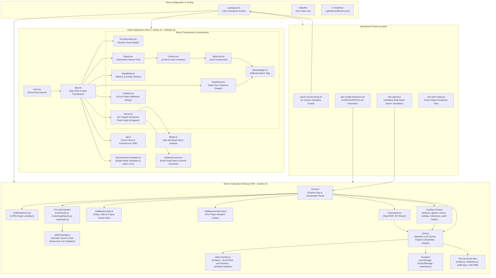
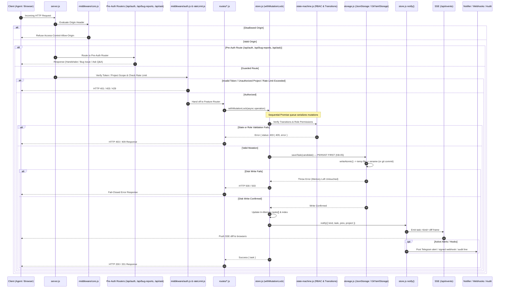
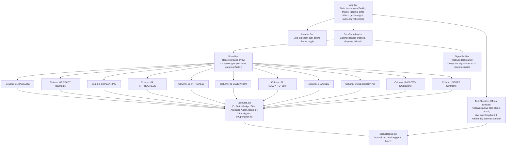

# Agent Kanban Board — File-by-File Technical Reference

This document provides a comprehensive, exhaustive walkthrough of every source, configuration, script, and documentation file across the entire `agent-kanban-board` repository.

---

## 1. Codebase Dependency & Architecture Topology

---

## 2. Server Request Pipeline & Execution Flow

---

## 3. Client Component Hierarchy & Data Flow

---

## 4. Detailed File-by-File Technical Directory

### 4.1 Root Manifests & Orchestration

#### `package.json`
- **Path:** [`package.json`](../package.json)
- **Type:** Root npm configuration (`"type": "module"`).
- **Scripts:**
  - `npm test`: Runs server tests, client status tests, client unit tests, and compiles the client bundle.
  - `npm start`: Runs the backend API on port 4000. Since v3.5.1 this execs `node server/server.js` directly instead of spawning a nested `npm --prefix server start`, so `SIGTERM` reaches the server rather than an npm wrapper that would then exit non-zero and be read as a crash by the host.
  - `npm run build`: Produces production client bundle in `client/dist`.

#### `Makefile`
- **Path:** [`Makefile`](../Makefile)
- **Targets:**
  - `all`: Runs `test` and `build`.
  - `test`: Invokes `npm test`.
  - `build`: Invokes `npm run build`.
  - `start`: Launches backend server via `npm start`.
  - `sec`: Security audit target:
    1. Verifies that no personal absolute user home paths are leaked into tracked repository files.
    2. Enforces that `dangerouslySetInnerHTML` is never used inside `client/src/`.

#### `README.md`
- **Path:** [`README.md`](../README.md)
- **Content:** System description, quickstart guide, state machine transitions, storage engine modes, security/auth model, design system, API table, and headless demo instructions. Links to `ONBOARDING.md`.

#### `ONBOARDING.md`
- **Path:** [`ONBOARDING.md`](../ONBOARDING.md)
- **Content:** "Connect a new project" guide: the project-implicit model (no registration endpoint), the four token mechanisms, project-tagging channels, and a curl walkthrough.

#### `skills/kanban/SKILL.md`
- **Path:** [`skills/kanban/SKILL.md`](../skills/kanban/SKILL.md)
- **Type:** Bundled opencode skill (Markdown with `name`/`description`/`version` frontmatter).
- **Content:** The strict Kanban orchestrator protocol — local deployment and config resolution, mandatory `?project=` scoping on every task path, the claim-first Build → Review → Test lifecycle with builder/reviewer/tester dispatch, safety rules (`expected_version` optimistic locking, heartbeat leases, lease-loss recovery, the 3-cycle limit), optional Telegram reclaim alerts (off unless `KANBAN_TELEGRAM_BOT_TOKEN` + `KANBAN_TELEGRAM_CHAT_ID` are set), and branch-normalization data-integrity notes.
- **Install:** Copy the directory to a project-local `.opencode/skills/kanban/` (gitignored here) or a global `~/.config/opencode/skills/kanban/`.

#### `render.yaml`
- **Path:** [`render.yaml`](../render.yaml)
- **Content:** Render.com blueprint — a single Node web service that builds the client and serves both API + SPA, with a persistent disk mounted at `/data` and auto-generated auth tokens.

#### `railway.json`
- **Path:** [`railway.json`](../railway.json)
- **Content:** Railway config-as-code — Railpack builder, `npm --prefix server start`, and `/api/health` healthcheck.

#### `LICENSE`
- **Path:** [`LICENSE`](../LICENSE)
- **License:** MIT License.

#### `.gitignore`
- **Path:** [`.gitignore`](../.gitignore)
- **Entries:** Ignores `node_modules`, `dist`, build artifacts, and local environments.

---

### 4.2 Backend Server (`server/`)

#### `server/package.json`
- **Path:** [`server/package.json`](../server/package.json)
- **Dependencies:** `express` (^4.19.2), `cors` (^2.8.5), `yaml` (^2.9.0), with `qs` (^6.16.0) security override.
- **Scripts:** `"start": "node server.js"`, `"test": "node --test"`.

#### `server/server.js`
- **Path:** [`server/server.js`](../server/server.js)
- **Functions:**
  - `createApp()`: Instantiates Express, mounts CORS, the `/api/auth` handshake router (before auth), the auth middleware and the rate-limit middleware, mounts `/api/tasks`, `/api/projects`, `/api/metrics` and `/api/health`, handles the `/api/events` Server-Sent Events stream (diff events by default; `?mode=snapshot` for whole-board snapshots, `?prime=1` to send an initial `event: tasks` snapshot; `event: settings` rides the same connection in both modes), serves the built client (`client/dist`) with an SPA fallback, and configures the global 500 error handler.
  - `startServer(port, host)`: Asynchronously loads tasks from storage into memory, logs the startup configuration (auth posture, CORS, rate limit), and binds the HTTP server. Host defaults to `0.0.0.0` whenever `PORT` is set (hosted) and `127.0.0.1` otherwise (local dev).
  - `registerShutdownHandlers(server, opts)`: Attaches the `SIGTERM`/`SIGINT` handlers a rolling deploy depends on. Order is load-bearing — **drain, then close, then drop idle sockets** — and is documented with a sequence diagram in `SYSTEM_DESIGN_AND_ARCHITECTURE.md` §9. `exit`, `log`, `timeoutMs` and `drain` are injectable so the unit tests can observe the ordering without a real socket. Returns a cleanup callback that removes the listeners.
  - `drainSseStreams()`: Ends every open `/api/events` response and returns how many were ended. Called **before** `server.close()`, which waits for every open connection and would otherwise block forever on streams that are held open by design (#108, v3.5.1). It calls `res.end()` rather than destroying the socket, so the browser's `EventSource` sees a normal stream end and reconnects onto the replacement container by itself.
  - `openSseStreams` (module-private `Set`) / `liveSseStreamCount()` / `resetSseStreams()`: The set holds the live response objects so they can be ended on shutdown; the count behind `liveSseStreamCount()` backs the `KANBAN_MAX_SSE_STREAMS` cap (SEC-05). A counter alone cannot satisfy the first job — **any future endpoint that holds a connection open must register in this set too**, or it will reintroduce the hang.
  - CLI Auto-runner: Detects direct execution, starts the server and installs the shutdown handlers.

#### `server/store.js`

v2.5.0 additions: the per-project settings store (`projectSettings` map,
`COLUMN_COLOR_KEYS`/`COLUMN_COLOR_TOKENS`/`STOCK_COLUMN_COLORS`, `getSettings`
resolution, `updateSettings` under the mutation lock, `onSettings` listeners,
`loadSettings`/`saveSettings` on both storage classes) and the comments field
(defaulted in `backfillLeaseFields`, seeded in `createTask`, round-tripped in
`serializeCard`, written only through `addComment` — deliberately outside
`patchTask`'s allowlist).
v2.10.0: `store.js` is now a thin stateful core that re-exports four extracted modules (`state-machine.js`, `task-identity.js`, `task-fields.js`, `storage.js`); every existing importer is unchanged and `store.X === module.X` identity is asserted by `kanban.modulesplit.test.js`.
v2.8.0 additions: an **optional append-only journal** for `JsonStorage` (`KANBAN_STORAGE_JOURNAL=1` appends one `{op,id,task}` line per mutation to `<partition>.journal.jsonl`, `_replayJournal` replays it on load and `_writeCanonical` compacts past `KANBAN_JOURNAL_COMPACT_BYTES`; off by default so the on-disk layout is unchanged) and **bounded inline logs/comments** (`getInlineLogCap`/`getInlineCommentCap`, `spillOverflow`/`appendSpill`/`readSpill`, which keep the newest `KANBAN_INLINE_LOG_CAP`/`KANBAN_INLINE_COMMENT_CAP` entries inline and spill older ones to `spill/<project>/<taskId>.jsonl`, read back via `getTaskLogs`).
- **Path:** [`server/store.js`](../server/store.js) (the pure state machine lives in [`server/state-machine.js`](../server/state-machine.js) and is re-exported here)
- **Core Domain State & Engine:**
  - `STATUSES`: Dictionary of the v3 loop statuses (`BACKLOG`, `READY`, `PLANNING`, `IN_PROGRESS`, `IN_REVIEW`, `VALIDATION`, `READY_TO_SHIP`, `DONE`, `BLOCKED`; ADR-004).
  - `normalizeStatus(status)`: Normalizes casing and legacy aliases (`TODO` $\to$ `BACKLOG`, `BUILDING` $\to$ `IN_PROGRESS`, `IN_TEST` $\to$ `VALIDATION`).
  - `canTransition(fromStatus, toStatus)`: Verifies if the proposed state jump exists in `VALID_TRANSITIONS`.
  - `canRoleTransition(role, fromStatus, toStatus)`: Enforces role permissions.
  - `writeAtomic(filePath, content)`: Creates unique temp file (`.tmp_<timestamp>_<random>`), writes content, and executes `rename` for atomic POSIX replacement.
  - `withMutationLock(operation)`: Queues mutations on a sequential Promise chain to serialize asynchronous operations.
  - `JsonStorage`: Standalone single-file JSON persistence engine.
  - `GitYamlStorage`: Git-backed YAML storage engine with path traversal protection and automated `git commit`.
  - CRUD Methods: `createTask()`, `patchTask()`, `claimTask()`, `appendLog()`, `addIssue()`.
  - Input hardening (v2.5.8): `createTask(data, project, { caller })` validates shapes and bounds on create — `depends_on` must be an array of non-empty task ids (`validateDependsOn`), `metadata` a plain object of at most 8000 bytes (`validateMetadata`), `title`/`description` capped at 200 / 20000 characters. Creating a task directly in a **work state** (`PLANNING`/`IN_PROGRESS`/`IN_REVIEW`/`VALIDATION`/`READY_TO_SHIP`/`DONE`, see `IMPORT_GATED_STATUSES`) requires a privileged credential (`403` otherwise); `BACKLOG` and `BLOCKED` stay open. A body-supplied `assigned_agent` is ignored (ownership is written only by a claim), and `stage_owners`/`agent_logs`/`comments` always start empty so audit provenance cannot be forged at create. The same shape rules apply inside `patchTask`'s allow-list loop.
  - Lease & reaper: `getClaimTtlMs()` (`KANBAN_CLAIM_TTL_MS`, default 600000), `getReapIntervalMs()`, `getOrphanGraceMs()` (`KANBAN_ORPHAN_GRACE_MS`, decoupled from the TTL, default 300000), `applyClaim()`, `renewLease()`, `reapExpiredClaims()`, `reclaimTaskInner()`. An owned task with an expired lease is reaped immediately; an *ownerless active* task must be untouched for the grace window first, anchored on `updated`. Any committed write by the lease holder — `appendLog()`, `renewLease()` and now `patchTask()` — extends `claim_expires_at` to the full TTL (headless workers log and PATCH instead of heartbeating); a non-holder write never extends or steals.
  - Branch normalisation: `toBranch()` normalises the branch value on every write path (non-empty string kept verbatim, anything else `null`), and `backfillLeaseFields()` applies the same normaliser on every READ path — so a legacy dirty `branch` (empty, whitespace-only or non-string) is nulled on load and never re-emerges in API responses or on git-backend cards.

#### `server/routes/tasks.js`
- **Path:** [`server/routes/tasks.js`](../server/routes/tasks.js)
- **Endpoints:**
  - `GET /`: Returns all tasks.
  - `POST /`: Creates a new task card (Status: 201).
  - `GET /archive`: Lists archived tasks (`?project=` scopes).
  - `POST /archive/sweep`: Runs the archive sweep now.
  - `POST /purge`: Bulk-deletes selected or filtered tasks; declared before `/:id`. v2.5.2: the purge scope is clamped to the caller's authorized project (unscoped purges only reach the default project; a disagreeing `filter.project` gets 403) and the delete/purge privilege is derived from the credential (`caller.privileged`), not the asserted `X-Agent-Role`.
  - `POST /next-claim`: Claims the next available task (role from header, `?project=` scopes).
  - `GET /:id`: Retrieves single task or returns 404.
  - `DELETE /:id`: Deletes one task; privileged-role gated via `isPrivilegedRole`.
  - `PATCH /:id`: Updates status or task attributes. A transition into an active stage is now dependency-gated like a claim (409 `dependency_unsatisfied` + `unresolved_dependencies`); DONE/BLOCKED/BACKLOG transitions stay ungated.
  - `POST /:id/claim`: Claims task for an agent ID.
  - `POST /:id/heartbeat`: Renews a task lease.
  - `POST /:id/logs`: Appends structured operational log.
  - `GET /:id/logs`: Pages a task's logs (`?offset=`/`?limit=`/`?include_spilled=1`), returning `{inline, spilled_count, entries}`.
  - `GET /:id/issues`: Lists issue IDs associated with the task.
  - `POST /:id/issues`: Appends an issue ID to the task.

#### `server/routes/projects.js`
- **Path:** [`server/routes/projects.js`](../server/routes/projects.js)
- **Endpoint:** `GET /` — per-project summary (task/live/done/archived counts + `updated`).

#### `server/routes/metrics.js`
- **Path:** [`server/routes/metrics.js`](../server/routes/metrics.js)
- **Endpoint:** `GET /` — cross-project metrics (`?project=` scopes; cycle time, `by_status` histogram, claim contention, active agents).

#### `server/routes/health.js`
- **Path:** [`server/routes/health.js`](../server/routes/health.js)
- **Endpoint:** `GET /` (and `/healthz` alias) — read-only liveness/readiness probe: store state, task counts, listener counts, reaper status, version.

#### `server/routes/auth.js`
- **Path:** [`server/routes/auth.js`](../server/routes/auth.js)
- **Endpoints:** `POST /session` (HMAC session-token handshake, gated by `KANBAN_AUTH_SECRET`) and `POST /stream-ticket` (v2.5.7 — exchanges a bearer credential for a 60 s single-use ticket used by `EventSource` via `?ticket=`).

#### `server/streamTicket.js`
- **Path:** [`server/streamTicket.js`](../server/streamTicket.js)
- **Functions:** `createStreamTicket()`, `verifyStreamTicket()`, `streamTicketTtlMs()`, `liveStreamTicketCount()`, `resetStreamTickets()`.
- **Purpose:** v2.5.7 (ENH-01) short-lived single-use tickets for the SSE endpoint (EventSource cannot set headers). Format `<payload-base64url>.<mac-hex>`; the `jti` is recorded at mint time and deleted on first successful verification, so a replay is inert. Signed with `KANBAN_AUTH_SECRET` when set, else the global `KANBAN_AUTH_TOKEN`.

#### `server/sessionAuth.js`
- **Path:** [`server/sessionAuth.js`](../server/sessionAuth.js)
- **Functions:** `authSecret()`, `createSessionToken()`, `verifySessionToken()`, `revokeSessionToken()`, `revokedSessionCount()` — stateless HMAC-SHA256 session tokens (24h expiry, role+project bound). v2.10.0: each token carries a random `jti`; `verifySessionToken` rejects a token whose `jti` is on the in-memory deny-list (legacy no-`jti` tokens verify but cannot be revoked), and `POST /api/auth/revoke` lets the holder revoke their own token immediately.

#### `server/routes/auth.js`
- **Path:** [`server/routes/auth.js`](../server/routes/auth.js)
- **Endpoints:** `POST /session` (HMAC session-token handshake; role+project-bound proof via `proofInput`), `POST /stream-ticket` (60 s single-use ticket for `EventSource`), and v2.10.0 `POST /revoke` (revoke the caller's own session token via the `jti` deny-list; 400 for a legacy no-`jti` token).

#### `server/routes/settings.js`
v2.5.0 per-project display settings. `GET /api/settings` returns the resolved
column colors (stock -> board default -> project override; public read with the
project-scope guard); `PUT /api/settings?project=X` persists a validated
`column_colors` override (any authenticated token, per-project token isolation
inherited from `referencedProjects`).

#### `server/notifier.js`
- **Path:** [`server/notifier.js`](../server/notifier.js)
- **Purpose:** §2.11 outbound Telegram alerts when the lease reaper returns a task to `READY`.
- **Functions:** `notifierConfig()`, `shouldNotify()`, `formatReclaimMessage()`, `startNotifier()`, `stopNotifier()`, `isNotifierRunning()`.
- **Design:** a pure subscriber on `store.onDiff` (no mutation-path surface). It filters `kind === 'reclaimed'` events by `reason` (`lease_expired` / `orphan_normalized`) and by project, renders a full-detail HTML message (project, task, title, work context, branch, dependencies, issues, truncated description, reason, previous owner, lease expiry, last activity, reclaim count, stage owners, last log, deep link), and POSTs it to the Bot API with the global `fetch` — **no new dependency**. Sends are serialized with a minimum interval and honour `429 retry_after`. Delivery is fail-silent: an outage is logged and never affects the reclaim. Off unless both `KANBAN_TELEGRAM_BOT_TOKEN` and `KANBAN_TELEGRAM_CHAT_ID` are set; the token is redacted from logs.

#### `server/middleware/auth.js`
- **Path:** [`server/middleware/auth.js`](../server/middleware/auth.js)
- **Enforcement:**
  - Permits open read-only access for `GET` requests.
  - Fails closed with 503 if no auth mechanism (`KANBAN_AUTH_TOKEN`, `KANBAN_PROJECT_TOKENS`, or `KANBAN_AUTH_SECRET`) is configured.
  - Tries HMAC session tokens first, then falls back to static tokens: per-project (`KANBAN_PROJECT_TOKENS`), admin (`KANBAN_ADMIN_TOKEN`, audited as `admin_write`), or global (`KANBAN_AUTH_TOKEN`). Returns 401 on mismatch.
  - Validates caller role against `VALID_ROLES`. Missing/unauthorized role returns 403.
  - v2.5.2: derives `req.caller.privileged` from the **credential** for destructive operations — the `KANBAN_ADMIN_TOKEN` bearer or a privileged session role confer it; per-project tokens do not (they are worker credentials); legacy single-token mode leaves the flag unset so the store falls back to the role check.
  - v2.5.7 (ENH-01): `KANBAN_READ_AUTH=token` also gates reads — a GET/SSE must present the bearer token or a single-use stream ticket (`?ticket=`). `/api/health` + `/healthz` stay open. Unset/`off` keeps reads public.
  - Optional redacted auth-failure logging via `KANBAN_AUTH_LOG`.

#### `server/middleware/projectScope.js`
- **Path:** [`server/middleware/projectScope.js`](../server/middleware/projectScope.js)
- **Enforcement:** Extracts every project a request references (body, query, header, composite path) and guards invalid `?project=` as 400 — never a silent widening to the whole portfolio.

#### `server/middleware/rateLimit.js`
- **Path:** [`server/middleware/rateLimit.js`](../server/middleware/rateLimit.js)
- **Enforcement:** Per-project fixed-window rate limiting on mutations, off unless `KANBAN_RATE_LIMIT_PER_MIN` is set.

#### `server/middleware/cors.js`
- **Path:** [`server/middleware/cors.js`](../server/middleware/cors.js)
- **Enforcement:** Enforces an explicit allow-list of origins (`KANBAN_ALLOWED_ORIGIN`, comma-separated, defaults to `http://localhost:5173`). Forbids wildcard `*` and empty entries.

#### `server/utils/sanitize.js`
- **Path:** [`server/utils/sanitize.js`](../server/utils/sanitize.js)
- **Function:** `escapeHtml(str)` escapes HTML characters (`&`, `<`, `>`, `"`, `'`) to prevent Stored XSS.

#### `server/auditLog.js`
- **Path:** [`server/auditLog.js`](../server/auditLog.js)
- **Function:** Persisted audit stream (ENH-04, v2.9.0). When `KANBAN_AUDIT_LOG` is truthy, `appendAudit(entry)` writes one compact JSON line (`ts`, `kind`, `project`, `task_id`, `actor`, `reason` — never the whole task payload) to `<data-dir>/audit.jsonl`; `readAudit({limit, since, project, kind})` reads it back newest-first; `resetAuditLog()` is the test helper. Wired to `store.onAudit` in `startServer` and read by `GET /api/audit`. Best-effort: a disk failure is logged and swallowed so an audit write can never break a mutation.

#### `server/state-machine.js`
- **Path:** [`server/state-machine.js`](../server/state-machine.js)
- **Function:** ENH-11 (v2.10.0) pure lifecycle module extracted from `store.js` (zero imports). Exports `STATUSES`, `VALID_STATUS_LIST`, `normalizeStatus`, `isValidStatus`, `VALID_TRANSITIONS`, `canTransition`, `canRoleTransition`. `store.js` re-exports every symbol (`store.normalizeStatus === stateMachine.normalizeStatus`).

#### `server/task-identity.js`
- **Path:** [`server/task-identity.js`](../server/task-identity.js)
- **Function:** ENH-11 (v2.10.0) identity/path helpers extracted from `store.js`: `writeAtomic` (temp file + `rename`), the project/task id validators and regexes, `toBranch`, `defaultProjectName`, `normalizeProject`, `resolveProjectScope`, `gitRoot`/`jsonDataDir` (in-repo `server/data` default) and `backfillLeaseFields`.

#### `server/task-fields.js`
- **Path:** [`server/task-fields.js`](../server/task-fields.js)
- **Function:** ENH-11 (v2.10.0) pure field validation extracted from `store.js`: `PRIVILEGED_ROLE_SET`, `isPrivilegedRole`, `validatePriority`, the `MAX_TITLE_LEN`/`MAX_DESCRIPTION_LEN`/`MAX_METADATA_BYTES` caps, `validateDependsOn`, `validateMetadata`, `priorityRank`.

#### `server/storage.js`
- **Path:** [`server/storage.js`](../server/storage.js)
- **Function:** ENH-11 (v2.10.0) the persistence backends extracted from `store.js`: `JsonStorage` (atomic single-file, optional `KANBAN_STORAGE_JOURNAL` append-only journal) and `GitYamlStorage` (per-card YAML with `git commit` audit trail). `store.js` imports and re-exports both classes.

#### `server/routes/milestones.js`
- **Path:** [`server/routes/milestones.js`](../server/routes/milestones.js)
- **Function:** v2.11.0 (opt-milestones). `GET /api/milestones` returns per-goal rollups `{milestone, project, total, done, by_status, progress}` for one project (`?project=`) or all projects, behind the project-scope guard.

#### `server/routes/agents.js`
- **Path:** [`server/routes/agents.js`](../server/routes/agents.js)
- **Function:** v2.12.0 (RC-2 fix). `POST /api/agents/:agent_id/heartbeat` renews EVERY active lease the given agent holds in one call, so an orchestrator holding N cards no longer needs N heartbeat calls. A non-privileged caller may only heartbeat its own agent id (else `403`); a privileged role may renew on another agent's behalf; an optional `?project=` narrows the sweep. Lapsed leases are deliberately not revived. Behind the project-scope guard; wraps `store.renewAllLeases`.

#### `server/webhooks.js`
- **Path:** [`server/webhooks.js`](../server/webhooks.js)
- **Function:** v2.11.0 (opt-integration-hooks). Generic outbound JSON webhooks: a pure `store.onDiff` subscriber that POSTs a flat event envelope (`{event, kind, project, task_id, status, priority, milestone, actor, reason, timestamp}`) to every URL in `KANBAN_WEBHOOK_URLS`. Optional HMAC-SHA256 body signing (`KANBAN_WEBHOOK_SECRET`, headers `x-kanban-signature`/`x-kanban-event`/`x-kanban-timestamp`) and event filtering (`KANBAN_WEBHOOK_EVENTS`). Exports `webhookConfig`, `shouldDeliver`, `buildPayload`, `signBody`, `startWebhooks`, `stopWebhooks`, `isWebhooksRunning`. Fail-silent fire-and-forget over global `fetch` (no new dependency).

#### `server/utils/constantTime.js`
- **Path:** [`server/utils/constantTime.js`](../server/utils/constantTime.js)
- **Function:** `tokensMatch(a, b)` — SEC-07 (v2.6.0) shared constant-time-ish comparison used by the auth middleware, session tokens, stream tickets and the session handshake. Unlike the four per-module copies it replaced, it does not early-return on a length mismatch: the length difference is folded into the accumulator and the loop always runs over the longer input, so the comparison time does not leak the secret's length.

#### `server/utils/credentialMap.js`
- **Path:** [`server/utils/credentialMap.js`](../server/utils/credentialMap.js)
- **Function:** §2.10 (v3.1.0) boot-time credential-map coverage check: `checkCredentialCoverage` compares configured projects in `KANBAN_PROJECT_TOKENS` against projects discovered in the local store directory, classifying coverage as `ok`, `undercovered`, `overcovered`, `unset`, or `malformed`. `reportCredentialCoverage` logs results non-fatally at boot with recovery guidance for platforms like Railway. Exposes status to `GET /api/health`.

#### `server/test/` (Node.js built-in test runner)
- **Paths:** `server/test/kanban.*.test.js`
- **Coverage:** The server suite (534 tests across 48 files) covers duplicate prevention and CRUD (`kanban.test.js`), state transitions + role gating, claim leases and the reaper (`kanban.lease.test.js`), dependency-gated unblocking (`kanban.deps.test.js`), metrics aggregation (`kanban.metrics.test.js`), projects/portfolio summaries (`kanban.projects.test.js`), archive sweep (`kanban.archive.test.js`), SSE diff events (`kanban.events.test.js`), concurrency/mutation-lock behavior (`kanban.concurrency.test.js`), per-project token isolation (`kanban.projectauth.test.js`), cross-project scoping (`kanban.scoping.test.js`), next-claim role binding (`kanban.nextclaim.test.js`), fail-closed auth, HMAC session tokens (`kanban.sessionauth.test.js`), redacted auth logging (`kanban.authlog.test.js`), CORS allow-list (`kanban.cors.test.js`), the health endpoint (`kanban.health.test.js`), periodic backups (`kanban.backup.test.js`), the IPv6/HOST resolution fix (`kanban.host.test.js`), ownerless-active task normalization (`kanban.orphan.test.js`), admin delete + bulk purge incl. the v2.5.2 scope/privilege hardening (`kanban.purge.test.js`), per-stage ownership (`kanban.stageowners.test.js`), the release-version guard (`kanban.version.test.js`), branch-field integrity (`kanban.branch.test.js`), Telegram reclaim notifications (`kanban.notify.test.js`), task comments + column-color settings (`kanban.comments.test.js`, `kanban.settings.test.js`), and corrupt-file fail-closed loading (`kanban.corruptfile.test.js`), the v2.5.5 backup-status block (`kanban.backup.test.js`), the soft-delete trash sink + restore (`kanban.trash.test.js`), read-auth + stream tickets (`kanban.readauth.test.js`), the v2.5.8 createTask input hardening (`kanban.createinput.test.js`), the v2.6.0 security-hardening batch — constant-time token compare, HMAC proof binding, purge-filter guard, SSE stream cap, auth-failure rate limiting, log/comment validation (`kanban.security260.test.js`), the v2.7.0 server-robustness batch — archive-name collision, dependency-cycle validation, listen-error handling, in-repo storage default, readiness endpoint, Telegram truncation, CORS scheme (`kanban.robustness270.test.js`), the v2.8.0 performance batch — SSE diff-default + single combined stream, optional JSON append-only journal, bounded inline logs/comments with sidecar spill and paging (`kanban.performance280.test.js`), the v2.9.0 ops batch — persisted audit stream + config-reference drift guard (`kanban.audit.test.js`, `kanban.config.test.js`), and the v2.9.1 mobile-rendering fix set (phone-only header/filter disclosures, paging arrows off below `md`, full-width card badge group) guarded by the client `mobileToolbar` / `responsive` suites, plus the v2.10.0 session-revocation suite (`kanban.revocation.test.js`) the store-split re-export guard (`kanban.modulesplit.test.js`), the v2.11.0 opt-features batch — milestones, operator assignment, outbound webhooks (`kanban.optfeatures211.test.js`), and the v2.12.0 lease-window batch — per-task `lease_ms` windows, bulk agent heartbeat, holder-write renewal (`kanban.leasewindow.test.js`), and the v2.13.0 lease-window review fixups — sibling-renewal version churn, cross-project reach, broadcast timing, semantic event tagging, stricter lease_ms validation, the per-agent claim cap, and last_progress_at (`kanban.leasewindow2.test.js`), the v2.16.0 Report-a-bug batch — feature gate, honeypot, validation, Turnstile outcomes, rate limits, GitHub retry/label fallback, issue-body sanitisation (`kanban.bugreports.test.js`), plus its global body-parser error-translation guard (`kanban.bodyparser.test.js`), the v3.0.0 AgentOS 8-state workflow test suite (`kanban.statemachine.test.js`, `kanban.migration.test.js`), and the v3.1.0 credential-map coverage check suite (`kanban.credentialmap.test.js`).

#### `server/tasks.json`
- **Path:** [`server/tasks.json`](../server/tasks.json)
- **Role:** Default-project JSON store (created/updated at runtime); the file also ships sample/seeded tasks.

---

### 4.3 Frontend Client (`client/`)

#### `client/package.json`
- **Path:** [`client/package.json`](../client/package.json)
- **Dependencies:** `react` (^18.3.1), `react-dom` (^18.3.1).
- **DevDependencies:** `vite`, `@vitejs/plugin-react`, `typescript`, `tailwindcss`, `postcss`, `autoprefixer`, `esbuild`.
- **Scripts:** `dev`, `build` (`tsc -b && vite build`), `preview`, `test`.

#### `client/vite.config.ts`
- **Path:** [`client/vite.config.ts`](../client/vite.config.ts)
- **Settings:** Configures the Vite dev server port (`VITE_PORT`, default 5173), `@tailwindcss/vite` plugin, the React plugin, and a dev proxy forwarding `/api` to `http://localhost:4000` (changeOrigin) so same-origin `/api` calls reach the backend during local development.

#### `client/src/index.css`
- **Path:** [`client/src/index.css`](../client/src/index.css)
- **Styling & Theme:** Tailwind CSS v4 entry point (`@import "tailwindcss";`), custom class-based dark variant (`@custom-variant dark`), and `@theme` token definitions (`bg`, `surface`, `line`, `ink`, `muted`, `pass`, `fail`, `warn`, `block`, `live`, and font stacks).

#### `client/tsconfig.json`, `tsconfig.app.json`, `tsconfig.node.json`
- **Paths:** [`client/tsconfig.json`](../client/tsconfig.json), [`client/tsconfig.app.json`](../client/tsconfig.app.json), [`client/tsconfig.node.json`](../client/tsconfig.node.json)
- **Settings:** Strict TypeScript type checking rules for browser and build environments.

#### `client/index.html`
- **Path:** [`client/index.html`](../client/index.html)
- **Content:** Single-page entry HTML, Google font preloading, responsive `<meta name="viewport">`, and an inline pre-paint theme script that applies the stored/OS theme before React mounts (avoids a flash of the wrong theme).

#### `client/src/index.css`
- **Path:** [`client/src/index.css`](../client/src/index.css)
- **Styles:** Light (warm cream) and dark theme CSS variable definitions meeting WCAG AA contrast standards, explicit `color-scheme` per theme (so native form controls match), `@supports (height:100dvh)` shell-height override, `.board-scroll` visible-scrollbar rules, tabular numeric font setup, and minimal global scrollbars.

#### `client/src/main.tsx`
- **Path:** [`client/src/main.tsx`](../client/src/main.tsx)
- **Execution:** Mounts `<App />` into the DOM root under `<React.StrictMode>`.

#### `client/src/App.tsx`
- **Path:** [`client/src/App.tsx`](../client/src/App.tsx)
- **Components & Hooks:** App shell and state coordinator. Manages `tasks`, `openTaskId`, `project` filter, `view` (Board/Portfolio/About), `theme`, `railOpen`, the agent-id/api-token identity, and the board filter/sort state (search, priority, assignee, plus the persisted column sort from `lib/boardSort.ts`). Fetches `getTasks` then applies SSE **diff events** to the local array (upsert by `(project, id)`; drop on `removed`/`archived`) via a single `subscribeToBoard` stream scoped by project, fetches `/api/health` for the header version chip, and exports the visible tasks to JSON. Renders a wrapping responsive header (with the three-way Board/Portfolio/About segmented switcher), `<Board />`, `<About />`, `<SignalRail />` (docked at `md`+, slide-over drawer below), `<TaskSheet />`, and `<ErrorBoundary />`. The metrics dashboard is fed the unfiltered task list on purpose so its totals stay stable while filters narrow the board.

#### `client/src/types.ts`
- **Path:** [`client/src/types.ts`](../client/src/types.ts)
- **Definitions:** Core data types (`TaskStatus`, `TaskPriority`, `AgentLog`, `Task`).

#### `client/src/api.ts`
- **Path:** [`client/src/api.ts`](../client/src/api.ts)
- **Functions:** HTTP client for REST operations (`getTasks`, `getTask`, `patchTask`, `claimTask`, `appendLog`, `addComment`, `getTaskLogs`, `getSettings`, `saveSettings`) and `subscribeToBoard(onDiffEvent, onSettings, { project })` for native `EventSource` SSE integration — one diff-mode stream that carries both `task.<kind>` events and `event: settings` (minting a single-use stream ticket first when read-auth is on).

#### `client/src/status.js` & `status.d.ts`
- **Paths:** [`client/src/status.js`](../client/src/status.js), [`client/src/status.d.ts`](../client/src/status.d.ts)
- **Functions:** `normalizeStatus()` and `statusStyle()` resolving status strings to border stripes and badge color combinations.

#### `client/src/board-model.js` & `board-model.d.ts`
- **Paths:** [`client/src/board-model.js`](../client/src/board-model.js), [`client/src/board-model.d.ts`](../client/src/board-model.d.ts)
- **Function:** `groupTasks(tasks)` categorizing tasks into column arrays by status (`BACKLOG`, `READY`, `PLANNING`, `IN_PROGRESS`, `IN_REVIEW`, `VALIDATION`, `READY_TO_SHIP`, `DONE`, `BLOCKED`, `UNKNOWN`) and aggregating issues into a dedicated `ISSUES` array.

#### `client/src/priority.ts`
- **Path:** [`client/src/priority.ts`](../client/src/priority.ts)
- **Function:** `normalizePriority()` safely mapping triage ratings (`P0-critical`, etc.) to `'high' | 'medium' | 'low'`; `priorityBadgeClass()` and `PRIORITY_WEIGHT` drive the priority badge chips and the default sort order.

#### `client/src/sanitize.ts`
- **Path:** [`client/src/sanitize.ts`](../client/src/sanitize.ts)
- **Function:** Client-side HTML entity handling. `escapeHtml` mirrors the server's escaping (the definition of the entity set); `decodeStored` inverts it for display — the server escapes untrusted text on write, so the client decodes the known entity set at render time (`TaskSheet` title/description/log message, `TaskCard` title, `SignalRail` message). Decode order matters: specific entities first, `&amp;` last, so a stored `&amp;lt;` never becomes a real tag. Decoded values are still rendered as JSX text nodes — never HTML. Guarded by `client/src/lib/sanitize.test.mjs`.

#### Components (`client/src/components/`)
- **`Board.tsx`:** Renders the horizontally snap-scrolling column container for all 8 columns including `UNKNOWN`, with edge-fade gradients and paging chevrons that appear when columns are off-screen. `COLUMNS` carries the workflow step numbers (`01`–`04`) down to each `Column` (the v2.4.0 advisory WIP limits were removed in v2.5.2). The paging chevrons are `hidden … md:flex` (v2.9.1) so they never overlay card content in a narrow `85vw` mobile column — touch devices use the native swipe + snap instead.
- **`BoardFilters.tsx`:** Filter/sort/export toolbar rendered above the board: live substring search, priority and assignee quick filters, the persisted column sort selector (`Priority | Recently Updated | Task ID`), a `Reset` action when any filter is active, one-click JSON export, and the metrics-dashboard toggle. Shows an `n of m tasks` counter. Below `sm` the secondary controls (selects, Reset, export, column colours, metrics) collapse behind a phone-only `Filters` disclosure (v2.9.1) so the toolbar is ~two rows instead of ~ten.
- **`ColumnColorsControl.tsx`:** v2.5.0 popover (mirrors HeaderHelp: outside-click + Escape) with one swatch row per swimlane and Reset-to-defaults; picks are saved optimistically via `PUT /api/settings` and applied live over SSE.
- **`MetricsDashboard.tsx`:** Toggleable summary banner with 7 tiles (Total, Backlog, In Flight, Blocked, Completed, Avg Cycle Time, Overdue/Stalled) computed from the unfiltered task list by `lib/dashboardMetrics.ts`.
- **`Column.tsx`:** Renders a column header with workflow step number, a plain task count badge (the advisory WIP badges/banner were removed in v2.5.2) and vertically scrolling card container. Each column carries a distinct top accent per stage (violet for In Test). Responsive: `85vw` with snap alignment below `md`, fixed `w-72` from `md` up. Memoized.
- **`TaskCard.tsx`:** Renders card ID, status stripe, priority badge, effort/estimate chip (`⚡` from task metadata), title (double-click to inline-edit with optimistic CAS), project chip (unscoped board only), agent assignment, and issues badge. High-priority cards get a red right accent. Memoized. The header row wraps on phones and the badge group goes full-width (`w-full … sm:w-auto`, v2.9.1) so the id keeps a readable width instead of collapsing to 1–2 characters.
- **`StatusBadge.tsx`:** Renders status glyphs (`▲`, `•`) and styling.
- **`TaskSheet.tsx`:** Slide-over modal displaying card details (including the project), metadata, logs timeline, and human log submission form.
- **`SignalRail.tsx`:** Right sidebar rendering Signal Overview metric tiles and recent activity feed. Docked at `md`+, rendered as a mobile slide-over drawer below `md`.
- **`Portfolio.tsx`:** Cross-project aggregate view with per-project summary rows.
- **`About.tsx`:** In-app product overview (third top-level view). Renders the elevator pitch, a headless-first curl snippet, a trust strip, the "why a normal board isn't enough" cards, the lifecycle walk, capabilities, an **Architecture & code flow** section (the stack table, the step-by-step next-claim code path, the three safety layers around every write, and a six-layer summary — all data-driven and mobile-first, with the stack table collapsing to labelled cards below `sm`), a curated tour of `/landing/*.png` screenshots, an FAQ, and the community CTA. Takes the live server `version` as a prop so the page can never show a stale version. The footer shows an **anonymous visit count** (v2.9.1, `useVisitCount`; hoisted to `App.tsx` in v2.14.2 so it counts every site load rather than only the About tab) with honest copy — no accounts, no tracking, one counter, no per-visitor data.
- **`HeaderHelp.tsx`:** Header `i` button opening a popover that explains the agent-id (auto-claim) and api-token header fields.
- **`ErrorBoundary.tsx`:** React Class Error Boundary containing card render errors.

#### Client Libraries (`client/src/lib/`)
- **`theme.ts`:** Pure tri-state theme resolution helpers (`parseStoredMode`, `resolveMode`, `nextMode`, `isDark`, `modeLabel`, `themeToggleTitle`, `THEME_STORAGE_KEY`) — Auto/Light/Dark, v2.17.0.
- **`status.ts`:** `CANONICAL_STATUSES` and `ACTIVE_STATUSES` matching backend definitions.
- **`filterTasks.ts`:** Pure filter predicate — live substring search (id/title/description/branch/assigned_agent), normalized-priority filter, and assignee filter including `unassigned`. Guarded by `filterTasks.test.mjs`.
- **`boardSort.ts`:** Column ordering for the board — `sortTasks(tasks, sort)` over `priority | updated | id` (stable, non-mutating; priority reuses `PRIORITY_WEIGHT`), plus `readStoredSort`/`writeStoredSort` persisting the choice under `localStorage kanban.sort` so column order survives SSE snapshots and reloads. Guarded by `boardSort.test.mjs`.
- **`columnColors.ts`:** v2.5.0 column-color palette module — token ids, literal `ACCENT_CLASS`/`SWATCH_CLASS` maps (Tailwind JIT requires literal class strings), `DEFAULT_COLUMN_COLORS` (mirrors the server stock palette), `resolveColumnAccent(status, colors)`, and `isStockPalette`. Guarded by `columnColors.test.mjs`.
- **`dashboardMetrics.ts`:** Pure computations behind the metrics dashboard (total/backlog/wip/blocked/done counts, average cycle time, overdue/stalled). Guarded by `dashboardMetrics.test.mjs`.
- **`signalStats.ts`:** `computeSignalStats(tasks)` calculating active/blocked/done counts.
- **`portfolioMetrics.ts`:** Cross-project rollup calculations for the Portfolio view.
- **`claimCoordinator.ts` / `useClaimCoordinator.ts`:** Client-side lease heartbeat + auto-claim coordination bound to the operator's agent identity.
- **`authToken.ts`:** Browser-local storage/wiring of the operator's API token.
- **`aboutContent.ts`:** Pure data for the About view — since v3.5.0 "Field Guide Nº 02": the twelve `CHAPTERS` (each with an ELI5 line, an under-the-hood paragraph, a labelled real snippet, a gotcha and the files it names), `FIELD_GUIDE` / `HERO` (the hero's italic accent words are pulled out so the component can set them in the display face without splitting the string), `ENV_VARS`, `TRUST_METRICS`, why-cards, lifecycle steps, capabilities, FAQ, curl snippet, `RECLAIM_INTRO` / `RECLAIM_FLOW` and the architecture data. No JSX, so it is unit-testable and keeps the copy out of the component.
- **`ask.ts`:** v3.5.0 client surface for Ask-the-Board. `getAskConfig()` decides whether the console renders at all; `askQuestion(q, password)` posts to `/api/ask` with the shared password in the `x-ask-pass` **header** (never a query string), and the password is remembered in `localStorage` under `kanban.askPass`. Failures throw a typed `AskError` carrying the HTTP `status` and the server's `error` code, which the console maps to specific messages (401 wrong password, 429 backoff, 502/503 unavailable) rather than one generic failure.
- **`useVisitCount.ts`:** v2.9.1 anonymous visit counter for the About footer. `useVisitCount()` counts the first page-view per browser session (`sessionStorage` flag `kanban-visit-counted`) against the public `abacus.jasoncameron.dev` counter under its own namespace `agent-kanban.riazrahaman.com`, returning `{count, counted}` (null when offline/blocked — the UI simply omits the line). As of v2.14.2 the hook is called from `App.tsx`, so it counts **every site load** (board-first visitors included) and the state is passed down to `About` as the `visit` prop — previously it lived inside `About` and so only counted About-tab opens. `formatVisitCount` renders `1 visit` / `1,234 visits`. Deliberately not per-visitor tracking. Guarded by `useVisitCount.test.mjs`.
- **Test files (`*.test.mjs`):** `signalStats`, `boardModel`, `memoComparator`, `portfolioMetrics`, `claimCoordinator`, `theme`, `authToken`, `stageOwners`, `filterTasks`, `dashboardMetrics`, `boardSort`, `sanitize`, `about`, `aboutFieldGuide`, `responsive`, `mobileToolbar`, and `useVisitCount` — run under `node:test` (TypeScript compiled on the fly via `esbuild`). The `memoComparator` and `reactStubForMemoTest` pair use a React stub to exercise the `React.memo` comparators directly; `responsive.test.mjs` is the mobile-layout regression guard (shell, columns, rail, viewport, card-header stacking), and `mobileToolbar.test.mjs` guards the board toolbar's shrink-and-wrap contract, the phone `⋯` / `Filters` disclosures and the mobile paging-arrow rule (v2.5.9/v2.9.1).

---

### 4.4 Scripts & CI Workflows

#### `scripts/test-agents.js`
- **Path:** [`scripts/test-agents.js`](../scripts/test-agents.js)
- **Role:** Headless multi-agent workflow demo script simulating Agent-Alpha and Agent-Beta claiming, transitioning, and logging against cards via REST calls.

#### `scripts/test-client-status.js`
- **Path:** [`scripts/test-client-status.js`](../scripts/test-client-status.js)
- **Role:** Test validating client status normalizer resilience against malformed inputs.

#### `scripts/gateway/ollama-tunnel-gateway.js`
- **Path:** [`scripts/gateway/ollama-tunnel-gateway.js`](../scripts/gateway/ollama-tunnel-gateway.js)
- **Role:** Lightweight local reverse proxy and firewall sitting between ingress tunnels (Tailscale Funnel or Cloudflare) and the local Ollama instance (`:11434`). Verifies the `Authorization: Bearer <TOKEN>` header before forwarding requests.

#### `scripts/setup-ollama-persistent-tunnel.sh`
- **Path:** [`scripts/setup-ollama-persistent-tunnel.sh`](../scripts/setup-ollama-persistent-tunnel.sh)
- **Role:** Automated setup script for persistent local Ollama connectivity. Configures the token gateway as a macOS background LaunchAgent service (`~/Library/LaunchAgents/com.riazrahaman.ollama-tunnel-gateway.plist`), enables Tailscale Funnel on port 11435, and updates Railway environment variables.

#### `scripts/start-ollama-tunnel.sh`
- **Path:** [`scripts/start-ollama-tunnel.sh`](../scripts/start-ollama-tunnel.sh)
- **Role:** Quick-start ephemeral tunnel launcher using Cloudflare Quick Tunnel (`trycloudflare.com`) for testing local Ollama against Railway without a persistent domain.

#### `.github/workflows/ci.yml`
- **Path:** [`.github/workflows/ci.yml`](../.github/workflows/ci.yml)
- **Pipeline:** Automated CI running discrete steps — security checks (`make sec`), server tests (`npm --prefix server test`), client status tests, client unit tests (`npm --prefix client test`), and the production build — across Node 20.x and 22.x, using `actions/checkout@v4` and `actions/setup-node@v4`.
