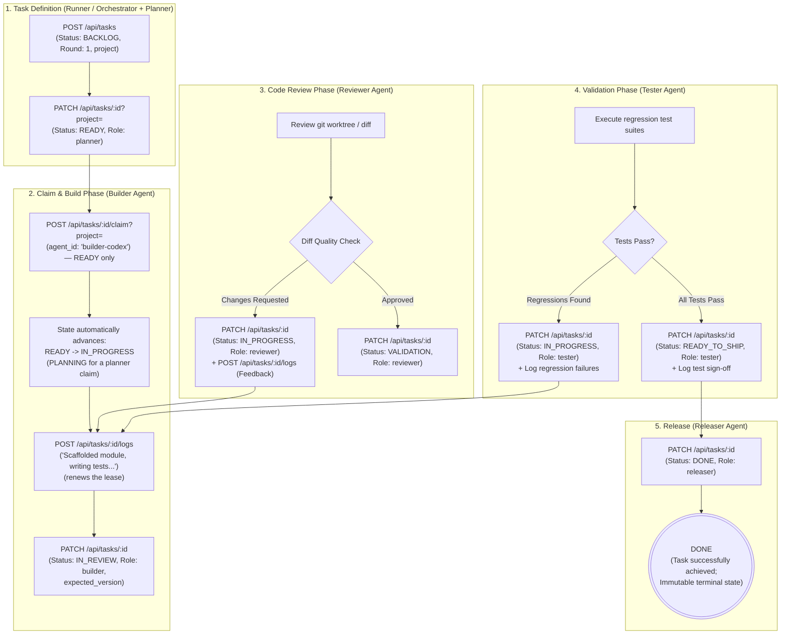
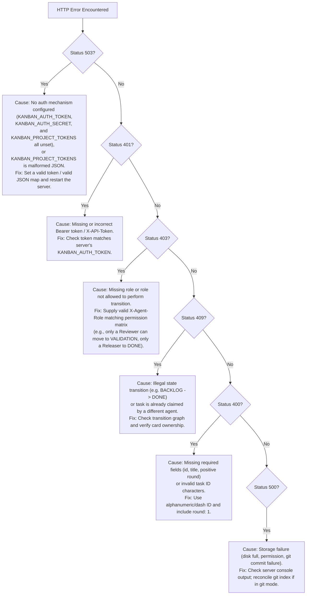

# Agent Kanban Board — User & Operator Manual

**Audience:** AI Swarm Architects, Autonomous Loop Runners, DevOps Engineers, and Human Operators  
**System:** Agent Kanban Board v3.6.2

---

## 1. System Overview & End-to-End Agent Lifecycle

The **Agent Kanban Board** provides an immutable, real-time state machine and monitoring dashboard for swarms of autonomous coding agents. Unlike human-facing project trackers, it enforces strict programmatic guardrails, claim contention locking, and role-based permissions to guarantee reliable automated execution without human interference.

### Autonomous Swarm Execution Flowchart



---

## 2. Quickstart & Installation

### 2.1 System Prerequisites
- **Node.js:** v20.x or v22.x LTS
- **npm:** v9.x or higher
- **Git:** v2.30+ (required if using Git-backed YAML storage)
- **Web Browser:** Modern evergreen browser with native ES Module and Server-Sent Events support (Chrome, Firefox, Safari, Edge).

### 2.2 Setup Commands

```bash
# Clone the repository
git clone <repo-url> agent-kanban-board
cd agent-kanban-board

# Install server and client dependencies
cd server && npm install && cd ..
cd client && npm install && cd ..
```

---

## 3. Configuration & Environment Variables

The server and client are configured via environment variables.

### 3.1 Server Environment Variables

| Variable | Default Value | Description |
|---|---|---|
| `PORT` | `4000` | HTTP port on which Express listens. |
| `HOST` | `127.0.0.1` (local) / `0.0.0.0` (when `PORT` injected) | Network interface to bind. |
| `KANBAN_AUTH_TOKEN` | *(None)* | **Mandatory for mutations** unless another mechanism is set. Shared secret for all `POST`, `PATCH`, `PUT`, `DELETE`. Unset → mutations return `503`. |
| `KANBAN_ADMIN_TOKEN` | *(None)* | Superuser token spanning every project. Audited as `admin_write`. |
| `KANBAN_PROJECT_TOKENS` | *(None)* | JSON map `{"project":"token"}` enabling per-project isolation. Boot check (§2.10) reports any store projects missing from this map. |
| `KANBAN_AUTH_SECRET` | *(None)* | Enables HMAC session tokens via `POST /api/auth/session` (stateless, 24h, revocable since v2.10.0 via `POST /api/auth/revoke`). |
| `KANBAN_AUTH_LOG` | `off` | Set truthy (not `0`/`false`) to emit redacted auth-failure logs. |
| `KANBAN_STORAGE_BACKEND` | `json` | Storage engine: `json` (file) or `git` (YAML card per task). |
| `KANBAN_DATA_FILE` | `server/tasks.json` | Default-project JSON file. |
| `KANBAN_DATA_DIR` | `server/data` | Root for named projects (`tasks/<project>.json`) + archives. Unset falls back to an in-repo `server/data` (one-time warning) — never a sibling checkout. |
| `KANBAN_DEFAULT_PROJECT` | `default` | Implicit single-project name. |
| `KANBAN_ARCHIVE_AFTER_DAYS` | `30` | Age after which `DONE` tasks archive (`0` disables). |
| `KANBAN_TRASH_DAYS` | `30` | Age after which soft-deleted tasks are permanently removed from the trash sink (`0` disables the sweep). |
| `KANBAN_GIT_DIR` | `server/data` | Directory containing `.yml` cards when using `git` backend. Same in-repo default as `KANBAN_DATA_DIR` (ADR-001). |
| `KANBAN_GIT_COMMIT` | `true` | Set `false` to disable auto-commits in git mode. |
| `KANBAN_STORAGE_JOURNAL` | *(off)* | Set `1` to append each JSON mutation to `<partition>.journal.jsonl` instead of rewriting the whole partition (replayed on load; compacted past `KANBAN_JOURNAL_COMPACT_BYTES`). Off → on-disk layout unchanged. |
| `KANBAN_JOURNAL_COMPACT_BYTES` | `1048576` | Journal size (bytes) that triggers a compaction into the canonical partition file. |
| `KANBAN_INLINE_LOG_CAP` | `50` | Newest `agent_logs` entries kept inline per task; older ones spill to a sidecar JSONL under `spill/<project>/`. `0` = unbounded. |
| `KANBAN_INLINE_COMMENT_CAP` | `50` | Newest `comments` kept inline per task; older ones spill to the sidecar. `0` = unbounded. |
| `KANBAN_ALLOWED_ORIGIN` | `http://localhost:5173` | Comma-separated CORS origins. Wildcard `*` is prohibited. |
| `KANBAN_CLAIM_TTL_MS` | `600000` | Default lease window (10 min) when a claim passes no `lease_ms`. Expired leases are auto-reclaimed. |
| `KANBAN_MIN_LEASE_MS` | `60000` | Lower bound a requested `lease_ms` is clamped to (1 min). |
| `KANBAN_MAX_LEASE_MS` | `7200000` | Upper bound a requested `lease_ms` is clamped to (2 h). |
| `KANBAN_HOLDER_WRITE_RENEWS_ALL` | `1` | When on, a holder's log/PATCH/claim also re-arms all its other held leases. |
| `KANBAN_ORPHAN_GRACE_MS` | `300000` | Grace before an ownerless ACTIVE task is normalized to READY. Decoupled from the claim TTL. Anchored on `updated`; any later write resets it. `0` reaps immediately. |
| `KANBAN_REAP_ENABLED` / `KANBAN_REAP_INTERVAL_MS` | `true` / *(default)* | Lease reaper switch and interval. |
| `KANBAN_BACKUP_ENABLED` / `KANBAN_BACKUP_INTERVAL_MS` / `KANBAN_BACKUP_KEEP` | `off` (enabled by default in `render.yaml` since v2.5.5) | Periodic snapshot of task data into `backups/`, rotated to a bounded count. Status is surfaced in the `backup` block of `GET /api/health`; restore with `scripts/restore-backup.mjs` per `docs/RESTORE.md`. |
| `KANBAN_RATE_LIMIT_PER_MIN` / `KANBAN_RATE_LIMIT_WINDOW_MS` | `off` / `60000` | Per-project fixed-window rate limit on mutations. |
| `KANBAN_READ_AUTH` | `off` | Set to `token` to require a credential on every read (GET + SSE). `EventSource` cannot set headers, so browsers mint a 60 s single-use ticket via `POST /api/auth/stream-ticket` and append `?ticket=`. Unset/`off`/`0` keeps reads open; `/api/health` and `/healthz` stay open for healthchecks. |
| `KANBAN_WEBHOOK_URLS` | *(unset)* | v2.11.0 — comma-separated URLs that receive signed outbound JSON webhooks on every task diff event. Off when unset. |
| `KANBAN_WEBHOOK_SECRET` | *(unset)* | v2.11.0 — optional HMAC-SHA256 key; when set each webhook carries `x-kanban-signature: sha256=<hex>` over `${timestamp}.${body}`. |
| `KANBAN_WEBHOOK_EVENTS` | *(all)* | v2.11.0 — optional comma-separated diff-kind allow-list (`created`, `updated`, `removed`, `claimed`, `renewed`, `unblocked`, `reclaimed`, `archived`). |

### 3.1.1 Telegram Reclaim Notifications

When the lease reaper returns a task to `READY` (an idle lease expired, a held task stopped making progress for `KANBAN_PROGRESS_STALL_MS`, or an ownerless active task was normalized), the server can post a full-detail alert to a Telegram group or chat. This is **off by default** and needs no extra dependency — the server calls the Telegram Bot API directly over HTTPS.

| Variable | Default | Description |
|---|---|---|
| `KANBAN_TELEGRAM_BOT_TOKEN` | *(unset)* | Bot token from **@BotFather**. Required to enable alerts. |
| `KANBAN_TELEGRAM_CHAT_ID` | *(unset)* | Target chat/group id. A group id is negative (e.g. `-5349084979`). |
| `KANBAN_NOTIFY_EVENTS` | `lease_expired,orphan_normalized` | Comma-separated reclaim reasons that alert: `lease_expired`, `orphan_normalized`. |
| `KANBAN_NOTIFY_PROJECTS` | *(all)* | Optional comma-separated project allow-list. |
| `KANBAN_NOTIFY_INCLUDE_DESC` | `true` | Include a truncated (300-char) task description. `false` omits it. |
| `KANBAN_NOTIFY_MIN_INTERVAL_MS` | `1000` | Minimum gap between alerts; the send queue is serialized so a multi-task sweep cannot trip Telegram's rate limit. |
| `KANBAN_BOARD_URL` | `https://agent-kanban.riazrahaman.com` | Base URL for the alert's deep link. |

### 3.1.2 Ask the Board (v3.4.0 backend · v3.5.0 console)

The About page opens with a password-gated, **read-only** assistant that answers
questions about this board — its protocol, engine, client, deployment and
configuration. The question is tokenised, the most relevant repository files are
ranked, and a window around the match is folded into the system prompt
(`server/askKnowledge.js`) alongside a live read-only board snapshot, so it can
explain the code and not only the documented protocol.

It never reads or writes a card, never accepts a board token, and never sees
one. `server/routes/ask.js` is mounted ahead of the auth middleware (like bug
reports) and carries its own gate and its own limits. **Fail-closed on both
secrets:** unset either and `GET /api/ask/config` reports `{"enabled":false}`,
the console collapses to a one-line note, and `POST /api/ask` is unavailable.

| Variable | Default | Description |
|---|---|---|
| `KANBAN_ASK_OPENROUTER_API_KEY` | *(unset)* | Upstream OpenRouter key. Required to enable the feature. Never returned or logged. |
| `KANBAN_ASK_PASSWORD` | *(unset)* | Shared gate on `POST /api/ask`, sent by the console as the `x-ask-pass` header. Required to enable the feature. |
| `KANBAN_ASK_MODEL` | `openai/gpt-oss-20b` | OpenRouter model id. |
| `KANBAN_ASK_DAILY_CAP` | `50` | Global answers per UTC day. |
| `KANBAN_ASK_PER_IP_PER_HOUR` | `3` | Per-IP answers per hour. |
| `KANBAN_ASK_TIMEOUT_MS` | `45000` | Upstream request timeout. |
| `KANBAN_ASK_MAX_PROMPT_TOKENS` | `6000` | Prompt budget. Raised from 2000 in v3.5.0, since the prompt now carries retrieved source. |
| `KANBAN_ASK_MAX_OUTPUT_TOKENS` | `600` | Answer budget. |

A wrong password is counted separately from the answer caps, so brute-forcing
the gate cannot exhaust the day's budget. Verify a deployment with `curl
<board-url>/api/ask/config`; the first genuine end-to-end check is asking one
real question from the page.

> The topic limit is a **prompt instruction, not a hard fence**. The assistant
> is told to stay on this board, but it is the same model answering, so an
> off-topic reply is expected behaviour, not a security bug.

**Setting up a bot (once):**

1. In Telegram, message **@BotFather** → `/newbot` → copy the **bot token**.
2. Add the bot to the target group (Members → Add).
3. Send the bot a command in that group: `/start@yourbotname`.
4. Read the group id:
   ```bash
   curl "https://api.telegram.org/bot<TOKEN>/getUpdates" | jq -r '.result[-1].message.chat | "\(.id) \(.type)"'
   ```
   Use the `chat.id` (negative for a group). If the result is empty, no webhook should be set (`getWebhookInfo`) and the bot may need to be re-added or a fresh command sent.
5. Set both variables on the host (e.g. Railway → Variables) and redeploy.

**Behaviour notes:**

- **One message per task.** A reclaim alerts immediately; sends are serialized with a ≥1 s gap and a `429 retry_after` is honoured, so a sweep of several tasks delivers several messages without throttling failures.
- **Failure isolation.** Delivery is fire-and-forget and wrapped: a Telegram outage is logged (`[kanban notify] send failed: …`) and **never** affects the reclaim — the task still returns to `READY`.
- **Secrets.** The bot token is server-side only, never sent to clients, never stored on the board, and redacted from logs. Treat it as a password; rotate it in BotFather if it leaks.
- **Per-task lease windows** (v2.12.0): a claim may request its own window with `lease_ms` (clamped to `KANBAN_MIN_LEASE_MS`..`KANBAN_MAX_LEASE_MS`, default 1 min..2 h); the chosen window is persisted on the card (`claim_lease_ms`) and every later heartbeat/log/PATCH keeps it, so a long job is not shrunk back to the global TTL. `POST /api/agents/:agent_id/heartbeat` renews every lease that agent holds in one call, and (unless `KANBAN_HOLDER_WRITE_RENEWS_ALL` is disabled) any holder write re-arms the holder's other leases too.
- **Orphan normalization** (an *ownerless active* task) is only reaped once a grace window has elapsed (`KANBAN_ORPHAN_GRACE_MS`, decoupled, default 5 min), then it alerts; a **lease expiry** alerts at TTL + one sweep (default ≈10–10.5 min). The message's `Reason` line distinguishes them. The grace window exists because entering an active stage with a status-only `PATCH` is a legitimate intermediate state, not a stuck card.

### 3.2 Client Environment Variables

| Variable | Default Value | Description |
|---|---|---|
| `VITE_API_BASE` | `/api` | Base URL of the API server (same-origin by default; set an absolute URL to split origin). |
| `VITE_PORT` | `5173` | Local Vite dev server port. |

---

## 4. Launching the System

### 4.1 Running in Development Mode

#### Terminal 1: Backend API Server
```bash
# Set authentication token and launch API
export KANBAN_AUTH_TOKEN="my-agent-swarm-secret"
npm start
```
*The API is now running on `http://localhost:4000`.*

#### Terminal 2: Frontend Dashboard
```bash
cd client
npm run dev
```
*Open `http://localhost:5173` in your browser.*

### 4.2 Building & Running for Production
```bash
# Run tests and security checks
make test
make sec

# Compile client production bundle
make build

# Launch the server
npm start
```

### 4.3 Cloud Deployment (Render / Railway)

The server is a stateful long-running Node process (it holds an in-memory cache, runs a background lease reaper, and keeps SSE connections open), so it must run on a platform that supports a persistent process — not a serverless/FaaS host. The repo ships two blueprint files:

- `render.yaml` — Render.com web service (Node runtime, disk-backed).
- `railway.json` — Railway (Railpack builder, healthcheck, start command).

Both rely on a `startCommand` and the fact that the server binds `0.0.0.0` whenever `PORT` is injected. Because the in-memory store is backed by files, attach a **persistent volume/disk** and point the storage env vars at it, or all data is lost on redeploy:

**Railway start command (v3.2.5):** `railway.json` sets `"startCommand": "node server/server.js"` — run that exact command, never `npm start` or `npm --prefix server start`. npm forwards SIGTERM to the child process correctly, but npm itself then exits non-zero, so Railway reports every clean shutdown (including a normal redeploy) as **"Deploy Crashed"** and emails you about it — the server was never actually crashing. If the Railway dashboard's Settings → Deploy → Custom Start Command has its own value set, it **overrides** `railway.json` silently; clear it (or set it to match) so the repo's blueprint is the one that actually runs. Point the healthcheck at `/api/health`.

| Variable | Value | Why |
|---|---|---|
| `KANBAN_STORAGE_BACKEND` | `json` | File backend (default). |
| `KANBAN_DATA_FILE` | `/data/tasks.json` | **Default project** location — its built-in default is the ephemeral `server/tasks.json`. |
| `KANBAN_DATA_DIR` | `/data` | Named projects (`tasks/<project>.json`) and archives. |
| `KANBAN_AUTH_TOKEN` | *(secret)* | Required — mutations fail closed with `503` when unset. |
| `KANBAN_PROJECT_TOKENS` | *(JSON map)* | Optional per-project scoping, e.g. `{"myapp":"tok"}`. |
| `KANBAN_ALLOWED_ORIGIN` | *(public URL)* | Comma-separated CORS allow-list. |
| `HOST` | `0.0.0.0` | Bind all interfaces (auto when `PORT` is set). |

Generate secrets with `openssl rand -hex 32`. Liveness probes can target `GET /api/health` (or `/healthz`), which always answers 200 and reports store-load state, reaper status, backup status, and `credential_map: { status, covered, missing, extra }` (§2.10; detects truncated per-project token configuration without taking down the board). Readiness probes should target `GET /api/health/ready`, which returns 503 until the store has finished loading — `render.yaml` health-checks this path so a platform does not route traffic to a half-booted instance.

---

## 5. Web Dashboard User Guide

The dashboard is designed for high-density, real-time operational oversight.

```mermaid
flowchart TD
    subgraph UI_Header ["Top Navigation Bar (wraps on narrow viewports)"]
        Pulse["Live Indicator (pulsing dot)"] --- Title["Title: Agent Kanban Board + version chip (vX.Y.Z)"]
        Title --- Project["Project Filter (all projects / one project)"]
        Project --- View["Board / Portfolio / About Switcher"]
        View --- Identity["Agent ID + API Token (auto-claim identity)"]
        Identity --- Help["'i' Help Popover"]
        Help --- Status["READ-ONLY Badge / claim status / N tasks"]
        Status --- Theme["Theme Switcher (Auto / Light / Dark)"]
        Theme --- Rail["Signal Rail Toggle (mobile only, below md)"]
    end

    subgraph UI_Main ["Main Display Area"]
        subgraph Board_Columns ["Kanban Columns (Horizontal Snap Scroll)"]
            Col1["01 BACKLOG\nCaptured, not yet claimable"]
            Col2["02 READY\nThe only claimable state"]
            Col3["03 PLANNING\nPlanner claim"]
            Col4["04 IN_PROGRESS\nActive implementation"]
            Col5["05 IN_REVIEW\nAwaiting reviewer evaluation"]
            Col6["06 VALIDATION\nTests / verification"]
            Col6b["07 READY_TO_SHIP\nVerified, awaiting release"]
            Col6c["08 DONE\nFinalized tasks (opacity 70%)"]
            Col5b["BLOCKED\nStalled on external dependency\n(shown once it has cards)"]
            Col7["UNKNOWN\nDefensive quarantine column"]
            Col8["ISSUES\nVirtual lane: tasks bearing issues"]
        end

        subgraph Sidebar ["Signal Rail (Docked Sidebar >= md; Slide-Over Drawer < md)"]
            subgraph Rollup ["Signal Overview"]
                ActiveStat["Active Tile\n(Planning + In Progress + Review + Validation)"]
                BlockedStat["Blocked Tile\n(Red when count > 0)"]
                DoneStat["Done Tile\n(Total completed)"]
            end
            subgraph Activity ["Activity Feed"]
                Feed["20 most recent agent logs\nwith relative timestamps (12s, 3m)"]
            end
        end

        subgraph Drawer ["TaskSheet (Slide-Over Inspector Modal)"]
            Details["ID, Title, Status, Priority, Assigned Agent"]
            MetaView["Raw JSON Metadata View"]
            Timeline["Reverse-Chronological Agent Logs"]
            HumanInput["Operator Form:\nAdd manual human log note"]
        end
    end

    UI_Header --- UI_Main
    Board_Columns -->|"Click any card"| Drawer
    Sidebar -->|"Click any activity"| Drawer
```



### 5.1 Board Layout & Columns
- **Backlog:** Tasks defined and ready for agent assignment.
- **Building:** Active implementation by a builder agent.
- **In Review:** Implementation complete; awaiting code review sign-off.
- **In Test:** Review approved; automated test suite or verification active.
- **Blocked:** Task blocked by external dependencies or human intervention requirement.
- **Done:** Fully finalized and verified tasks (terminal state).
- **Unknown:** Defensive quarantine lane for cards with unmapped or malformed statuses, isolating corrupt state without unmounting the board.
- **Issues (Swimlane):** Dedicated column aggregating any card with registered issues.

> [!NOTE]
> **Column counts.** Each column header shows a plain task count. The earlier advisory WIP capacity badges (`n/3` on Building / In Review) were removed in v2.5.2 — the server never enforced a WIP ceiling and the fixed cap of 3 was arbitrary, so the guard was dropped. Counts are informational only.

> [!TIP]
> The board scrolls horizontally. When more columns exist than fit the viewport, an edge-fade gradient and a paging chevron appear on the side that has hidden columns — click the chevron (or scroll/swipe) to page one column at a time. On the **all projects** view each card also shows its owning **project chip** so cards from different projects are distinguishable; switch the header's project filter to a single project to hide the chips and scope the board.

### 5.1.1 Filter, Sort & Export Toolbar
A toolbar above the board (`BoardFilters.tsx`) operates the board view:

- **Search:** live substring filter matching task id, title, description, branch and assigned agent, with an inline `×` clear button.
- **Priority filter:** `All Priorities` / `High (P0 / P1)` / `Medium (P2)` / `Low (P3)` — normalizes the triage ratings before matching.
- **Assignee filter:** `All Assignees` / `Unassigned` / one entry per agent currently holding work.
- **Sort selector:** orders cards inside every column — `Sort: Priority` (default: high → medium → low, server recency within a rank), `Sort: Recently Updated` (newest first), or `Sort: Task ID` (lexical). The choice is persisted in this browser (`localStorage kanban.sort`) and re-applied on every live update.
- **Reset:** appears only while a filter is active and clears all of them.
- **Export:** downloads the currently loaded tasks as a timestamped JSON file (`kanban-export-<project|all>-<date>.json`).
- **Metrics:** toggles the summary dashboard (§5.1.2). The dashboard always reports the whole board scope, so its totals stay stable while filters narrow the visible cards.

The right-hand counter shows `n of m tasks` while any filter is active, otherwise just `m tasks`.

### 5.1.2 Metrics Dashboard
Toggled from the toolbar, a banner above the board shows seven live tiles: **Total Tickets**, **Backlog**, **In Flight** (Planning + In Progress + In Review + Validation), **Blocked** (turns red when non-zero), **Completed**, **Avg Cycle Time** (derived from completed work), and **Overdue / Stalled** (active tasks past a freshness threshold, amber when non-zero). It is computed from the unfiltered task list by design — a filtered board still shows true portfolio totals.

### 5.2 Card Anatomy
- **Left 3px Color Stripe:** Visual severity and state indicator:
  - Green (`border-l-pass`): `DONE`, `READY_TO_SHIP`
  - Violet (`border-l-test`): `VALIDATION`
  - Yellow (`border-l-warn`): `IN_REVIEW`
  - Blue (`border-l-live`): `IN_PROGRESS`
  - Grey (`border-l-block`): `PLANNING`, `BLOCKED`
  - Hairline (`border-l-line`): `BACKLOG`, `READY`
  - Hairline (`border-l-line`): `BACKLOG` / `UNKNOWN`
- **Task ID:** Monospace identifier (e.g. `chess-c1`).
- **Status Badge:** Normalized status with glyph markers (`▲` for review, `•` for active execution).
- **Priority Badge:** The card's priority as a colored chip (red `high` / amber `medium` / grey `low`); `high` cards additionally carry a red right-edge accent so they stand out in a dense column.
- **Effort / Estimate Chip:** When a task carries `metadata.estimate`, `metadata.points` or `metadata.size`, a `⚡ <value>` chip displays the sizing (display only — set it via the API's `metadata` field).
- **Project Chip:** Shown on the unscoped **all projects** board so cards from different projects are distinguishable (hidden when a single project is selected).
- **Assigned Agent:** Indicates which autonomous agent holds the card claim.
- **Issues Pill:** Displayed when active issues exist on the card.
- **Inline Title Editing:** Double-click a card's title to edit it in place — Enter or blur saves (optimistic, version-checked), Escape cancels.

### 5.3 Task Inspector Sheet (Slide-Over Drawer)
Clicking any card opens the Inspector Sheet:
- View complete title, priority, status badge, and assigned agent.
- Read comprehensive task descriptions and structured JSON metadata.
- **Comments (v2.5.0):** A discussion thread beside the activity log, stored
  server-side as `comments[]` and written through `POST /api/tasks/:id/comments`.
  The thread renders oldest-first with the author chip and timestamp; the
  composer shares the sheet's single Agent ID input. Comments are deliberately
  separate from the machine `agent_logs` audit trail.
- **Agent Log:** Reverse-chronological timeline of operational logs submitted by agents.
- **Stage ownership:** The `stage_owners` history shows which actor created, claimed, or transitioned each lifecycle stage.
- **Operator Notes (Human Form):** Human operators can enter manual notes directly into the card timeline.

Privileged operators can remove one task with `DELETE /api/tasks/:id` or bulk-clean selected/filtered tasks with `POST /api/tasks/purge`. Both operations require a privileged role and are audited; they are not available to ordinary lifecycle roles.

Creating a task normally lands it in `BACKLOG` and any lifecycle role may do
that. Creating one **directly** in an active or terminal work state
(`PLANNING`, `IN_PROGRESS`, `IN_REVIEW`, `VALIDATION`, `READY_TO_SHIP`, `DONE`) requires a privileged credential,
because those states are otherwise only reachable through the claim/transition
contract. A body-supplied `assigned_agent` is ignored at create time — ownership
is written only by `POST /api/tasks/:id/claim` (or `next-claim`) — and the
`stage_owners`, `agent_logs` and `comments` fields always start empty so the
audit trail records only real transitions and real log/comment calls.

> [!NOTE]
> The frontend dashboard is primarily an observability viewport. When `KANBAN_AUTH_TOKEN` is configured on the backend, mutating API calls directly from the browser (such as the TaskSheet manual log form) require authorization credentials. Operators should append manual logs using authenticated cURL/HTTP requests with `-H "X-Agent-Role: human"` and the bearer token.

### 5.4 Signal Overview & Live Activity Feed
- Located on the right-hand sidebar.
- **Signal Overview:** Real-time counters for `Active` (`PLANNING` + `IN_PROGRESS` + `IN_REVIEW` + `VALIDATION`), `Blocked` (turns red when $>0$), and total `Done`.
- **Activity Feed:** Live streaming log of the 20 most recent agent actions across all tasks with relative timestamps (`12s`, `4m`).

### 5.5 Theme Customization
Click the theme button in the header to cycle **Auto -> Light -> Dark -> Auto**. The label shows the current mode (`AUTO`/`LIGHT`/`DARK`). Auto follows the operating system's `prefers-color-scheme` and live-updates the instant the OS setting changes, with no reload needed; it is the default for a visitor with no stored choice. An explicit Light or Dark choice always wins over the OS preference and is persisted in browser `localStorage`. Native form controls (including the project filter's option popup) follow the active theme via `color-scheme`.

The light theme uses a warm cream palette; the dark theme uses a midnight-navy blueprint palette adopted from the Stack Field Guide (https://stack-field-guide.riazrahaman.com/#map), with bright ice-white text and crisp slate-blue hairlines. Both meet WCAG AA contrast for body text.

### 5.6 Responsive & Mobile Layout
The dashboard is responsive from ~360px phone widths up to widescreen desktop:

- **App shell:** The header wraps onto multiple rows instead of forcing a single wide row, so the page never scrolls horizontally.
- **Board columns:** Below the `md` breakpoint each column is `85vw` wide with horizontal snap scrolling (one column per swipe); from `md` up columns are a fixed 288px (`w-72`).
- **Signal Rail:** Docked as a right-hand sidebar at `md` and above; below `md` it collapses into a slide-over **drawer** opened by the header's signal-rail toggle button (with a dimmed backdrop, closable by tapping the backdrop).
- **Touch targets:** Interactive header controls are enlarged on small screens (every header and toolbar control is `py-1.5` tall on phones, ≥30px).
- **Header rhythm:** On phones the header uses tighter padding (`py-2`) and the title scales down (`text-base`), so it folds to roughly 118px on a 390px viewport instead of a four-row 158px stack.
- **Filter toolbar:** The toolbar row wraps on phones and every control group may shrink (`min-w-0`), so `Sort`, `Export`, column colours and `Metrics` stay reachable at 360px and up. Each select clamps to `max-w-full`. (Before v2.5.9 the control group was a rigid 720px row clipped by the board column, which made those four controls untappable.)
- **Phone layout (v3.2.4):** on a touch phone in portrait (below 768px), the page scrolls like a normal website. The header (title, `⋯` and view tabs) stays pinned at the top, every column shows all its cards at full height, and you swipe sideways between columns. Because the page itself scrolls, iOS Safari draws the board behind its translucent floating toolbar and can collapse its address bar. Opening the `⋯` controls unpins the header, so the controls scroll away with the page. While a card, the bug-report dialog or the signal drawer is open, the page behind it is frozen and returns to the same position when you close it.
- **Viewport height:** on desktop, tablets and landscape phones the app is exactly the visible viewport (`100dvh`) and columns scroll inside themselves, so a visible URL bar never hides content. The task-detail sheet and bug-report dialog always stay at `100dvh`, so their pinned footers stay visible.
- **Bottom scroll clearance (v3.2.3):** on coarse pointers (touch) below `md`, the board columns, Portfolio and About each reserve `env(safe-area-inset-bottom) + 5rem` of bottom padding, so the last row can be scrolled up clear of iOS Safari's floating bottom toolbar. A mouse window resized under 768px keeps the dense default padding — there is no floating toolbar to clear there.
- **Pinch zoom (v3.2.4):** iOS Safari has ignored `user-scalable=no` in the viewport meta tag since ~iOS 10, so zoom is instead blocked via `touch-action: pan-x pan-y` on every element (keeps both scroll axes fully intact for every column, sheet and dialog; v3.2.3 set it on the page root only, which WebKit does not carry into scroll containers) plus a JS guard that cancels two-finger `touchmove` and WebKit's pinch-gesture events. One-finger scrolling and taps are never cancelled, and desktop browser zoom (ctrl+wheel, keyboard) is left alone.
- **Card text sizing (v3.2.3):** iOS Safari's WebKit text autosizer previously inflated multi-line card titles independently of their explicit font size, next to mono status badges that stayed their declared size — `text-size-adjust: 100%` disables that autosizing so the rendered scale matches the design system everywhere.
- **Phone disclosure (v2.9.1):** below `md`/`sm` the secondary header and toolbar controls (agent id, token, help, Signal, theme, project picker, priority/assignee/sort, export, column colours, metrics) collapse behind a single `⋯` / `Filters` disclosure button; only the title, the Board/Portfolio/About switch, the search box and the task count stay visible. This keeps the chrome to roughly three rows — measured at 390px, chrome went from 299px to ~155px so the board keeps ~82% of the viewport.
- **Column paging arrows (v2.9.1):** the `‹ / ›` scroll-columns buttons are hidden below `md`; touch devices use the native horizontal swipe + snap instead.
- **Task-card header (v2.9.1):** on phones the card header wraps and the badge group (project/estimate/priority/status) takes its own full-width line, so the task id keeps a readable width instead of collapsing to 1–2 characters.
- **Header agent-id field (v3.2.3):** inside the `⋯` disclosure, the agent-id input previously carried a zero flex-basis (`flex-1`) alongside two fixed-basis siblings, so it absorbed none of a crowded row's growth and shrank to ~2 characters on a real 390px phone; it now carries the same real basis as its siblings (`flex-initial`) and wraps as a whole field instead of collapsing.
- Lower-priority header chips (`read-only`, claim status, task count) progressively hide on narrow viewports; the project filter and token input remain available behind the disclosure.

Three regression guards lock these invariants in CI: `client/src/lib/responsive.test.mjs` (shell, columns, rail, viewport, card header stacking), `client/src/lib/mobileToolbar.test.mjs` (the toolbar's shrink-and-wrap contract, the phone disclosures, the mobile paging-arrow rule, and phone tap targets — v2.5.9/v2.9.1), and `client/src/lib/useVisitCount.test.mjs` (the About visit counter).

### 5.7 About View
The header's segmented switcher (**Board / Portfolio / About**) opens a third top-level view: an in-app product overview aimed at new adopters and contributors.

- **Hero:** the product pitch ("A trusted state register for swarms of coding agents"), a short lead, and two calls to action (open the live demo / fork on GitHub).
- **Headless-first snippet:** a `curl` walkthrough showing an agent claiming the next task and advancing it, to make the API-first model concrete.
- **Trust strip:** key credibility metrics (server/client test counts, the Node 20 & 22 CI matrix, the count of architecture decision records).
- **"Why a normal board isn't enough":** three cards pairing each failure mode with the exact mechanism that handles it (`withMutationLock`, the lease plus reaper, the transition graph + role matrix).
- **Lifecycle walk:** the v3 8-state lifecycle (`BACKLOG → READY → PLANNING → IN_PROGRESS → IN_REVIEW → VALIDATION → READY_TO_SHIP → DONE`, plus `BLOCKED`) with the role that moves a card into each state.
- **Capabilities table:** each capability mapped to the source file that implements it.
- **Architecture & code flow:** an additive section that goes deeper than the capability list — a **stack table** (layer → choice → why → location), a step-by-step walk of the **next-claim code path** (route → auth → mutation lock → eligibility → `applyClaim` → persist-before-memory → SSE notify), the **three safety layers** that guard every write (optimistic concurrency, the transition graph + role matrix, lease ownership), a walk of the **reclaim-alert path** (stalled heartbeat → `reapExpiredClaims` → `reclaimTaskInner` → `notify()` → `notifier.js` → Telegram, including the fail-silent delivery guarantee), and a six-layer summary mirroring the system-design chapter. It is mobile-first: the stack table collapses into labelled cards on narrow screens.
- **Guided tour:** curated screenshots served from `/landing/*.png` (board, project filter, task inspector, portfolio, dark mode).
- **FAQ and community CTA:** hosting, telemetry, database, and how to connect a project.

The view takes the live server `version` as a prop, so the version shown there can never go stale. It inherits the active theme (including the active dark palette) and the responsive layout automatically.

### 5.8 Reporting a Bug (v2.16.0+, header icon entry point added in v2.17.0)

When the operator has configured the feature, there are two entry points, both opening the same short form (title, description, a Cloudflare Turnstile captcha):

1. **Header icon:** a small bug-outline icon button sits directly in the header, immediately beside the theme toggle. This replaced two earlier, more hidden entry points (v2.17.0): a row inside the header's "i" help popover (v2.16.0) and a slim footer link (v2.16.3) — both removed once the icon made the feature a single direct tap away at every width.
2. **About view:** the same entry also appears as a button alongside the other calls to action.

Submitting files a public, labelled (`user-report`) GitHub issue directly from the server; no account, no attachments, and no contact field is collected.

The entry point only renders once `GET /api/bug-reports/config` reports `{"enabled":true}` — it is off by default and invisible until an operator sets `KANBAN_REPORT_GITHUB_TOKEN`, `KANBAN_REPORT_REPO`, `TURNSTILE_SECRET` and `TURNSTILE_SITE_KEY`. See the README's "Enabling Report-a-bug" section for the full environment-variable reference, the Cloudflare test keys, and how to verify a deployment is live.

---

## 6. Autonomous Swarm Integration Guide

Autonomous agents interact with the board exclusively through HTTP requests.

### 6.1 Authentication & Role Headers
Every mutating request must include:
1. **Token:** `Authorization: Bearer <token>` or `X-API-Token: <token>`. Sources: `KANBAN_AUTH_TOKEN` (global), `KANBAN_ADMIN_TOKEN` (spans all), `KANBAN_PROJECT_TOKENS` (per-project map), or an HMAC session token issued via `POST /api/auth/session` (when `KANBAN_AUTH_SECRET` is set; revoke your own token early with `POST /api/auth/revoke`).
2. **Role:** `X-Agent-Role: <role>` (Allowed: `planner`, `builder`, `reviewer`, `tester`/`validator`, `releaser`, `runner`, `system`, `human`, `admin`)
4. **Project:** every task path carries `?project=<name>` (only `POST /api/tasks` takes `project` in the body instead).
5. **Version:** every `PATCH` carries the card's current `version` as `expected_version` (or `If-Match`); a stale write is rejected `409 Version mismatch`.
3. **Agent ID (Optional but recommended):** `X-Agent-Id: <agent-name>`

> To connect a brand-new project, see [ONBOARDING.md](../../ONBOARDING.md).

---

### 6.2 Agent Lifecycle Example (cURL)

The v3 lifecycle (ADR-004) is `BACKLOG → READY → PLANNING → IN_PROGRESS → IN_REVIEW → VALIDATION → READY_TO_SHIP → DONE` (+ `BLOCKED`); only `READY` cards can be claimed. Every committed mutation — including a claim and a log entry — bumps the card's `version`, so each `PATCH` below uses the version returned by the previous call (read it from the response, or `GET /api/tasks/:id?project=…`). The numbers shown are what a fresh card goes through; this exact sequence was run against a 3.2.4 server.

#### Step 1: Create a Task (Runner/Orchestrator)
```bash
curl -X POST http://localhost:4000/api/tasks \
  -H "Authorization: Bearer $KANBAN_AUTH_TOKEN" \
  -H "X-Agent-Role: runner" \
  -H "Content-Type: application/json" \
  -d '{
    "id": "task-auth-01",
    "project": "default",
    "title": "Implement JWT validation middleware",
    "description": "Add token validation with expiry checks",
    "status": "BACKLOG",
    "priority": "high",
    "round": 1
  }'
```

#### Step 2: Make it claimable (Planner)
```bash
curl -X PATCH "http://localhost:4000/api/tasks/task-auth-01?project=default" \
  -H "Authorization: Bearer $KANBAN_AUTH_TOKEN" \
  -H "X-Agent-Role: planner" \
  -H "Content-Type: application/json" \
  -d '{ "status": "READY", "expected_version": 1 }'
```

#### Step 3: Claim the Task (Builder Agent)
```bash
curl -X POST "http://localhost:4000/api/tasks/task-auth-01/claim?project=default" \
  -H "Authorization: Bearer $KANBAN_AUTH_TOKEN" \
  -H "X-Agent-Role: builder" \
  -H "Content-Type: application/json" \
  -d '{ "agent_id": "builder-codex" }'
```
*Note: only a `READY` card can be claimed; a successful claim moves it `READY → IN_PROGRESS` (`PLANNING` for a planner claim) and starts a lease (10 minutes by default, renewed by logs and heartbeats).*

#### Step 4: Append Progress Logs (Builder Agent)
```bash
curl -X POST "http://localhost:4000/api/tasks/task-auth-01/logs?project=default" \
  -H "Authorization: Bearer $KANBAN_AUTH_TOKEN" \
  -H "X-Agent-Role: builder" \
  -H "Content-Type: application/json" \
  -d '{
    "agent_id": "builder-codex",
    "message": "Scaffolded auth middleware; writing unit tests."
  }'
```

#### Step 5: Submit for Review (Builder Agent)
```bash
curl -X PATCH "http://localhost:4000/api/tasks/task-auth-01?project=default" \
  -H "Authorization: Bearer $KANBAN_AUTH_TOKEN" \
  -H "X-Agent-Role: builder" \
  -H "Content-Type: application/json" \
  -d '{ "status": "IN_REVIEW", "expected_version": 4 }'
```

#### Step 6: Approve & Advance to Validation (Reviewer Agent)
```bash
curl -X PATCH "http://localhost:4000/api/tasks/task-auth-01?project=default" \
  -H "Authorization: Bearer $KANBAN_AUTH_TOKEN" \
  -H "X-Agent-Role: reviewer" \
  -H "Content-Type: application/json" \
  -d '{ "status": "VALIDATION", "expected_version": 5 }'
```

#### Step 7: Verify (Tester Agent)
```bash
curl -X PATCH "http://localhost:4000/api/tasks/task-auth-01?project=default" \
  -H "Authorization: Bearer $KANBAN_AUTH_TOKEN" \
  -H "X-Agent-Role: tester" \
  -H "Content-Type: application/json" \
  -d '{ "status": "READY_TO_SHIP", "expected_version": 6 }'
```

#### Step 8: Release (Releaser Agent)
```bash
curl -X PATCH "http://localhost:4000/api/tasks/task-auth-01?project=default" \
  -H "Authorization: Bearer $KANBAN_AUTH_TOKEN" \
  -H "X-Agent-Role: releaser" \
  -H "Content-Type: application/json" \
  -d '{ "status": "DONE", "expected_version": 7 }'
```
*A tester cannot set `DONE` (403); only a releaser (or a privileged role) closes a card.*

---

### 6.3 Python Swarm Client Example

```python
import os
import requests

API_URL = "http://localhost:4000/api"
PROJECT = {"project": os.getenv("KANBAN_PROJECT", "default")}
TOKEN = os.getenv("KANBAN_AUTH_TOKEN", "default-secret")

def agent_claim_and_build(task_id: str, agent_id: str):
    headers = {
        "Authorization": f"Bearer {TOKEN}",
        "X-Agent-Role": "builder",
        "X-Agent-Id": agent_id,
        "Content-Type": "application/json"
    }
    
    # 1. Claim task (must be READY)
    res = requests.post(f"{API_URL}/tasks/{task_id}/claim", params=PROJECT, json={"agent_id": agent_id}, headers=headers)
    if res.status_code == 409:
        print(f"Task {task_id} already claimed by another agent!")
        return False
    res.raise_for_status()
    version = res.json()["version"]
    print(f"Successfully claimed {task_id}")

    # 2. Append operational log
    requests.post(
        f"{API_URL}/tasks/{task_id}/logs",
        params=PROJECT,
        json={"agent_id": agent_id, "message": "Starting code generation..."},
        headers=headers
    ).raise_for_status()
    version = requests.get(f"{API_URL}/tasks/{task_id}", params=PROJECT).json()["version"]

    # 3. Move to review
    requests.patch(
        f"{API_URL}/tasks/{task_id}",
        params=PROJECT,
        json={"status": "IN_REVIEW", "expected_version": version},
        headers=headers
    ).raise_for_status()
    print(f"Task {task_id} submitted for review")
    return True
```

---

### 6.4 Bundled Orchestrator Skill

The repository ships a ready-made opencode skill at [`skills/kanban/SKILL.md`](../skills/kanban/SKILL.md) that implements the orchestration pattern described in this chapter. It is the recommended starting point for a new swarm: instead of hand-rolling the claim-first lifecycle and retry logic, load the skill and let the agent follow the protocol.

To install it, copy the directory into an opencode skill path — project-local `.opencode/skills/kanban/` (gitignored in this repository) or global `~/.config/opencode/skills/kanban/`:

```bash
cp -r skills/kanban .opencode/skills/kanban
# or, for every project on the machine:
cp -r skills/kanban ~/.config/opencode/skills/kanban
```

The skill enforces the same contract as the HTTP API: it resolves the board URL, token and project name from `.opencode/config.json` or the `KANBAN_*` environment variables, appends `?project=<name>` to every task path, claims before entering a stage, sends `expected_version` on every `PATCH`, and dispatches builder, reviewer and tester workers through Build → Review → Test. Its safety rules also document the optional Telegram reclaim alerts (off unless `KANBAN_TELEGRAM_BOT_TOKEN` and `KANBAN_TELEGRAM_CHAT_ID` are set), which notify the operator when the reaper resets a card. The About view in the running board describes the skill in the browser.

---

## 7. Troubleshooting & Error Resolution Guide

### Diagnostic Decision Tree



### Error Code Reference Catalog

| Status Code | Meaning | Common Cause & Resolution |
|---|---|---|
| **`400 Bad Request`** | Validation Error | - Missing `id` or `title` during creation.<br>- `id` contains invalid characters (must match `^[A-Za-z0-9_-]+$`).<br>- Missing or non-positive integer `round`.<br>- Malformed status value. |
| **`401 Unauthorized`** | Authentication Failure | - Missing or mismatched `Authorization: Bearer <token>` or `X-API-Token: <token>`. Check `KANBAN_AUTH_TOKEN`. |
| **`403 Forbidden`** | Role Access Denied | - Missing `X-Agent-Role` or `role` body property.<br>- Role not permitted to make transition (e.g. `builder` trying to mark `DONE`). |
| **`404 Not Found`** | Resource Missing | - Task ID does not exist in store. Verify task ID via `GET /api/tasks`. |
| **`409 Conflict`** | State Machine or Claim Contention | - Attempting an illegal state transition (e.g. `BACKLOG` $\to$ `DONE`).<br>- Attempting to transition out of terminal state `DONE`.<br>- Attempting to claim a task already held by another agent. |
| **`500 Internal Error`** | Server / Git Error | - Git persistence failure (e.g. git hook rejection, index lock). Check server terminal logs. |
| **`503 Unavailable`** | Server Unconfigured | - No auth mechanism is configured (`KANBAN_AUTH_TOKEN`, `KANBAN_AUTH_SECRET`, and `KANBAN_PROJECT_TOKENS` all unset), **or** `KANBAN_PROJECT_TOKENS` is not valid JSON. Mutations are fail-closed until a valid token is configured. |

### 7.3 Credential-Map Coverage Troubleshooting (§2.10)

If `GET /api/health` reports `"credential_map": { "status": "undercovered" }` or the boot log warns `[kanban auth] CREDENTIAL MAP INCOMPLETE`:
- **Cause**: One or more store projects have no token entry in `KANBAN_PROJECT_TOKENS`. Requests to those projects return `403 Forbidden`.
- **Diagnosis**: Check `GET /api/health` payload `credential_map.missing` for the list of uncovered projects.
- **Fix**: Update the `KANBAN_PROJECT_TOKENS` environment variable to include the missing projects. Note that platforms like Railway do not preserve variable history across deployments; recover values from a previous deployment record or your secure secrets vault.

### 7.4 Troubleshooting: Could Not File The Report (v3.2.5)

If "Report a bug" reliably returns `could_not_file` (HTTP 502) even though the Turnstile captcha visibly passes, the GitHub issue never got filed. Before v3.2.5 the server logged nothing on this path at all — a Railway deployment with a placeholder `KANBAN_REPORT_GITHUB_TOKEN` (GitHub answering `401 Bad credentials` on every attempt) left no trace in the deploy logs. The server now logs **one line per failed request** (not one per retry attempt), prefixed `[kanban bug-report]`, in its console output (on Railway: `railway logs`), rate-limited to at most one identical line per 60 seconds per status and repo so a flood or an outage can't fill the log:

```
[kanban bug-report] could_not_file: github status=401 message="Bad credentials" accepted-permissions="n/a" ratelimit-remaining="4999" attempts=1 repo=owner/name hint="token invalid/expired/placeholder"
```

Read the `status` and `hint` fields to diagnose and fix:

| GitHub status | Hint | Fix |
| :--- | :--- | :--- |
| `201` (unreadable body) | issue may have been filed; check the repo | GitHub answered success but the response body couldn't be read, so the issue number is unknown — the server still 502s. Check the repo before retrying; filing may have already happened. |
| `401` | token invalid/expired/placeholder | `KANBAN_REPORT_GITHUB_TOKEN` is wrong, expired, or a placeholder (the incident this feature was built for: a 19-character non-token string). Generate a real fine-grained PAT (below) and redeploy. |
| `403` | token lacks Issues:write or secondary rate limit | Either the PAT's repository permission is not **Issues: Read and write**, or GitHub's secondary rate limit kicked in — check `ratelimit-remaining` in the same line. Fix the PAT's permissions, or wait it out. |
| `404` | repo name wrong or token has no access to that repo | `KANBAN_REPORT_REPO` is misspelled, or the fine-grained PAT's repository access list does not include that repo. |
| `410` | issues disabled | The target repository has Issues disabled in its GitHub settings. Enable Issues, or point `KANBAN_REPORT_REPO` elsewhere. |
| `422` | validation (label) | GitHub rejected the request even after the automatic fallback that drops the `user-report` label — uncommon; read the `message` field in the same line. |
| `429` | GitHub rate limit; retry later | GitHub's primary rate limit was exhausted across all 3 retries. Transient; wait and retry, and check `ratelimit-remaining`. |
| `5xx` | GitHub outage | Transient; the server already retried up to 3 times with backoff before giving up. If it persists, check <https://www.githubstatus.com/>. |
| network error | network/DNS error or wrong KANBAN_REPORT_GITHUB_API_URL | The server couldn't reach GitHub at all. Check connectivity, and that `KANBAN_REPORT_GITHUB_API_URL` (if set) is correct. |

A startup warning also catches a misconfigured credential before the first report ever fails, e.g.:

```
[kanban bug-report] WARNING: KANBAN_REPORT_GITHUB_TOKEN does not look like a GitHub token (placeholder?)
```

(the same check also covers `KANBAN_REPORT_REPO` and `TURNSTILE_SITE_KEY`). It fires once at boot when a value's **shape** doesn't match a real credential — the value itself, and its length, are never logged — and it does not disable the feature.

**Generating a fine-grained GitHub PAT:**
1. Open <https://github.com/settings/personal-access-tokens/new>.
2. **Repository access** → "Only select repositories" → choose the one repo `KANBAN_REPORT_REPO` points at.
3. **Permissions** → Repository permissions → set **Issues** to **Read and write**. Leave every other permission at "No access".
4. Generate the token, copy it (it starts with `github_pat_`), set it as `KANBAN_REPORT_GITHUB_TOKEN` in Railway's variables, and redeploy.

Turnstile verification failures are logged the same way, with Cloudflare's own `error-codes` array instead of a GitHub status, e.g.:

```
[kanban bug-report] turnstile check failed: success=false error-codes=["invalid-input-response"]
```

Every remote/untrusted value that reaches one of these lines — GitHub's `message`, the two diagnostic headers, Cloudflare's `error-codes`/`action`/`hostname` — is run through a shared sanitizer first: control characters and the Unicode line/paragraph separators are stripped and the value is length-capped, so an upstream response can never inject a raw control byte or fake a second log line. The GitHub token/Turnstile secret are redacted from the raw GitHub message before that truncation, so a secret straddling the length cut can't leak a surviving prefix. None of these log lines ever contain the GitHub token, the Turnstile secret, the Authorization header, the report's title/description, or the reporter's IP address.

---

## 8. Backup, Storage & Maintenance Operations

### 8.1 Standalone JSON Mode
- All data resides in `server/tasks.json` (default project) or `KANBAN_DATA_DIR/tasks/<project>.json` (named projects).
- **Automatic backup (recommended):** set `KANBAN_BACKUP_ENABLED=1` (with `KANBAN_BACKUP_INTERVAL_MS` and `KANBAN_BACKUP_KEEP`) to snapshot task data into a `backups/` directory, rotated to a bounded count. The `backup` block on `GET /api/health` shows freshness at a glance; `docs/RESTORE.md` has the restore runbook.
- **Manual backup:** copy the JSON file(s):
  ```bash
  cp server/tasks.json server/tasks.backup.$(date +%Y%m%d_%H%M%S).json
  ```
- **Reset / Truncate:** To reset all tasks, stop the server, write `{ "tasks": [] }` to `server/tasks.json`, and restart.

### 8.2 Git-Backed YAML Mode
- Tasks are stored in individual `<id>.yml` files.
- Each state transition creates a Git commit.
- **Recovery from Failed Commit (ADR-002):**
  If a crash occurs after the file rename but before `git commit`, inspect `git status` in the cards directory and either commit or discard the uncommitted card:
  ```bash
  cd $KANBAN_GIT_DIR
  git status
  git add . && git commit -m "ops(recovery): reconcile uncommitted card state"
  ```
