# Agent Kanban Board — System Design & Architecture Specification

**System Version:** 3.6.1        
**Target Environment:** Local-first Autonomous AI Agent Swarms & Human Ops Oversight  
**Repository:** `agent-kanban-board`

---

## 1. Executive Summary & Design Philosophy

The **Agent Kanban Board** is a specialized, local-first state dashboard and orchestration register engineered specifically for swarms of autonomous AI coding agents (such as Claude Code, Codex, Antigravity, or custom loop runners).

### Key Architectural Tenets

1. **Agent-Driven, Headless-First Operation:**
   Traditional Kanban tools (Jira, Trello, Linear) are human-centric, featuring drag-and-drop interactions, complex auth flows, and heavy relational dependencies. In contrast, this board is built for programmatic interaction via lightweight REST HTTP calls.
2. **Intentional Omission of Drag-and-Drop:**
   Drag-and-drop interactions are deliberately excluded from the user interface. In an autonomous swarm loop, cards represent executing git worktrees, active processes, and test runs. Accidental human clicks or drag events could corrupt state machines and cause split-brain executions.
3. **Local-First & Telemetry-Zero:**
   The entire system runs locally on `localhost` (API default: port 4000; UI default: port 5173). There are no cloud dependencies, external databases, SaaS subscriptions, or telemetry calls.
4. **Real-Time Human Observability via Server-Sent Events (SSE):**
   Human operators monitor autonomous swarms live. Any agent mutation (task creation, claim, transition, log entry) updates in-memory state and immediately broadcasts to all connected browser clients via an SSE stream with zero manual page refreshes.
5. **Strict State Machine & Role-Based Access Control (RBAC):**
   Transitions follow the v3 8-state lifecycle (ADR-004; `server/state-machine.js`): `BACKLOG → READY → PLANNING → IN_PROGRESS → IN_REVIEW → VALIDATION → READY_TO_SHIP → DONE`, plus the side state `BLOCKED`. Only `READY` cards can be claimed (a claim lands on `PLANNING` for a planner, `IN_PROGRESS` otherwise). Roles (`planner`, `builder`, `reviewer`, `tester`/`validator`, `releaser`, plus the privileged `runner`/`system`/`human`/`admin`) are strictly bound to allowable transitions. Legacy v2 names (`BUILDING`, `IN_TEST`, `TODO`) are still accepted on input and normalized to `IN_PROGRESS`, `VALIDATION` and `BACKLOG`.
6. **Dual Persistence Strategy (Pluggable Storage):**
   Supports standalone atomic single-file JSON persistence for isolated workstations, or Git-backed YAML cards (`ops/kanban/<id>.yml`) where every state transition creates an atomic Git commit (`ops(<id>): kanban <STATUS>`).

---

## 2. Technology Stack

### 2.1 Backend Server

| Layer / Concern | Technology | Version | Purpose / Rationale |
|---|---|---|---|
| **Runtime** | Node.js (ESM) | 20.x, 22.x | Native ES Modules (`"type": "module"`), native `node:test` runner, native `fetch`, native `fs/promises`. |
| **HTTP Framework** | Express | ^5.0.1 | Minimalist HTTP routing, middleware pipeline, and streaming response handler for SSE. |
| **Persistence (YAML)** | `yaml` | ^2.9.0 | High-performance YAML parsing and stringification for Git-backed cards. |
| **Cross-Origin Control** | `cors` | ^2.8.5 | Restricts browser access strictly to the configured frontend origin. |
| **Version Control Integration** | `child_process.execFile` (promisified) | Native | Direct execution of `git add` and `git commit` without external Git wrapper overhead. |
| **Health & Readiness** | `server/routes/health.js` | Native | `GET /api/health` (+ `/healthz`) is a liveness probe that always returns 200 with store/reaper/backup state and `credential_map` (§2.10); `GET /api/health/ready` returns 503 until the store has loaded, and `render.yaml` health-checks that path. |
| **Credential Coverage (§2.10)** | `server/utils/credentialMap.js` | Native | Boot-time comparison of `KANBAN_PROJECT_TOKENS` against known store projects; exposes `credential_map: { status, covered, missing, extra }` on `GET /api/health` to alert on truncated token maps without taking down the board. |
| **Stateless Session & Stream Tickets** | `server/middleware/sessionAuth.js`, `server/middleware/streamTicket.js` | Native | HMAC stateless tokens for web sessions and single-use 60s stream tickets for EventSource streaming. |
| **Anonymous Bug Reports** | `server/routes/bugReports.js` | Native | Public bug reporting with Cloudflare Turnstile verification, honeypot protection, and in-memory rate limiting. |
| **Ask-the-Board Knowledge Engine** | `server/routes/ask.js`, `server/askKnowledge.js` | Native | Password-gated (`x-ask-pass`) Q&A assistant with verbatim source-code retrieval and in-process live snapshots. |

### 2.2 Frontend Client

| Layer / Concern | Technology | Version | Purpose / Rationale |
|---|---|---|---|
| **Core UI Framework** | React | ^19.3.0 | Functional components, hooks (`useState`, `useEffect`, `useMemo`, `useCallback`, `useLayoutEffect`, `useRef`), `React.memo` render gating on `Column`/`TaskCard`, React.StrictMode. |
| **DOM Renderer** | React DOM | ^19.3.0 | Client-side root mounting (`createRoot`). |
| **Build & Dev Server** | Vite | ^8.3.3 | Lightning-fast HMR, ES module bundling, asset optimization, `/api` dev proxy to the backend. |
| **Language** | TypeScript | ^7.0.2 | Strict type definitions (`types.ts`, `status.ts`, component props). |
| **Styling Engine** | Tailwind CSS v4 | ^4.3.3 | Utility-first styling with `@tailwindcss/vite` adhering to the editorial minimalist design system. |
| **Theming** | CSS custom properties + `color-scheme` | Browser Native | Warm-cream light / midnight-navy blueprint dark palettes (adopted from the Stack Field Guide); explicit choice beats OS preference; persisted in `localStorage`; native controls follow the active scheme. |
| **Responsive Layout** | Tailwind breakpoints + `100dvh` + one phone-layout media block | Browser Native | Two layouts (v3.2.4). Desktop/tablet/mouse/landscape: the `h-screen` (`100dvh`) app shell with internal column scrolling, html/body `overflow: hidden`. Phone layout (`(max-width: 47.99rem) and (pointer: coarse)`): the document scrolls like a normal website (html scroller, sticky `.app-header`, full-height columns in the horizontal snap strip, Portfolio/About flow), the only way iOS Safari draws content behind its translucent floating toolbar; full-height overlays lock the document scroll (`lib/scrollLock.ts`). The header pads `env(safe-area-inset-top)` (`viewport-fit=cover`). `.h-screen` stays `100dvh` for TaskSheet/BugReportDialog so their pinned footers stay visible. `85vw` snap-scroll columns below `md` (`w-72` from `md` up) with bottom scroll padding of `safe-area-inset-bottom + 5rem` on coarse pointers below `md` (Column/Portfolio/About) so the last row can clear the floating toolbar, Signal Rail collapses into a slide-over drawer below `md`. Below `md`/`sm` the secondary header and toolbar controls collapse behind a `⋯` / `Filters` disclosure (v2.9.1), the column paging arrows are `hidden … md:flex`, and the task-card badge group wraps full-width so the id stays readable. Phone controls carry `py-1.5` touch padding. `touch-action: pan-x pan-y` on EVERY element (`*`, v3.2.4 — WebKit resets the effective value at each scroll container, so a root-only rule never reached the board) + a JS guard (multi-touch `touchmove`, WebKit `gesture*`; non-passive, capture, on document and window; no wheel listener, so desktop zoom is untouched) block pinch zoom without narrowing any scroll axis; `text-size-adjust: 100%` stops WebKit's text autosizer from inflating prose independently of the `any-pointer: coarse` input-zoom rule. |
| **Top-Level Views** | React state (no router) | Browser Native | A segmented **Board / Portfolio / About** switcher drives a `useState<'board' \| 'portfolio' \| 'about'>`. The **About** view (`components/About.tsx`, data in `lib/aboutContent.ts`) is an in-app product overview that takes the live server `version` prop so it can never go stale. |
| **Board Filters & Sorting** | `components/BoardFilters.tsx`, `lib/filterTasks.ts`, `lib/boardSort.ts` | Browser Native | Live substring search (id/title/description/branch/agent), priority + assignee quick filters, and a persisted column sort (`priority \| updated \| id`, stable, re-applied on every SSE snapshot under `localStorage kanban.sort`). |
| **Metrics Dashboard** | `components/MetricsDashboard.tsx`, `lib/dashboardMetrics.ts` | Browser Native | Toggleable 7-tile summary (Total, Backlog, In Flight, Blocked, Completed, Avg Cycle Time, Overdue/Stalled) computed from the **unfiltered** task list so totals stay stable while filters narrow the board. |
| **Milestones** | `components/Portfolio.tsx`, `server/routes/milestones.js` | Browser Native | v2.11.0 (opt-milestones): cards carry an optional `milestone` label; `GET /api/milestones` rolls live cards up per goal (total / done / %) for the portfolio view. |
| **Lease Windows & Bulk Renewal** | `server/store.js` · `leaseWindowFor`, `renewAllLeases`, `routes/agents.js` | Server | v2.12.0: a claim may request its own `lease_ms` (persisted as `claim_lease_ms`, clamped to `KANBAN_MIN_LEASE_MS`..`KANBAN_MAX_LEASE_MS`); every later renewal keeps that window, so a long job is not shrunk back to the global TTL. `POST /api/agents/:agent_id/heartbeat` renews every lease the agent holds in one call, and a holder write re-arms the holder's other leases (RC-1/RC-2 false-reclaim fix). |
| **Operator Assignment** | `server/store.js` · `assignTask`, `components/TaskSheet.tsx` | Browser Native | v2.11.0 (opt-operator-assignment): a privileged caller can assign a task to a named agent (or release it) via `POST /api/tasks/:id/assign`; assignment sets the owner + lease and lifts a BACKLOG or READY card to IN_PROGRESS (releasing an active card returns it to READY), bypassing the dependency/contention gates by design. |
| **Integration Webhooks** | `server/webhooks.js` | Node HTTPS | v2.11.0 (opt-integration-hooks): signed (HMAC-SHA256) outbound JSON POSTs on task diff events to every `KANBAN_WEBHOOK_URLS` sink; fail-silent, no new dependency. |

| **Custom Column Colors** | `routes/settings.js`, `store.js` (`getSettings`/`updateSettings`), `lib/columnColors.ts`, `components/ColumnColorsControl.tsx` | Server + Client | v2.5.0 per-project accent overrides resolved stock → board default → project override, persisted through both storage backends and pushed live over an SSE `event: settings`; the palette is the design system's 8 accent tokens (no raw hex). |
| **Task Comments** | `store.js` (`addComment`), `POST /api/tasks/:id/comments`, `components/TaskSheet.tsx` | Server + Client | v2.5.0 discussion thread per card, a `comments[]` array deliberately separate from the `agent_logs` machine audit trail; escapeHtml on write, §2.6 CAS guard, one version bump, KB-05 persist-first. |
| **Project Deep Link** | URL query + local storage | Browser Native | On load the client reads `?project=` (as sent in reclaim alerts), scopes the board to that project, persists the choice, and removes the one-time query parameter. |
| **Stage Ownership** | `stage_owners` task map | Server + React UI | Create, patch-transition, and claim writes record the responsible actor for each stage; the task inspector and alerts surface that ownership history. |
| **Privileged Cleanup** | `deleteTask` / `purgeTasks` | Express + store | `DELETE /api/tasks/:id` and `POST /api/tasks/purge` are privileged-role-only, audited cleanup operations. |
| **Real-Time Transport** | W3C `EventSource` (SSE) | Browser Native | Automatic reconnects, low overhead streaming, unidirectional server-to-client push. **Diff events are the default** (one `task.<kind>` per changed task); `?mode=snapshot` restores whole-board snapshots and `?prime=1` sends an initial `event: tasks` snapshot. A single client stream carries both diffs and `event: settings` (v2.8.0). |
| **Outbound Alerts** | Telegram Bot API via global `fetch` | Node 20/22 native | `server/notifier.js` subscribes to the diff event stream and posts a full-detail alert when the reaper returns a task to `READY` (lease expired / orphan normalized). No dependency; off unless a bot token + chat id are configured; delivery is fail-silent so an outage never affects the reclaim. Alerts that exceed Telegram's 4096-char limit drop low-value rows first and always keep the reason, holder, and board deep link. |
| **Bundling for Tests** | `esbuild` | ^0.25.0 | On-the-fly TS bundling in `.mjs` test runner across Node 20.x & 22.x. |

### 2.3 Typography & Design System

- **Display Serif:** `Instrument Serif` (editorial headers, title badges).
- **Technical Monospace:** `JetBrains Mono` / System Monospace (`ui-monospace`, `SF Mono`, `Menlo`, `Consolas`) with `tabular-nums` for card IDs, counts, timestamps, and metric rollups.
- **Body Sans-Serif:** System UI stack (`system-ui`, `-apple-system`, `Segoe UI`, `Helvetica`, `Arial`).
- **Surface & Hairlines:** 1px borders (`border-line`), 0px radius on cards, 3px vertical severity stripe on cards; dropshadows and heavy gradients are banished.
- **Theme Support:** Dynamic CSS custom properties with an Auto/Light/Dark toggle (v2.17.0); Auto follows the OS `prefers-color-scheme` live (a `matchMedia` change listener, no reload needed) and is the default with no stored choice, an explicit Light/Dark choice wins outright, and `color-scheme` keeps native form controls in sync.
- **Responsive Behaviour:** The app shell wraps rather than overflowing horizontally; board columns snap-scroll at `85vw` on mobile; the Signal Rail is a docked sidebar at `md`+ and a slide-over drawer below `md`. On phones the secondary header/toolbar controls sit behind a `⋯` / `Filters` disclosure, the column paging arrows are hidden below `md`, and the task-card badge group wraps full-width under the id — so the board keeps most of the viewport and cards stay readable (v2.5.9 toolbar reachability, v2.9.1 chrome budget + card header).

---

## 3. Layered System Architecture


<details>
<summary>View Mermaid Source Code</summary>

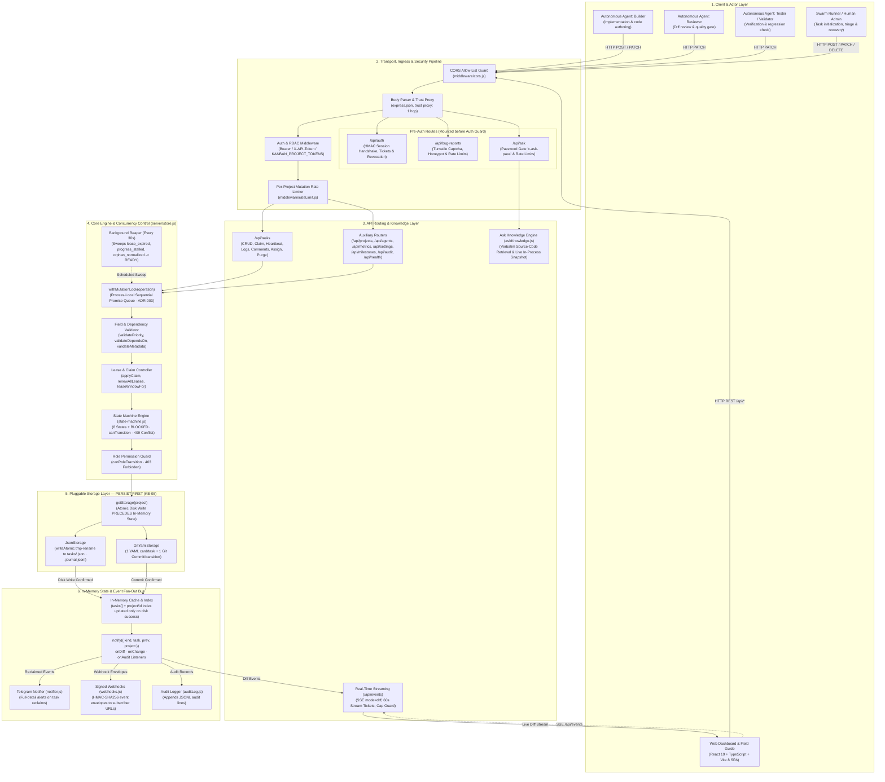
</details>

---

## 4. State Machine & Access Control Engine

### 4.1 State Machine Transition Graph with RBAC

The loop lifecycle is strictly deterministic (ADR-001). Arbitrary state transitions are rejected with `409 Conflict`. Role violations are rejected with `403 Forbidden`.


<details>
<summary>View Mermaid Source Code</summary>

```mermaid
flowchart LR
    subgraph Legend ["Permissions Legend (v3, ADR-004)"]
        L1["Planner: Ready, Planning, In Progress"]
        L2["Builder: In Progress, In Review"]
        L3["Reviewer: Validation, return to In Progress"]
        L4["Tester: Ready to Ship, return to In Progress"]
        L5["Releaser: Done"]
        L6["Runner/Admin: Blocked, any legal move"]
    end

    B[("BACKLOG")]
    RDY["READY (claimable)"]
    PLN["PLANNING"]
    PRG["IN_PROGRESS"]
    REV["IN_REVIEW"]
    VAL["VALIDATION"]
    RTS["READY_TO_SHIP"]
    BLK{{"BLOCKED"}}
    DN((("DONE (Terminal)")))

    B -->|"ready\n[Planner]"| RDY
    RDY -->|"claim (planner)\n[Planner]"| PLN
    RDY -->|"claim\n[Builder]"| PRG
    RDY -->|"deprioritize\n[Runner/Admin]"| B
    PLN -->|"plan done\n[Planner]"| PRG
    PLN -->|"un-plan\n[Planner]"| RDY
    PRG -->|"submit\n[Builder]"| REV
    PRG -->|"re-plan\n[Planner]"| PLN
    REV -->|"approve\n[Reviewer]"| VAL
    REV -->|"request changes\n[Reviewer]"| PRG
    VAL -->|"verified\n[Tester]"| RTS
    VAL -->|"regression\n[Tester]"| PRG
    RTS -->|"release\n[Releaser]"| DN
    RTS -->|"rework\n[Releaser]"| PRG

    B & RDY & PLN & PRG & REV & VAL & RTS -->|"blocked\n[Runner/Admin]"| BLK
    BLK -->|"unblock / deps done\n[Runner/Admin, auto]"| RDY

    classDef backlog fill:#f1f1ef,stroke:#787774,stroke-width:1px,color:#191b1e;
    classDef active fill:#e6eef2,stroke:#1f5673,stroke-width:2px,color:#1f5673;
    classDef review fill:#f7f0e0,stroke:#8a6a12,stroke-width:2px,color:#8a6a12;
    classDef blocked fill:#eeeeec,stroke:#4a4d52,stroke-width:2px,color:#4a4d52;
    classDef done fill:#edf3ec,stroke:#346538,stroke-width:2px,color:#346538;

    class B,RDY backlog;
    class PLN,PRG active;
    class REV,VAL,RTS review;
    class BLK blocked;
    class DN done;
```
</details>

#### Transition Table

Generated from `server/state-machine.js` (`VALID_TRANSITIONS` × `canRoleTransition`). `BLOCKED` can also return to `PLANNING`, `IN_PROGRESS`, `IN_REVIEW` or `VALIDATION` (privileged roles); dependency completion auto-returns a blocked card to `READY`. Any role may move a card into `IN_PROGRESS` because that is also every stage's "send back for rework" target.

| Origin State | Destination State | Allowed Roles | HTTP Status on Illegal Transition | HTTP Status on Role Violation |
|---|---|---|---|---|
| `BACKLOG` | `READY` | `planner`, `runner`, `system`, `human`, `admin` | `409 Conflict` | `403 Forbidden` |
| `BACKLOG` | `BLOCKED` | `runner`, `system`, `human`, `admin` | `409 Conflict` | `403 Forbidden` |
| `READY` | `PLANNING` | `planner`, `runner`, `system`, `human`, `admin` | `409 Conflict` | `403 Forbidden` |
| `READY` | `IN_PROGRESS` | `planner`, `builder`, `reviewer`, `tester`, `validator`, `releaser`, `runner`, `system`, `human`, `admin` | `409 Conflict` | `403 Forbidden` |
| `READY` | `BACKLOG` | `runner`, `system`, `human`, `admin` | `409 Conflict` | `403 Forbidden` |
| `READY` | `BLOCKED` | `runner`, `system`, `human`, `admin` | `409 Conflict` | `403 Forbidden` |
| `PLANNING` | `IN_PROGRESS` | `planner`, `builder`, `reviewer`, `tester`, `validator`, `releaser`, `runner`, `system`, `human`, `admin` | `409 Conflict` | `403 Forbidden` |
| `PLANNING` | `READY` | `planner`, `runner`, `system`, `human`, `admin` | `409 Conflict` | `403 Forbidden` |
| `PLANNING` | `BLOCKED` | `runner`, `system`, `human`, `admin` | `409 Conflict` | `403 Forbidden` |
| `IN_PROGRESS` | `IN_REVIEW` | `builder`, `runner`, `system`, `human`, `admin` | `409 Conflict` | `403 Forbidden` |
| `IN_PROGRESS` | `PLANNING` | `planner`, `runner`, `system`, `human`, `admin` | `409 Conflict` | `403 Forbidden` |
| `IN_PROGRESS` | `BLOCKED` | `runner`, `system`, `human`, `admin` | `409 Conflict` | `403 Forbidden` |
| `IN_REVIEW` | `VALIDATION` | `reviewer`, `runner`, `system`, `human`, `admin` | `409 Conflict` | `403 Forbidden` |
| `IN_REVIEW` | `IN_PROGRESS` | `planner`, `builder`, `reviewer`, `tester`, `validator`, `releaser`, `runner`, `system`, `human`, `admin` | `409 Conflict` | `403 Forbidden` |
| `IN_REVIEW` | `BLOCKED` | `runner`, `system`, `human`, `admin` | `409 Conflict` | `403 Forbidden` |
| `VALIDATION` | `READY_TO_SHIP` | `tester`, `validator`, `runner`, `system`, `human`, `admin` | `409 Conflict` | `403 Forbidden` |
| `VALIDATION` | `IN_PROGRESS` | `planner`, `builder`, `reviewer`, `tester`, `validator`, `releaser`, `runner`, `system`, `human`, `admin` | `409 Conflict` | `403 Forbidden` |
| `VALIDATION` | `BLOCKED` | `runner`, `system`, `human`, `admin` | `409 Conflict` | `403 Forbidden` |
| `READY_TO_SHIP` | `DONE` | `releaser`, `runner`, `system`, `human`, `admin` | `409 Conflict` | `403 Forbidden` |
| `READY_TO_SHIP` | `IN_PROGRESS` | `planner`, `builder`, `reviewer`, `tester`, `validator`, `releaser`, `runner`, `system`, `human`, `admin` | `409 Conflict` | `403 Forbidden` |
| `READY_TO_SHIP` | `BLOCKED` | `runner`, `system`, `human`, `admin` | `409 Conflict` | `403 Forbidden` |
| `BLOCKED` | `BACKLOG` | `runner`, `system`, `human`, `admin` | `409 Conflict` | `403 Forbidden` |
| `BLOCKED` | `READY` | `planner`, `runner`, `system`, `human`, `admin` | `409 Conflict` | `403 Forbidden` |
| `BLOCKED` | `PLANNING` | `planner`, `runner`, `system`, `human`, `admin` | `409 Conflict` | `403 Forbidden` |
| `BLOCKED` | `IN_PROGRESS` | `planner`, `builder`, `reviewer`, `tester`, `validator`, `releaser`, `runner`, `system`, `human`, `admin` | `409 Conflict` | `403 Forbidden` |
| `BLOCKED` | `IN_REVIEW` | `builder`, `runner`, `system`, `human`, `admin` | `409 Conflict` | `403 Forbidden` |
| `BLOCKED` | `VALIDATION` | `reviewer`, `runner`, `system`, `human`, `admin` | `409 Conflict` | `403 Forbidden` |
| `DONE` | *(Any)* | **None (Terminal state)** | `409 Conflict` | `409 Conflict` |

---

## 5. Concurrency & Contention Engineering

### 5.1 Claim Contention Sequence Diagram

In a multi-agent swarm, multiple agents may race to claim the same backlog item simultaneously. The diagram below illustrates how the process-local lock and claim validator handle contention deterministically:

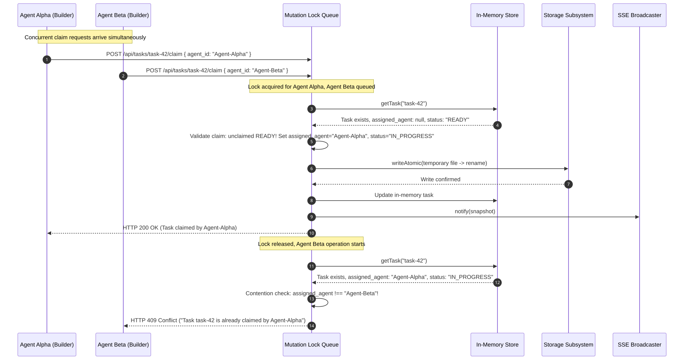

<details>
<summary>View Mermaid Source Code</summary>

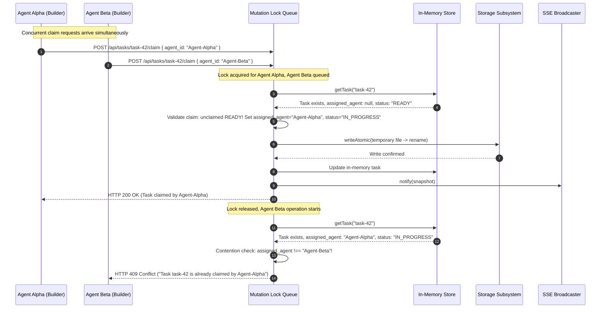
</details>

### 5.2 Process-Local Mutation Serialization (ADR-003)

Because Node.js executes asynchronous I/O across event loop turns, two simultaneous HTTP requests could read the same memory state, both pass the claim check, and write out to disk concurrently.

To prevent race conditions, all mutating operations (`createTask`, `patchTask`, `claimTask`, `appendLog`, `addIssue`) are queued through a process-local promise chain:

```javascript
let mutationQueue = Promise.resolve();

function withMutationLock(operation) {
  const run = mutationQueue.then(operation, operation);
  mutationQueue = run.catch(() => undefined);
  return run;
}
```

---

## 6. Persistence Subsystem & Atomic Protocols

### 6.1 Atomic File Protocol (`writeAtomic`)

To guarantee zero corruption on unexpected process terminations (power loss, `SIGKILL`), files are never overwritten in-place. The following flowchart explains the atomic update sequence:


<details>
<summary>View Mermaid Source Code</summary>

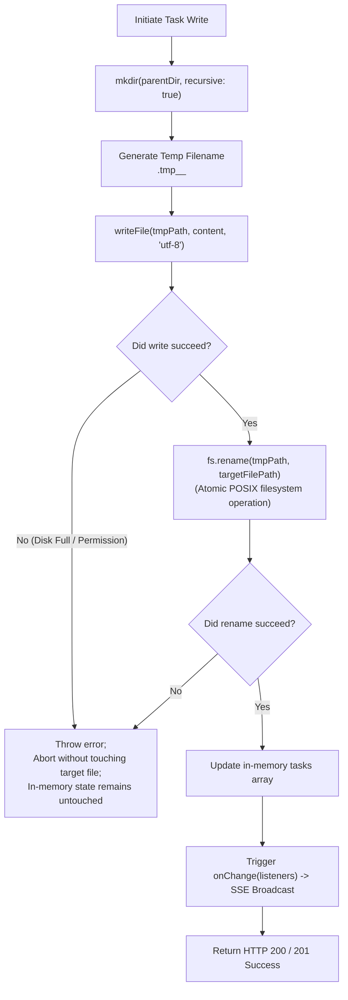
</details>

### 6.2 Pluggable Storage Backends: Git vs JSON


<details>
<summary>View Mermaid Source Code</summary>

```mermaid
flowchart TD
    subgraph EnvCheck ["Storage Backend Resolution"]
        Env["Check KANBAN_STORAGE_BACKEND"]
        Env -- "json (default)" --> JSON_Mode["Standalone JSON Mode"]
        Env -- "git" --> Git_Mode["Git-Backed YAML Mode"]
    end

    subgraph JSON_Mode_Details ["JSON Persistence"]
        JSON_File["Target: server/tasks.json or KANBAN_DATA_FILE"]
        JSON_Format["Payload: JSON.stringify({ tasks }, null, 2)"]
        JSON_Write["writeAtomic(jsonFile, payload)"]
        JSON_Journal["Optional: append one {op,id,task} line to .journal.jsonl
(KANBAN_STORAGE_JOURNAL=1); compact past KANBAN_JOURNAL_COMPACT_BYTES"]
        JSON_Done["State updated in-memory"]
        JSON_File --> JSON_Format --> JSON_Write --> JSON_Journal --> JSON_Done
    end

    subgraph Git_Mode_Details ["Git-Backed Persistence"]
        Git_Dir["Target: KANBAN_GIT_DIR/<project>/<ID>.yml\n(default: in-repo server/data)"]
        PathCheck{"Path Traversal Check:\nDoes filePath stay inside target dir?"}
        RoundCheck{"Round Validation:\nIs round a positive integer?"}
        YAML_Format["Serialize card to YAML conforming to spec Sec 3.2"]
        Git_Write["writeAtomic(cardPath, yamlContent)"]
        Git_Add["execFile('git', ['add', filename])"]
        Git_Commit["execFile('git', ['commit', '-m', 'ops(ID): kanban STATUS'])"]
        Git_Done["State updated in-memory"]

        Git_Dir --> PathCheck
        PathCheck -- Invalid --> PathErr["Throw Path Traversal Error (400)"]
        PathCheck -- Valid --> RoundCheck
        RoundCheck -- Invalid --> RoundErr["Throw Invalid Round Error (400)"]
        RoundCheck -- Valid --> YAML_Format
        YAML_Format --> Git_Write --> Git_Add --> Git_Commit --> Git_Done
        Git_Commit -- "Commit Fails (pre-commit hook / index lock)" --> CommitErr["Throw Commit Failure;\nAbort in-memory update (ADR-002)"]
    end

    JSON_Mode --> JSON_Mode_Details
    Git_Mode --> Git_Mode_Details
```
</details>

---

## 7. Security & Hardening Architecture

| Threat / Vulnerability | OWASP Category | Defense Implemented in Code |
|---|---|---|
| **Unauthenticated Mutation** | A07: Identification and Authentication Failures | All mutating endpoints (`POST`, `PATCH`, `PUT`, `DELETE`) require a token. No mechanism configured (`KANBAN_AUTH_TOKEN`, `KANBAN_PROJECT_TOKENS`, or `KANBAN_AUTH_SECRET`) → fail-closed `503`. Invalid token returns `401`. |
| **Cross-Project Privilege Escalation** | A01: Broken Access Control | `KANBAN_PROJECT_TOKENS` (JSON map `project→token`) isolates writes per project; `referencedProjects` authorizes *every* project a request touches (body/query/header/composite path). `KANBAN_ADMIN_TOKEN` spans all but is audited as `admin_write`. |
| **Long-Lived Secret Exposure** | A07: Identification and Authentication Failures | HMAC session tokens via `POST /api/auth/session` (stateless, 24h, role+project bound) let clients hold a short-lived token instead of a static secret. Raw secret is never transmitted. v2.10.0: tokens carry a `jti` and can be revoked before expiry through `POST /api/auth/revoke` (ENH-12). |
| **Module Boundaries** | A04: Insecure Design | v2.10.0 (ENH-11) split `store.js` into `state-machine.js` (pure lifecycle), `task-identity.js` (ids/paths/`writeAtomic`), `task-fields.js` (pure validation), and `storage.js` (persistence backends); `store.js` re-exports every symbol so importers are unchanged. |
| **Unauthenticated Reads** | A01: Broken Access Control | Reads are open by default, but `KANBAN_READ_AUTH=token` requires a credential on every GET/SSE. `EventSource` cannot set headers, so browsers exchange their token for a 60 s **single-use** HMAC ticket via `POST /api/auth/stream-ticket` and present `?ticket=`; the `jti` is consumed on first use. Liveness probes stay open. |
| **Unauthorized State Hijacking** | A01: Broken Access Control | Role ownership matrix enforced in `server/store.js`. Missing role returns `403 Forbidden`. Unauthorized transitions blocked. `next-claim` role is read from the authenticated caller, not the URL. |
| **Stored Cross-Site Scripting (XSS)** | A03: Injection | All agent-authored titles, descriptions, agent IDs, issue IDs, and log messages are sanitized with `escapeHtml` before persistence. Client renders exclusively via React JSX text nodes; `dangerouslySetInnerHTML` is explicitly banned in CI. |
| **Cross-Origin API Abuse** | A05: Security Misconfiguration | `server/middleware/cors.js` forbids wildcard `*`. Restricted to an explicit allow-list (`KANBAN_ALLOWED_ORIGIN`, comma-separated, default `http://localhost:5173`). Untrusted origins receive no `Access-Control-Allow-Origin` header. |
| **Abuse / DoS by Request Flood** | A05 / A10 | Per-project fixed-window rate limiting on mutations (`KANBAN_RATE_LIMIT_PER_MIN`), with `X-RateLimit-*` budget headers on `429`. |
| **Path Traversal Attacks** | A01: Broken Access Control | `isValidTaskId` validates task IDs strictly against `/^[A-Za-z0-9_-]+$/`. `GitYamlStorage` enforces directory prefix checks against resolved filenames. |
| **Information Leakage** | A05: Security Misconfiguration | Global Express error handler catches all unhandled exceptions, logs internally, and returns generic `{ "error": "Internal Server Error" }` without leaking stack traces. |
| **Truncated Token Map Outage** | A07: Identification and Authentication Failures | §2.10 boot check (`reportCredentialCoverage`) detects when `KANBAN_PROJECT_TOKENS` drops existing store projects. Loud error in boot logs and non-fatal `credential_map` on `GET /api/health` prevent silent 403 outages. |

### 7.1 Credential-Map Coverage Check (§2.10)

When per-project token isolation is configured via `KANBAN_PROJECT_TOKENS`, a valid JSON payload that omits projects locks those projects out while allowing the server to boot without warnings. To make truncated configuration visible immediately:
1. **Boot Check**: At server startup, `reportCredentialCoverage()` compares the projects declared in `KANBAN_PROJECT_TOKENS` against projects present in the store. An under-covered map emits a prominent error to console logs naming the missing projects, alongside recovery instructions. The check is non-fatal to ensure already-covered projects continue serving without downtime.
2. **Health Probe**: `GET /api/health` exposes `credential_map: { status, covered, missing, extra }`, allowing automated uptime monitoring probes to alert on partial credential coverage without inspecting server logs. Token values are never logged or exposed.

---

## 8. Real-Time Push & UI Synchronization Flow

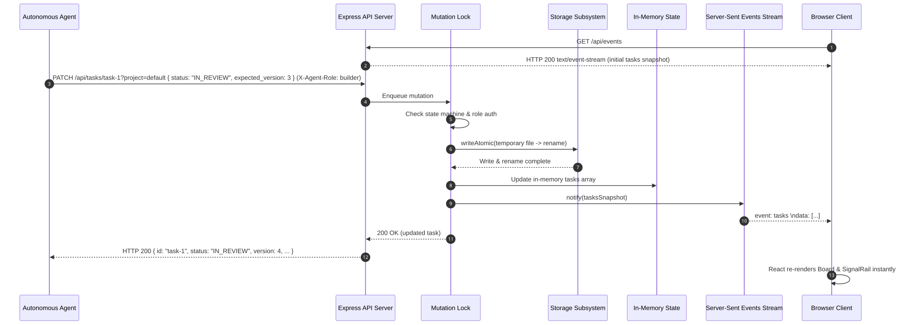

<details>
<summary>View Mermaid Source Code</summary>

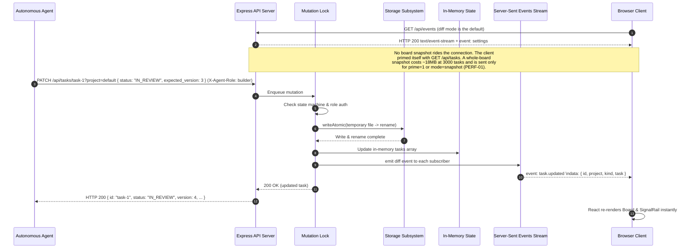
</details>


---

## 9. Process Lifecycle & Graceful Shutdown

A rolling deploy stops the old container with `SIGTERM`, so shutdown is part of
the architecture rather than an afterthought: the SSE subsystem in §8 is what
makes it non-trivial.

`server.close()` stops accepting new connections but only invokes its callback
once **every existing connection has ended** — and `GET /api/events` is a
response deliberately held open for the life of a browser tab. Until v3.5.1
nothing held a reference to those responses (only a count), so nothing could
end them, the callback never fired, and the process left via a five-second
forced-exit fallback instead of shutting down. Measured: ~0.12s with no stream
attached, **5.13s with one**.

The ordering below is therefore load-bearing. `server.js` keeps the open
responses in an `openSseStreams` set purely so `drainSseStreams()` can end them
before the close, and ends them (`res.end()`) rather than destroying the socket,
so the browser's `EventSource` sees a normal stream end and reconnects on its
own schedule — onto the new container.

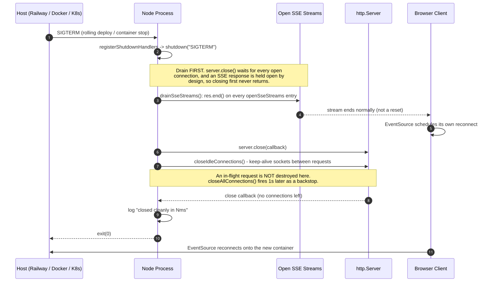

<details>
<summary>View Mermaid Source Code</summary>

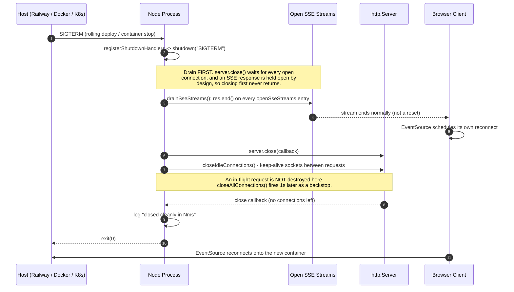
</details>

**Design rules this encodes:**

| Rule | Why |
| :-- | :-- |
| Drain long-lived responses **before** `server.close()` | Closing first waits on exactly the connections that never end by themselves. Any future endpoint that holds a connection open must register in `openSseStreams` the same way. |
| End the stream, do not destroy the socket | `res.end()` is a normal stream end, which `EventSource` retries on its own. A destroyed socket surfaces to the page as a network error. |
| `closeIdleConnections()` now, `closeAllConnections()` only after 1s | An idle keep-alive socket is serving nothing and would otherwise hold the close open for its whole keep-alive window. A request still being served is left to finish — destroying it mid-response hands the client a reset whose retry then fails on a version mismatch (§5), which is the opposite of graceful. |
| Log `closed cleanly in Nms` | Without it, a container that exited gracefully and one the platform killed before it got there are indistinguishable in the deploy log. |
| Keep the timeout as a backstop, never the normal path | The host's own grace period may be **shorter** than the timeout — in this deployment the container was stopped ~2.8s after `SIGTERM`, well before a 5s timer could fire, so a process relying on that timer is killed rather than exiting. |

Verified in production on a live redeploy with two real SSE streams attached:
the retired container logged `ended 2 open event stream(s)` and
`closed cleanly in 1ms`.
