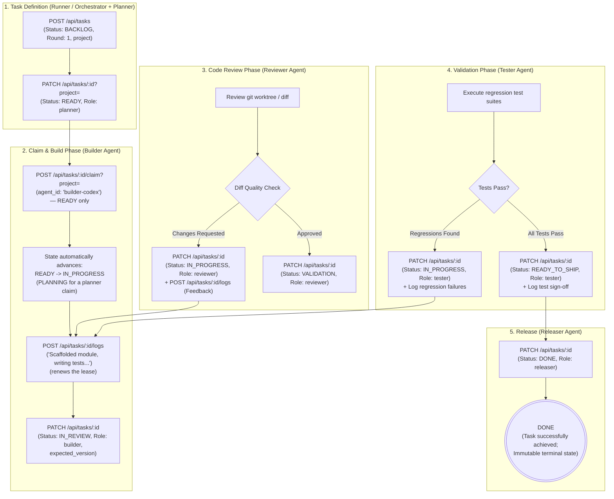
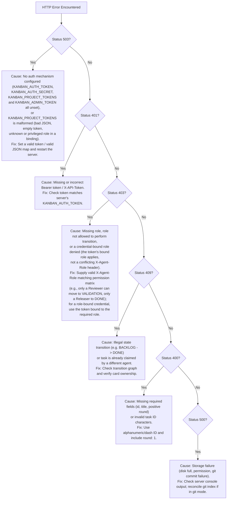

# Agent Kanban Board — User & Operator Manual

**Audience:** AI Swarm Architects, Autonomous Loop Runners, DevOps Engineers, and Human Operators  
**System:** Agent Kanban Board v3.19.1

---

## 1. System Overview & End-to-End Agent Lifecycle

The **Agent Kanban Board** provides an immutable, real-time state machine and monitoring dashboard for swarms of autonomous coding agents. Unlike human-facing project trackers, it enforces strict programmatic guardrails, claim contention locking, and role-based permissions to guarantee reliable automated execution without human interference.

### Autonomous Swarm Execution Flowchart



<details>
<summary>View Mermaid Source Code</summary>


</details>

---

## 2. Quickstart & Installation

### 2.1 System Prerequisites
- **Node.js:** v20.3+ (v20.x or v22.x LTS; declared in `engines`)
- **npm:** v9.x or higher
- **Git:** v2.30+ (required if using Git-backed YAML storage)
- **Web Browser:** Modern evergreen browser with native ES Module and Server-Sent Events support (Chrome, Firefox, Safari, Edge).

### 2.2 Setup Commands

```bash
# Clone the repository
git clone <repo-url> agent-kanban-board
cd agent-kanban-board

# Install server and client dependencies
cd server && npm install && cd ..
cd client && npm install && cd ..
```

---

## 3. Configuration & Environment Variables

The server and client are configured via environment variables.

### 3.1 Server Environment Variables

| Variable | Default Value | Description |
|---|---|---|
| `PORT` | `4000` | HTTP port on which Express listens. |
| `HOST` | `127.0.0.1` (local) / `0.0.0.0` (when `PORT` injected) | Network interface to bind. |
| `KANBAN_AUTH_TOKEN` | *(None)* | **Mandatory for mutations** unless another mechanism is set. Shared secret for all `POST`, `PATCH`, `PUT`, `DELETE`. Unset → mutations return `503`. |
| `KANBAN_ADMIN_TOKEN` | *(None)* | Superuser token spanning every project. Audited as `admin_write`. |
| `KANBAN_PROJECT_TOKENS` | *(None)* | JSON map enabling per-project isolation. Each credential may be role-bound and/or identity-bound: a legacy string or `{"token":"tok"}` is unbound (header role/identity kept); `{"token":"tok","role":"builder"}` forces that role server-side; `{"token":"tok","agent_id":"agent-7"}` forces the agent identity server-side (v3.12.8, A7); a credential may carry both; `{"credentials":[…]}` carries several credentials per project. `agent_id` must be 1-64 chars from `[A-Za-z0-9._@:/-]`, and one token bound to different agent ids across projects is rejected. Privileged roles (`runner`/`system`/`human`/`admin`) cannot be bound. Boot check (§2.10) reports any store projects missing from this map plus bound/unbound counts. |
| `KANBAN_AUTH_SECRET` | *(None)* | Enables HMAC session tokens via `POST /api/auth/session` (stateless, 24h, revocable since v2.10.0 via `POST /api/auth/revoke`). |
| `KANBAN_AUTH_LOG` | `off` | Set truthy (not `0`/`false`) to emit redacted auth-failure logs. |
| `KANBAN_STORAGE_BACKEND` | `json` | Storage engine: `json` (file) or `git` (YAML card per task). |
| `KANBAN_DATA_FILE` | `server/tasks.json` | Default-project JSON file. |
| `KANBAN_DATA_DIR` | `server/data` | Root for named projects (`tasks/<project>.json`) + archives. Unset falls back to an in-repo `server/data` (one-time warning) — never a sibling checkout. |
| `KANBAN_DEFAULT_PROJECT` | `default` | Implicit single-project name. |
| `KANBAN_ARCHIVE_AFTER_DAYS` | `30` | Age after which `DONE` tasks archive (`0` disables). |
| `KANBAN_TRASH_DAYS` | `30` | Age after which soft-deleted tasks are permanently removed from the trash sink (`0` disables the sweep). |
| `KANBAN_GIT_DIR` | `server/data` | Directory containing `.yml` cards when using `git` backend. Same in-repo default as `KANBAN_DATA_DIR` (ADR-001). |
| `KANBAN_GIT_COMMIT` | `true` | Set `false` to disable auto-commits in git mode. |
| `KANBAN_STORAGE_JOURNAL` | *(off)* | Set `1` to append each JSON mutation to `<partition>.journal.jsonl` instead of rewriting the whole partition (replayed on load; compacted past `KANBAN_JOURNAL_COMPACT_BYTES`). Off → on-disk layout unchanged. |
| `KANBAN_JOURNAL_COMPACT_BYTES` | `1048576` | Journal size (bytes) that triggers a compaction into the canonical partition file. |
| `KANBAN_INLINE_LOG_CAP` | `50` | Newest `agent_logs` entries kept inline per task; older ones spill to a sidecar JSONL under `spill/<project>/`. `0` = unbounded. |
| `KANBAN_INLINE_COMMENT_CAP` | `50` | Newest `comments` kept inline per task; older ones spill to the sidecar. `0` = unbounded. |
| `KANBAN_ALLOWED_ORIGIN` | `http://localhost:5173` | Comma-separated CORS origins. Wildcard `*` is prohibited. **Production must set this explicitly** (D8, v3.12.6): with `NODE_ENV=production` and no allowlist the server refuses to boot rather than fall back to the localhost dev origin. |
| `KANBAN_ALLOW_DEV_CORS` | *(unset)* | D8 — set to `1` to deliberately accept the localhost development CORS default when `NODE_ENV=production`. Prefer an explicit `KANBAN_ALLOWED_ORIGIN`. |
| `KANBAN_IDEMPOTENCY_TTL_MS` / `KANBAN_IDEMPOTENCY_MAX_ENTRIES` | `600000` / `1000` | D3 — how long a successful `POST /api/tasks` `Idempotency-Key` is retained for replay, and the entry cap (oldest evicted first). In-memory only; a restart forgets keys, and the caller-supplied `id` remains the durable natural handle. |
| `KANBAN_CLAIM_TTL_MS` | `600000` | Default lease window (10 min) when a claim passes no `lease_ms`. Expired leases are auto-reclaimed. |
| `KANBAN_MIN_LEASE_MS` | `60000` | Lower bound a requested `lease_ms` is clamped to (1 min). |
| `KANBAN_MAX_LEASE_MS` | `7200000` | Upper bound a requested `lease_ms` is clamped to (2 h). |
| `KANBAN_HOLDER_WRITE_RENEWS_ALL` | `1` | When on, a holder's log/PATCH/claim also re-arms all its other held leases. |
| `KANBAN_ORPHAN_GRACE_MS` | `300000` | Grace before an ownerless ACTIVE task is normalized to READY. Decoupled from the claim TTL. Anchored on `updated`; any later write resets it. `0` reaps immediately. |
| `KANBAN_REAP_ENABLED` / `KANBAN_REAP_INTERVAL_MS` | `true` / `30000` | Lease reaper switch and interval. An interval `<= 0` disables the reaper (no timer is scheduled) and `GET /api/health` reports `status: "degraded"` instead of `ok`. |
| `KANBAN_BACKUP_ENABLED` / `KANBAN_BACKUP_INTERVAL_MS` / `KANBAN_BACKUP_KEEP` | `off` (enabled by default in `render.yaml` since v2.5.5) | Periodic snapshot of task data into `backups/`, rotated to a bounded count. Status is surfaced in the `backup` block of `GET /api/health`; restore with `scripts/restore-backup.mjs` per `docs/RESTORE.md`. |
| `KANBAN_RATE_LIMIT_PER_MIN` / `KANBAN_RATE_LIMIT_WINDOW_MS` | `off` / `60000` | Per-project fixed-window rate limit on mutations. |
| `KANBAN_DEPLOY_DRIFT_INTERVAL_MS` / `KANBAN_DEPLOY_DRIFT_GRACE_MS` / `KANBAN_DEPLOY_DRIFT_API_URL` / `KANBAN_DEPLOY_DRIFT_TAGS_API_URL` | `1800000` / `2700000` / GitHub releases URL / GitHub tags URL of the same repo | v3.9.5 — deploy-drift monitor: compares the running version with the newest published version once after boot and then every 30 min, and reports `in_sync`/`drift`/`unknown` (plus `reason` and `source`) in the `deploy_drift` block of `GET /api/health`. **Drift means only that the running build is behind**: the comparison is semver since v3.12.7, a build that is ahead of the newest release is `in_sync`, and a mismatch only becomes `drift` after the 45-min grace. The tags endpoint is derived from the release URL (`/releases/latest` -> `/tags?per_page=100`) and is used when the release is missing or older than the highest semver tag. Public feeds — no GitHub token. An interval `<= 0` disables it. |
| `KANBAN_READ_AUTH` | `off` | Set to `token` to require a credential on every read (GET + SSE). `EventSource` cannot set headers, so browsers mint a 60 s single-use ticket via `POST /api/auth/stream-ticket` and append `?ticket=`. Unset/`off`/`0` keeps reads open; `/api/health` and `/healthz` stay open for healthchecks. |
| `KANBAN_MASTER_PASSWORD` | *(unset)* | Optional master password for card details (§5.3.1). Unset: details are open to every reader. Set (12+ characters, not blank, different from every token and from `KANBAN_AUTH_SECRET`, or startup refuses): anonymous readers get the summary shape of each task; details need a board token or the master unlock. Read-only apart from saving column colours. The unlock endpoint allows 10 unrecognised attempts per address per minute; behind a reverse proxy set `KANBAN_TRUST_PROXY` or all visitors share one counter. A random signing secret is kept in `<data dir>/.secrets/master-unlock.json`; it is never part of a backup, so a board restored onto a fresh volume makes a new one and every browser enters the master password again. |
| `KANBAN_WEBHOOK_URLS` | *(unset)* | v2.11.0 — comma-separated URLs that receive signed outbound JSON webhooks on every task diff event. Off when unset. v3.12.6: delivery retries transient failures, dead-letters terminal ones, and never blocks a board write. |
| `KANBAN_WEBHOOK_SECRET` | *(unset)* | v2.11.0 — optional HMAC-SHA256 key; when set each webhook carries `x-kanban-signature: sha256=<hex>` over `${timestamp}.${body}`. |
| `KANBAN_WEBHOOK_EVENTS` | *(all)* | v2.11.0 — optional comma-separated diff-kind allow-list (`created`, `updated`, `removed`, `claimed`, `renewed`, `unblocked`, `reclaimed`, `archived`). |
| `KANBAN_WEBHOOK_MAX_ATTEMPTS` | `3` | D6 — attempts per event. Only transient outcomes retry: network throw/timeout, 408, 425, 429, 5xx. A 2xx/3xx or other 4xx is terminal after one attempt. |
| `KANBAN_WEBHOOK_BACKOFF_MS` | `250` | D6 — base retry backoff (`250` → 250 ms, 1 s, 4 s). A 429/503 `Retry-After` is honoured up to 30 s. `0` disables waiting but keeps the attempt count. |
| `KANBAN_WEBHOOK_MAX_QUEUE` | `100` | D6 — per-URL queue cap. Beyond it the OLDEST waiting event is dropped with one log line, so the freshest board state still syncs. |
| `KANBAN_WEBHOOK_DEAD_LETTER_MAX` | `50` | D6 — per-URL in-memory dead-letter ring for terminal failures (`{ at, event_kind, status?, error?, attempts }`). Nothing is persisted. |

### 3.1.1 Telegram Reclaim Notifications

When the lease reaper returns a task to `READY` (an idle lease expired, a held task stopped making progress for `KANBAN_PROGRESS_STALL_MS`, or an ownerless active task was normalized), the server can post a full-detail alert to a Telegram group or chat. This is **off by default** and needs no extra dependency — the server calls the Telegram Bot API directly over HTTPS.

| Variable | Default | Description |
|---|---|---|
| `KANBAN_TELEGRAM_BOT_TOKEN` | *(unset)* | Bot token from **@BotFather**. Required to enable alerts. |
| `KANBAN_TELEGRAM_CHAT_ID` | *(unset)* | Target chat/group id. A group id is negative (e.g. `-5349084979`). |
| `KANBAN_NOTIFY_EVENTS` | `lease_expired,orphan_normalized` | Comma-separated reclaim reasons that alert: `lease_expired`, `orphan_normalized`. |
| `KANBAN_NOTIFY_PROJECTS` | *(all)* | Optional comma-separated project allow-list. |
| `KANBAN_NOTIFY_INCLUDE_DESC` | `true` | Include a truncated (300-char) task description. `false` omits it. |
| `KANBAN_NOTIFY_MIN_INTERVAL_MS` | `1000` | Minimum gap between alerts; the send queue is serialized so a multi-task sweep cannot trip Telegram's rate limit. |
| `KANBAN_BOARD_URL` | `https://agent-kanban.riazrahaman.com` | Base URL for the alert's deep link. |

### 3.1.1.1 Daily Telegram Backup (v3.17.1)

The same bot can also send you a **full backup of the board once a day**, an off-volume copy that survives losing the hosting volume. It is off until you opt in:

| Variable | Default | Purpose |
|---|---|---|
| `KANBAN_TELEGRAM_BACKUP_ENABLED` | *(unset)* | Set truthy to enable. Also needs `KANBAN_TELEGRAM_BOT_TOKEN` and `KANBAN_TELEGRAM_CHAT_ID` (§3.1.1). |
| `KANBAN_TELEGRAM_BACKUP_HOUR` | `3` | Hour of day (0-23) to send, in the zone below. |
| `KANBAN_TELEGRAM_BACKUP_TZ` | `Asia/Dubai` | IANA time zone. `Asia/Dubai` is Abu Dhabi time (UTC+4, no DST); an invalid value falls back to it. |

- **What is sent.** A `kanban-backup-YYYY-MM-DD-HHMM.tar.gz` of a consistent snapshot (taken under the mutation lock) of **all** data: every project, archive, trash, settings, journal, spill and audit file, plus `backup-manifest.json`. No board data is stripped; the one thing left out is the `.secrets/` directory (the master-password unlock signing secret, 3.18.1). It is a few hundred KB to a few MB compressed (Telegram bots accept up to 50 MB; a larger archive is refused with a text alert instead).
- **Privacy.** The archive contains every task's text and Telegram bot chats are not end-to-end encrypted: use a private chat that only you can read. Credentials are env vars, not data, so they are not in the archive.
- **Reliability.** A failed send retries twice, then posts a short failure alert; the bot token is redacted from every error. A marker file (`<backup root>/.telegram-last-sent`) stops a restart or deploy from re-sending within 24 h, and a missed run (or the first boot) is caught up about a minute after startup. It never affects a request.
- **Restore.** Download the file, `tar -xzf kanban-backup-<date>.tar.gz`, then run `scripts/restore-backup.mjs` on the extracted `<timestamp>/` directory (`docs/RESTORE.md`).

### 3.1.2 Ask the Board (v3.4.0 backend · v3.5.0 console · v3.7.0 Ollama provider · v3.11.0 card history · v3.12.0 source index)

The About page opens with a password-gated, **read-only** assistant that answers
questions about this board — its protocol, engine, client, deployment and
configuration. The question is tokenised, a cached index of `server/`,
`client/src/` and `scripts/` ranks every module — by exported symbol, route path
or topic, not only a curated list — and a window around the match is folded into
the system prompt
(`server/askKnowledge.js`) alongside a live read-only board snapshot, board
metadata (milestones, archive, backup, recent audit), and — when the question
names a card — that card's full record, log history and comments. So it can
explain the code, not only the documented protocol, and can trace a single
card's history rather than only reporting board-wide figures.

It never mutates the board and never accepts a board token. It does read card
records in-process: card text is redacted for credential-shaped strings
(`sk-…`, `ghp_…`, `Bearer …`, `*TOKEN=…`, URLs with userinfo) before it reaches
the model; `KANBAN_ASK_INCLUDE_LOGS=raw` disables that. `server/routes/ask.js`
is mounted ahead of the auth middleware (like bug
reports) and carries its own gate and its own limits. **Fail-closed on both
secrets:** unset either the provider secret/host or `KANBAN_ASK_PASSWORD` and `GET /api/ask/config` reports `{"enabled":false}`,
the console collapses to a one-line note, and `POST /api/ask` is unavailable.

Supported providers:
1. **OpenRouter** (cloud API): requires `KANBAN_ASK_OPENROUTER_API_KEY` and `KANBAN_ASK_PASSWORD`. Default model: `openai/gpt-oss-20b`.
2. **Ollama** (local or private network model): requires `KANBAN_ASK_PASSWORD` and `KANBAN_ASK_PROVIDER=ollama` (or `KANBAN_ASK_OLLAMA_HOST` set). Default model: `qwen3.6:latest` (or any local model). Supports custom auth header `KANBAN_ASK_OLLAMA_AUTH_HEADER`.

| Variable | Default | Description |
|---|---|---|
| `KANBAN_ASK_PROVIDER` | *(auto)* | LLM provider: `"openrouter"` or `"ollama"`. Auto-detected if unset. |
| `KANBAN_ASK_OPENROUTER_API_KEY` | *(unset)* | Upstream OpenRouter key. Required when using OpenRouter. Never returned or logged. |
| `KANBAN_ASK_OLLAMA_HOST` | `http://localhost:11434` | Base URL for the Ollama instance or private gateway when using Ollama. |
| `KANBAN_ASK_OLLAMA_AUTH_HEADER` | *(unset)* | (secret) Optional token for reverse proxy or Cloudflare tunnel gateway in front of Ollama. |
| `KANBAN_ASK_PASSWORD` | *(unset)* | Shared gate on `POST /api/ask`, sent by the console as the `x-ask-pass` header. Required to enable the feature. |
| `KANBAN_ASK_MODEL` | *(provider default)* | Model id (`openai/gpt-oss-20b` for OpenRouter; `qwen3.6:latest` for Ollama). |
| `KANBAN_ASK_DAILY_CAP` | `50` | Global answers per UTC day. |
| `KANBAN_ASK_PER_IP_PER_HOUR` | `3` | Per-IP answers per hour. |
| `KANBAN_ASK_TIMEOUT_MS` | `45000` | Upstream request timeout. |
| `KANBAN_ASK_MAX_PROMPT_TOKENS` | `24000` | Prompt budget for a hosted provider. Ignored for a local Ollama (loopback host, model without a `:cloud` suffix): no budget is applied there. Raised from 6000 in v3.11.0 once card history and board metadata joined the prompt. |
| `KANBAN_ASK_MAX_OUTPUT_TOKENS` | `1500` | Answer budget (raised to 1500 in v3.6.4). |
| `KANBAN_ASK_INCLUDE_LOGS` | `redacted` | Card text sent to the model: `redacted` replaces credential-shaped values with `[redacted]`; `raw` sends it verbatim. |

#### Connecting Railway-Hosted Kanban to Local Ollama

When running the Kanban board on Railway and Ollama on your local development machine:

- **Option 1 (Recommended — Tailscale Funnel + Token Gateway):**
  Uses Tailscale Funnel on your local machine to publish only the local reverse proxy (`scripts/gateway/ollama-tunnel-gateway.js` on port `11435`) as a permanent public HTTPS domain (`https://<node-name>.<tailnet>.ts.net`).
  Railway never joins your tailnet and has zero access to your private network.
  The gateway enforces `Authorization: Bearer <token>` before proxying to `http://localhost:11434`.
  Managed via macOS `launchd` (`~/Library/LaunchAgents/com.riazrahaman.ollama-tunnel-gateway.plist`).
  On Railway, set `KANBAN_ASK_PROVIDER=ollama`, `KANBAN_ASK_OLLAMA_HOST=https://<node-name>.<tailnet>.ts.net`, and `KANBAN_ASK_OLLAMA_AUTH_HEADER="<token>"`.

- **Option 2 (Cloudflare Tunnel + Token Gateway):**
  Create a persistent Cloudflare Tunnel (`cloudflared tunnel run`) pointing to the local reverse proxy (`scripts/gateway/ollama-tunnel-gateway.js`).
  On Railway, set `KANBAN_ASK_PROVIDER=ollama`, `KANBAN_ASK_OLLAMA_HOST=https://ollama.your-tunnel-domain.com`, and `KANBAN_ASK_OLLAMA_AUTH_HEADER="<your-secret-token>"`.

- **Option 3 (Private Tailscale Mesh):**
  Join the Railway container directly to your Tailscale tailnet using Tailscale Userspace networking or a subnet router.
  Set `KANBAN_ASK_PROVIDER=ollama` and `KANBAN_ASK_OLLAMA_HOST=http://<tailscale-ip-or-magicdns>:11434`.

A wrong password is counted separately from the answer caps, so brute-forcing
the gate cannot exhaust the day's budget. Verify a deployment with `curl -s -H
"x-ask-pass: $KANBAN_ASK_PASSWORD" <board-url>/api/ask/config` (without the
header only `{"enabled":true,"gated":true}` comes back; a wrong password counts
toward the Ask lockout); the first genuine end-to-end check is asking one real
question from the page.

> The topic limit is a **prompt instruction, not a hard fence**. The assistant
> is told to stay on this board, but it is the same model answering, so an
> off-topic reply is expected behaviour, not a security bug.

**Setting up a bot (once):**

1. In Telegram, message **@BotFather** → `/newbot` → copy the **bot token**.
2. Add the bot to the target group (Members → Add).
3. Send the bot a command in that group: `/start@yourbotname`.
4. Read the group id:
   ```bash
   curl "https://api.telegram.org/bot<TOKEN>/getUpdates" | jq -r '.result[-1].message.chat | "\(.id) \(.type)"'
   ```
   Use the `chat.id` (negative for a group). If the result is empty, no webhook should be set (`getWebhookInfo`) and the bot may need to be re-added or a fresh command sent.
5. Set both variables on the host (e.g. Railway → Variables) and redeploy.

**Behaviour notes:**

- **One message per task.** A reclaim alerts immediately; sends are serialized with a ≥1 s gap and a `429 retry_after` is honoured, so a sweep of several tasks delivers several messages without throttling failures.
- **Failure isolation.** Delivery is fire-and-forget and wrapped: a Telegram outage is logged (`[kanban notify] send failed: …`) and **never** affects the reclaim — the task still returns to `READY`.
- **Secrets.** The bot token is server-side only, never sent to clients, never stored on the board, and redacted from logs. Treat it as a password; rotate it in BotFather if it leaks.
- **Per-task lease windows** (v2.12.0): a claim may request its own window with `lease_ms` (clamped to `KANBAN_MIN_LEASE_MS`..`KANBAN_MAX_LEASE_MS`, default 1 min..2 h); the chosen window is persisted on the card (`claim_lease_ms`) and every later heartbeat/log/PATCH keeps it, so a long job is not shrunk back to the global TTL. `POST /api/agents/:agent_id/heartbeat` renews every lease that agent holds in one call, and (unless `KANBAN_HOLDER_WRITE_RENEWS_ALL` is disabled) any holder write re-arms the holder's other leases too.
- **Orphan normalization** (an *ownerless active* task) is only reaped once a grace window has elapsed (`KANBAN_ORPHAN_GRACE_MS`, decoupled, default 5 min), then it alerts; a **lease expiry** alerts at TTL + one sweep (default ≈10–10.5 min). The message's `Reason` line distinguishes them. The grace window exists because entering an active stage with a status-only `PATCH` is a legitimate intermediate state, not a stuck card.

### 3.2 Client Environment Variables

| Variable | Default Value | Description |
|---|---|---|
| `VITE_API_BASE` | `/api` | Base URL of the API server (same-origin by default; set an absolute URL to split origin). |
| `VITE_PORT` | `5173` | Local Vite dev server port. |

---

## 4. Launching the System

### 4.1 Running in Development Mode

#### Terminal 1: Backend API Server
```bash
# Set authentication token and launch API
export KANBAN_AUTH_TOKEN="my-agent-swarm-secret"
npm start
```
*The API is now running on `http://localhost:4000`.*

#### Terminal 2: Frontend Dashboard
```bash
cd client
npm run dev
```
*Open `http://localhost:5173` in your browser.*

### 4.2 Building & Running for Production
```bash
# Run tests and security checks
make test
make sec

# Compile client production bundle
make build

# Launch the server
npm start
```

### 4.3 Cloud Deployment (Render / Railway)

The server is a stateful long-running Node process (it holds an in-memory cache, runs a background lease reaper, and keeps SSE connections open), so it must run on a platform that supports a persistent process — not a serverless/FaaS host. The repo ships two blueprint files:

- `render.yaml` — Render.com web service (Node runtime, disk-backed).
- `railway.json` — Railway (Railpack builder, healthcheck, start command).

Both rely on a `startCommand` and the fact that the server binds `0.0.0.0` whenever `PORT` is injected. Because the in-memory store is backed by files, attach a **persistent volume/disk** and point the storage env vars at it, or all data is lost on redeploy:

**Railway start command (v3.2.5):** `railway.json` sets `"startCommand": "node server/server.js"` — run that exact command, never `npm start` or `npm --prefix server start`. npm forwards SIGTERM to the child process correctly, but npm itself then exits non-zero, so Railway reports every clean shutdown (including a normal redeploy) as **"Deploy Crashed"** and emails you about it — the server was never actually crashing. If the Railway dashboard's Settings → Deploy → Custom Start Command has its own value set, it **overrides** `railway.json` silently; clear it (or set it to match) so the repo's blueprint is the one that actually runs. Point the healthcheck at `/api/health`.

| Variable | Value | Why |
|---|---|---|
| `KANBAN_STORAGE_BACKEND` | `json` | File backend (default). |
| `KANBAN_DATA_FILE` | `/data/tasks.json` | **Default project** location — its built-in default is the ephemeral `server/tasks.json`. |
| `KANBAN_DATA_DIR` | `/data` | Named projects (`tasks/<project>.json`) and archives. |
| `KANBAN_AUTH_TOKEN` | *(secret)* | Required — mutations fail closed with `503` when unset. |
| `KANBAN_PROJECT_TOKENS` | *(JSON map, role-bound)* | Per-project credentials, e.g. `{"myapp":{"credentials":[{"token":"tok-b","role":"builder","agent_id":"agent-7"},…]}}` — one bound credential per agent role; `agent_id` is an optional identity binding (v3.12.8). |
| `KANBAN_ALLOWED_ORIGIN` | *(public URL)* | Comma-separated CORS allow-list. |
| `HOST` | `0.0.0.0` | Bind all interfaces (auto when `PORT` is set). |

Generate secrets with `openssl rand -hex 32`. Liveness probes can target `GET /api/health` (or `/healthz`), which always answers 200 to a probe that sends no token (with `KANBAN_READ_AUTH=token` an invalid token presented there counts a failed-auth strike, as on any read, and gets the failed-auth 429 once the address is over budget; since 3.18.1) and reports store-load state, reaper status, backup status, `credential_map: { status, covered, missing, extra }` (§2.10; detects truncated per-project token configuration without taking down the board), and `deploy_drift` (v3.9.5; the running version versus the newest published version, so a deploy that is BEHIND is not mistaken for a healthy one). Since v3.12.7 the comparison is semver: `drift` means only `running < latest`, a build ahead of the newest release is `in_sync` (running ahead is not drift), and `source: "release" | "tags"` says which GitHub feed produced the verdict. Readiness probes should target `GET /api/health/ready`, which returns 503 until the store has finished loading — `render.yaml` health-checks this path so a platform does not route traffic to a half-booted instance.

---

## 5. Web Dashboard User Guide

The dashboard is designed for high-density, real-time operational oversight.

```mermaid
flowchart TD
    subgraph UI_Header ["Top Navigation Bar (wraps on narrow viewports)"]
        Pulse["Live Indicator (pulsing dot)"] --- Title["Title: Agent Kanban Board + version chip (vX.Y.Z)"]
        Title --- Project["Project Filter (all projects / one project)"]
        Project --- View["Board / Portfolio / About Switcher"]
        View --- Identity["Agent ID + API Token (auto-claim identity)"]
        Identity --- Help["'i' Help Popover"]
        Help --- Status["READ-ONLY Badge / claim status / N tasks"]
        Status --- Theme["Theme Switcher (Auto / Light / Dark)"]
        Theme --- Rail["Signal Rail Toggle (mobile only, below md)"]
    end

    subgraph UI_Main ["Main Display Area"]
        subgraph Board_Columns ["Kanban Columns (Horizontal Snap Scroll)"]
            Col1["01 BACKLOG\nCaptured, not yet claimable"]
            Col2["02 READY\nThe only claimable state"]
            Col3["03 PLANNING\nPlanner claim"]
            Col4["04 IN_PROGRESS\nActive implementation"]
            Col5["05 IN_REVIEW\nAwaiting reviewer evaluation"]
            Col6["06 VALIDATION\nTests / verification"]
            Col6b["07 READY_TO_SHIP\nVerified, awaiting release"]
            Col6c["08 DONE\nFinalized tasks (opacity 70%)"]
            Col5b["BLOCKED\nStalled on external dependency\n(shown once it has cards)"]
            Col7["UNKNOWN\nDefensive quarantine column"]
            Col8["ISSUES\nVirtual lane: tasks bearing issues"]
        end

        subgraph Sidebar ["Signal Rail (Docked Sidebar >= md; Slide-Over Drawer < md)"]
            subgraph Rollup ["Signal Overview"]
                ActiveStat["Active Tile\n(Planning + In Progress + Review + Validation)"]
                BlockedStat["Blocked Tile\n(Red when count > 0)"]
                DoneStat["Done Tile\n(Total completed)"]
            end
            subgraph Activity ["Activity Feed"]
                Feed["20 most recent agent logs\nwith relative timestamps (12s, 3m)"]
            end
        end

        subgraph Drawer ["TaskSheet (Slide-Over Inspector Modal)"]
            Details["ID, Title, Status, Priority, Assigned Agent"]
            MetaView["Raw JSON Metadata View"]
            Timeline["Reverse-Chronological Agent Logs"]
            HumanInput["Comment / log / assign forms:\ncurrently hidden (agents use the API)"]
        end
    end

    UI_Header --- UI_Main
    Board_Columns -->|"Click any card"| Drawer
    Sidebar -->|"Click any activity"| Drawer
```



<details>
<summary>View Mermaid Source Code</summary>


</details>

### 5.1 Board Layout & Columns
- **Backlog:** Tasks defined and ready for agent assignment.
- **Building:** Active implementation by a builder agent.
- **In Review:** Implementation complete; awaiting code review sign-off.
- **In Test:** Review approved; automated test suite or verification active.
- **Blocked:** Task blocked by external dependencies or human intervention requirement.
- **Done:** Fully finalized and verified tasks (terminal state).
- **Unknown:** Defensive quarantine lane for cards with unmapped or malformed statuses, isolating corrupt state without unmounting the board.
- **Issues (Swimlane):** Dedicated column aggregating any card with registered issues.

> [!NOTE]
> **Column counts.** Each column header shows a plain task count. The earlier advisory WIP capacity badges (`n/3` on Building / In Review) were removed in v2.5.2 — the server never enforced a WIP ceiling and the fixed cap of 3 was arbitrary, so the guard was dropped. Counts are informational only.

> [!TIP]
> The board scrolls horizontally. When more columns exist than fit the viewport, an edge-fade gradient and a paging chevron appear on the side that has hidden columns — click the chevron (or scroll/swipe) to page one column at a time. On the **all projects** view each card also shows its owning **project chip** so cards from different projects are distinguishable; switch the header's project filter to a single project to hide the chips and scope the board.

### 5.1.1 Filter, Sort & Export Toolbar
A toolbar (`BoardFilters.tsx`) operates the board view. On desktop it is docked into the header, which reads left to right as three groups: what you are looking at (title, **Board / About** tabs, project picker), narrowing it down (these filters), and who you are (task count, agent id, token, help, bug report and theme, right-aligned). From 1880px wide the filters share the single header row; below that they take a second header row of their own. The tabs and the picker never move when the filters appear or disappear. On phones, and on touch tablets under 1024px, the toolbar stays above the board:

- **Search:** live substring filter matching task id, title, description, branch and assigned agent, with an inline `×` clear button.
- **Priority filter:** `All Priorities` / `High (P0 / P1)` / `Medium (P2)` / `Low (P3)` — normalizes the triage ratings before matching.
- **Assignee filter:** `All Assignees` / `Unassigned` / one entry per agent currently holding work.
- **Sort selector:** orders cards inside every column — `Sort: Priority` (default: high → medium → low, server recency within a rank), `Sort: Updated` (most recently updated first), or `Sort: Task ID` (lexical). The choice is persisted in this browser (`localStorage kanban.sort`) and re-applied on every live update.
- **Reset:** appears only while a filter is active and clears all of them.
- **Columns (column colours):** pick an accent per column. Every pick is saved to the server: in a project view it is that project's palette, in the **all projects** view it is the board-wide palette that every project without its own palette inherits. Saved colours come back on reload, in other browsers, and live in every open tab. Saving needs the master unlock (§5.3.1), or a token that is authorised for the project (the admin or shared token for the board-wide palette). A pick the server refuses is put back at once and the popover says what would save it, from what the server reports for this browser: "Not saved. Enter the master password in the header token box to save column colours." when the server withholds card details from this browser or reports a valid unlock (either means a master password is configured); "Not saved. Enter an API token in the header token box to save column colours." when the server serves this browser card details without an unlock, which covers a board with no master password and a board token that may read but not save here (on a master-password board too); and "Not saved. Enter a credential that may save column colours in the header token box." when the server could not say. Nothing is kept only in the browser. A palette that an earlier version stored only in one browser is not migrated: choose the colours once more after unlocking.
- **Export:** currently hidden (owner decision: anyone who could open the board could export its contents). The button is commented out in `BoardFilters.tsx`, not removed; when shown it downloads the currently loaded tasks as a timestamped JSON file (`kanban-export-<project|all>-<date>.json`).
- **Metrics:** currently hidden (the button is commented out in `BoardFilters.tsx`, and the dashboard is treated as closed while it is). When shown it toggles the summary dashboard (§5.1.2), which always reports the whole board scope, so its totals stay stable while filters narrow the visible cards.

The task counter shows `n of m tasks` while any filter is active, otherwise just `m tasks`. On desktop it is the chip at the start of the right-hand header group; on phones it sits at the end of the toolbar.

### 5.1.2 Metrics Dashboard
The Metrics toggle is currently hidden, so this banner is not reachable from the UI; the description is kept for when it is restored. Toggled from the toolbar, a banner above the board shows seven live tiles: **Total Tickets**, **Backlog**, **In Flight** (Planning + In Progress + In Review + Validation), **Blocked** (turns red when non-zero), **Completed**, **Avg Cycle Time** (derived from completed work), and **Overdue / Stalled** (active tasks past a freshness threshold, amber when non-zero). It is computed from the unfiltered task list by design — a filtered board still shows true portfolio totals.

### 5.2 Card Anatomy
- **Left 3px Color Stripe:** Visual severity and state indicator:
  - Green (`border-l-pass`): `DONE`, `READY_TO_SHIP`
  - Violet (`border-l-test`): `VALIDATION`
  - Yellow (`border-l-warn`): `IN_REVIEW`
  - Blue (`border-l-live`): `IN_PROGRESS`
  - Grey (`border-l-block`): `PLANNING`, `BLOCKED`
  - Hairline (`border-l-line`): `BACKLOG`, `READY`
  - Hairline (`border-l-line`): `BACKLOG` / `UNKNOWN`
- **Task ID:** Monospace identifier (e.g. `chess-c1`).
- **Status Badge:** Normalized status with glyph markers (`▲` for review, `•` for active execution).
- **Priority Badge:** The card's priority as a colored chip (red `high` / amber `medium` / grey `low`); `high` cards additionally carry a red right-edge accent so they stand out in a dense column.
- **Effort / Estimate Chip:** When a task carries `metadata.estimate`, `metadata.points` or `metadata.size`, a `⚡ <value>` chip displays the sizing (display only — set it via the API's `metadata` field).
- **Project Chip:** Shown on the unscoped **all projects** board so cards from different projects are distinguishable (hidden when a single project is selected).
- **Assigned Agent:** Indicates which autonomous agent holds the card claim.
- **Issues Pill:** Displayed when active issues exist on the card.
- **Title:** display-only. A card's title is changed through the API (`PATCH /api/tasks/:id`); double-clicking a card does nothing more than clicking it.

### 5.3 Task Inspector Sheet (Slide-Over Drawer)
Clicking any card opens the Inspector Sheet (when a master password is configured, only in an unlocked browser: see §5.3.1):
- View complete title, priority, status badge, and assigned agent.
- Read comprehensive task descriptions and structured JSON metadata.
- **Comments (v2.5.0):** A discussion thread beside the activity log, stored
  server-side as `comments[]` and written through `POST /api/tasks/:id/comments`.
  The thread renders oldest-first with the author chip and timestamp, and is
  read-only in the sheet: its comment composer is currently hidden (see below),
  so comments are posted by agents through the API. Comments are deliberately
  separate from the machine `agent_logs` audit trail.
- **Agent Log:** Reverse-chronological timeline of operational logs submitted by agents.
- **Stage ownership:** The `stage_owners` history shows which actor created, claimed, or transitioned each lifecycle stage.
- **Write forms (currently hidden):** the sheet's "Add a comment..." box with **Post comment**, the log form (Agent ID field, "Add a log message..." box, **Add log entry**) and the **Assignment** block (**Assign** / **Release**) are hidden at the owner's request, on every screen size and for every browser, token holder or not. Agents write comments and log entries through the API (`POST /api/tasks/:id/comments`, `POST /api/tasks/:id/logs`), and a privileged caller assigns or releases with `POST /api/tasks/:id/assign`. The forms' code is kept, so they can be restored.

Privileged operators can remove one task with `DELETE /api/tasks/:id` or bulk-clean selected/filtered tasks with `POST /api/tasks/purge`. Both operations require the admin token or a privileged session and are audited; they are not available to ordinary lifecycle roles.

Creating a task normally lands it in `BACKLOG` and any lifecycle role may do
that. Creating one **directly** in an active or terminal work state
(`PLANNING`, `IN_PROGRESS`, `IN_REVIEW`, `VALIDATION`, `READY_TO_SHIP`, `DONE`) requires a privileged credential,
because those states are otherwise only reachable through the claim/transition
contract. A body-supplied `assigned_agent` is ignored at create time — ownership
is written only by `POST /api/tasks/:id/claim` (or `next-claim`) — and the
`stage_owners`, `agent_logs` and `comments` fields always start empty so the
audit trail records only real transitions and real log/comment calls.

> [!NOTE]
> The frontend dashboard is primarily an observability viewport. When `KANBAN_AUTH_TOKEN` is configured on the backend, mutating API calls directly from the browser require authorization credentials (the TaskSheet's comment, log and assign forms are currently hidden, so the browser makes none from the sheet); the browser holds a server-issued session whose role comes from the server, never a header. For operator log appends outside the browser, use authenticated cURL/HTTP requests with `-H "X-Agent-Role: human"` and the bearer token — under role-bound `KANBAN_PROJECT_TOKENS` that means the admin token (which derives `admin`) or an unbound credential, since `human` cannot be bound to a project credential.

### 5.3.1 Master Password: Locked and Unlocked Card Details
The board is always publicly viewable. Whether a visitor can open a card depends on `KANBAN_MASTER_PASSWORD`:

- **Not configured:** every visitor can click a card and read its details. Nothing else about the board changes.
- **Configured, locked (the default for a visitor):** the board renders as usual (titles, badges, assignee, counts, signal rail), but a card click opens nothing; the pointer stays an arrow and the tooltip reads "Enter the master password to view details". A small closed-lock mark sits inside the header's token box. The signal rail's activity feed shows who touched which card and when, with the card title in place of the log text. The server does not send the details at all (see README, Security & Authentication), so nothing is merely hidden in the page.
- **Unlocking:** type the master password into the token box (right corner of the header) and press Enter. The lock mark turns into an open lock, and clicking a card (on the board or in the signal rail) opens the Inspector Sheet with description, metadata, comments and agent log. The password is checked once by the server and is never stored; the browser keeps a 12-hour unlock in `localStorage` (`kanban.unlock`), so a reload stays unlocked until it expires. To lock again, open the "i" help beside the box and press **Lock**.
- **The same box still takes an API token.** The browser does not guess which one was typed: it asks the server, and it keeps only what the server recognises. The master password becomes an unlock; a token that is valid for the board is stored as the API token (and also opens card details for the projects it covers). **Anything else, for example a mistyped password, is not saved and is not sent anywhere:** the box keeps what you typed, its border and lock mark turn amber, and the tooltip reads "Not recognised: not saved". Correct it and press Enter again. If the server cannot be asked (network error), nothing is saved either.
- **Too many wrong attempts:** after 10 unrecognised values in a minute from one address the server refuses further attempts, the correct password included, until the minute is over; the tooltip shows how long to wait. Operators: behind a reverse proxy `KANBAN_TRUST_PROXY` must be set (§3.1), otherwise all visitors share one address and one counter.
- **Double-click and keyboard:** double-clicking a card (or a signal-rail row) opens the sheet and leaves it open. Cards can also be reached with Tab and opened with Enter or Space.
- **What the unlock cannot do:** it is read-only. Writing a log or comment, assigning or claiming still needs an API token (and goes through the API: the sheet's comment, log and assign forms are currently hidden). The one exception is saving column colours (§5.1.1), for the board-wide palette or an existing project.
- **What stays public when locked:** card titles, milestone labels, issue ids and the short estimate chip are part of the public board. Keep confidential text in the description, comments or log, not in the title.
- **Other things to know:** with `KANBAN_READ_AUTH=token` the master unlock is accepted as a read credential for every read (cards, metrics, milestones, projects, audit). Ask-the-Board is separate: a holder of the Ask password can receive card text in an answer. The lock mark in the box always reflects what the server says, so an unlock that is no longer valid (password changed) shows as locked and is forgotten.

### 5.4 Signal Overview & Live Activity Feed
- Located on the right-hand sidebar.
- **Signal Overview:** Real-time counters for `Active` (`PLANNING` + `IN_PROGRESS` + `IN_REVIEW` + `VALIDATION`), `Blocked` (turns red when $>0$), and total `Done`.
- **Activity Feed:** Live streaming log of the 20 most recent agent actions across all tasks with relative timestamps (`12s`, `4m`).

### 5.5 Theme Customization
Click the theme button in the header to cycle **Auto -> Light -> Dark -> Auto**. The label shows the current mode (`AUTO`/`LIGHT`/`DARK`). Auto follows the operating system's `prefers-color-scheme` and live-updates the instant the OS setting changes, with no reload needed; it is the default for a visitor with no stored choice. An explicit Light or Dark choice always wins over the OS preference and is persisted in browser `localStorage`. Native form controls (including the project filter's option popup) follow the active theme via `color-scheme`.

The light theme uses a warm cream palette; the dark theme uses a midnight-navy blueprint palette adopted from the Stack Field Guide (https://stack-field-guide.riazrahaman.com/#map), with bright ice-white text and crisp slate-blue hairlines. Both meet WCAG AA contrast for body text.

### 5.6 Responsive & Mobile Layout
The dashboard is responsive from ~360px phone widths up to widescreen desktop:

- **App shell:** The header wraps onto multiple rows instead of forcing a single wide row, so the page never scrolls horizontally.
- **Board columns:** Below the `md` breakpoint each column is `85vw` wide with horizontal snap scrolling (one column per swipe); from `md` up columns are a fixed 288px (`w-72`).
- **Signal Rail:** Docked as a right-hand sidebar at `md` and above; below `md` it collapses into a slide-over **drawer** opened by the header's signal-rail toggle button (with a dimmed backdrop, closable by tapping the backdrop).
- **Touch targets:** Interactive header controls are enlarged on small screens (every header and toolbar control is `py-1.5` tall on phones, ≥30px).
- **Header rhythm:** On phones the header uses tighter padding (`py-2`) and the title scales down (`text-base`), so it folds to roughly 118px on a 390px viewport instead of a four-row 158px stack.
- **Filter toolbar:** The toolbar row wraps on phones and every control group may shrink (`min-w-0`), so `Sort`, `Export`, column colours and `Metrics` stay reachable at 360px and up. Each select clamps to `max-w-full`. (Before v2.5.9 the control group was a rigid 720px row clipped by the board column, which made those four controls untappable.)
- **Phone layout (v3.2.4):** on a touch phone in portrait (below 768px), the page scrolls like a normal website. The header (title, `⋯` and view tabs) stays pinned at the top, every column shows all its cards at full height, and you swipe sideways between columns. Because the page itself scrolls, iOS Safari draws the board behind its translucent floating toolbar and can collapse its address bar. Opening the `⋯` controls unpins the header, so the controls scroll away with the page. While a card, the bug-report dialog or the signal drawer is open, the page behind it is frozen and returns to the same position when you close it.
- **Viewport height:** on desktop, tablets and landscape phones the app is exactly the visible viewport (`100dvh`) and columns scroll inside themselves, so a visible URL bar never hides content. The task-detail sheet and bug-report dialog always stay at `100dvh`, so the dialog's pinned footer and the bottom of the sheet stay visible.
- **Bottom scroll clearance (v3.2.3):** on coarse pointers (touch) below `md`, the board columns, Portfolio and About each reserve `env(safe-area-inset-bottom) + 5rem` of bottom padding, so the last row can be scrolled up clear of iOS Safari's floating bottom toolbar. A mouse window resized under 768px keeps the dense default padding — there is no floating toolbar to clear there.
- **Pinch zoom (v3.2.4):** iOS Safari has ignored `user-scalable=no` in the viewport meta tag since ~iOS 10, so zoom is instead blocked via `touch-action: pan-x pan-y` on every element (keeps both scroll axes fully intact for every column, sheet and dialog; v3.2.3 set it on the page root only, which WebKit does not carry into scroll containers) plus a JS guard that cancels two-finger `touchmove` and WebKit's pinch-gesture events. One-finger scrolling and taps are never cancelled, and desktop browser zoom (ctrl+wheel, keyboard) is left alone.
- **Card text sizing (v3.2.3):** iOS Safari's WebKit text autosizer previously inflated multi-line card titles independently of their explicit font size, next to mono status badges that stayed their declared size — `text-size-adjust: 100%` disables that autosizing so the rendered scale matches the design system everywhere.
- **Phone disclosure (v2.9.1):** below `md`/`sm` the secondary header and toolbar controls (agent id, token, help, Signal, theme, project picker, priority/assignee/sort, column colours) collapse behind a single `⋯` / `Filters` disclosure button; only the title, the Board/About switch, the search box and the task count stay visible. This keeps the chrome to roughly three rows — measured at 390px, chrome went from 299px to ~155px so the board keeps ~82% of the viewport.
- **Column paging arrows (v2.9.1):** the `‹ / ›` scroll-columns buttons are hidden below `md`; touch devices use the native horizontal swipe + snap instead.
- **Task-card header (v2.9.1):** on phones the card header wraps and the badge group (project/estimate/priority/status) takes its own full-width line, so the task id keeps a readable width instead of collapsing to 1–2 characters.
- **Header agent-id field (v3.2.3):** inside the `⋯` disclosure, the agent-id input previously carried a zero flex-basis (`flex-1`) alongside two fixed-basis siblings, so it absorbed none of a crowded row's growth and shrank to ~2 characters on a real 390px phone; it now carries the same real basis as its siblings (`flex-initial`) and wraps as a whole field instead of collapsing.
- Lower-priority header chips (claim status, task count; the `read-only` chip is hidden since v3.17.2) progressively hide on narrow viewports; the project filter and token input remain available behind the disclosure.

Three regression guards lock these invariants in CI: `client/src/lib/responsive.test.mjs` (shell, columns, rail, viewport, card header stacking), `client/src/lib/mobileToolbar.test.mjs` (the toolbar's shrink-and-wrap contract, the phone disclosures, the mobile paging-arrow rule, and phone tap targets — v2.5.9/v2.9.1), and `client/src/lib/useVisitCount.test.mjs` (the About visit counter).

### 5.7 About View
The header's segmented switcher (**Board / About**; the **Portfolio** tab is currently hidden, though the cross-project rollup view is still in the code) opens the About view: an in-app product overview aimed at new adopters and contributors.

- **Hero:** the product pitch ("A trusted state register for swarms of coding agents"), a short lead, and two calls to action (open the live demo / fork on GitHub).
- **Headless-first snippet:** a `curl` walkthrough showing an agent claiming the next task and advancing it, to make the API-first model concrete.
- **Trust strip:** key credibility metrics (server/client test counts, the Node 20 & 22 CI matrix, the count of architecture decision records).
- **System walkthrough video (v3.8.3):** a 24-minute high-definition video walkthrough (`/media/kanban-video.mp4`) with an interactive chapter navigator, dual playhead controls, and 12 timestamped jump chips spanning the protocol, multi-agent lifecycle, and deployment.
- **"Why a normal board isn't enough":** three cards pairing each failure mode with the exact mechanism that handles it (`withMutationLock`, the lease plus reaper, the transition graph + role matrix).
- **Lifecycle walk:** the v3 8-state lifecycle (`BACKLOG → READY → PLANNING → IN_PROGRESS → IN_REVIEW → VALIDATION → READY_TO_SHIP → DONE`, plus `BLOCKED`) with the role that moves a card into each state.
- **Capabilities table:** each capability mapped to the source file that implements it.
- **Architecture & code flow:** an additive section that goes deeper than the capability list — a **stack table** (layer → choice → why → location), a step-by-step walk of the **next-claim code path** (route → auth → mutation lock → eligibility → `applyClaim` → persist-before-memory → SSE notify), the **three safety layers** that guard every write (optimistic concurrency, the transition graph + role matrix, lease ownership), a walk of the **reclaim-alert path** (stalled heartbeat → `reapExpiredClaims` → `reclaimTaskInner` → `notify()` → `notifier.js` → Telegram, including the fail-silent delivery guarantee), and a six-layer summary mirroring the system-design chapter. It is mobile-first: the stack table collapses into labelled cards on narrow screens.
- **Guided tour:** curated screenshots served from `/landing/*.png` (board, project filter, task inspector, portfolio, dark mode).
- **FAQ and community CTA:** hosting, telemetry, database, and how to connect a project.

The view takes the live server `version` as a prop, so the version shown there can never go stale. It inherits the active theme (including the active dark palette) and the responsive layout automatically.

### 5.8 Report a Bug/Request a feature (v2.16.0+, header icon entry point added in v2.17.0)

When the operator has configured the feature, there are two entry points, both opening the same short form (title, description, a Cloudflare Turnstile captcha):

1. **Header icon:** a small bug-outline icon button sits directly in the header, immediately beside the theme toggle. This replaced two earlier, more hidden entry points (v2.17.0): a row inside the header's "i" help popover (v2.16.0) and a slim footer link (v2.16.3) — both removed once the icon made the feature a single direct tap away at every width.
2. **About view:** the same entry also appears as a button alongside the other calls to action.

The dialog is titled **Report a Bug/Request a feature** and suits either: a bug (what you expected, what happened, steps to reproduce) or a feature request (what you want and why). Pressing **Send** delivers it **privately to the board owner on Telegram**, as one message from the board's existing Telegram bot; no account, no attachments, and no contact field is collected, and nothing is published: a report creates neither a board card nor a GitHub issue (before this change reports became public GitHub issues labelled `user-report`). The dialog says so: "Sent privately to the board owner on Telegram. Do not include passwords, tokens or personal data." The message carries the title, the description, the board version, the browser viewport and user agent (and the board URL when `KANBAN_BOARD_URL` is set), never the visitor's IP address.

The entry point only renders once `GET /api/bug-reports/config` reports `{"enabled":true}` — it is off by default and invisible until an operator sets `TURNSTILE_SECRET` and `TURNSTILE_SITE_KEY` and the board bot resolves: `KANBAN_TELEGRAM_BOT_TOKEN` (the same bot as the reclaim alerts) plus a chat id, `KANBAN_REPORT_TELEGRAM_CHAT_ID` when set (a dedicated channel or chat), else `KANBAN_TELEGRAM_CHAT_ID`. The bot must be allowed to post in that chat: for a channel, add it as an administrator with permission to post messages. `KANBAN_REPORT_GITHUB_TOKEN`, `KANBAN_REPORT_REPO` and `KANBAN_REPORT_GITHUB_API_URL` are no longer read. See the README's "Enabling Report-a-bug" section for the full environment-variable reference, the Cloudflare test keys, and how to verify a deployment is live.

---

## 6. Autonomous Swarm Integration Guide

Autonomous agents interact with the board exclusively through HTTP requests.

### 6.1 Authentication & Role Headers
Every mutating request must include:
1. **Token:** `Authorization: Bearer <token>` or `X-API-Token: <token>`. Sources: `KANBAN_AUTH_TOKEN` (global), `KANBAN_ADMIN_TOKEN` (spans all — derives the `admin` role), `KANBAN_PROJECT_TOKENS` (per-project credentials, each optionally **role-bound** `{"token":"…","role":"…"}` and/or **identity-bound** `{"token":"…","agent_id":"…"}`, v3.12.8), or an HMAC session token issued via `POST /api/auth/session` (when `KANBAN_AUTH_SECRET` is set; sessions minted while presenting an identity-bound credential carry that `agent_id`; revoke your own token early with `POST /api/auth/revoke`).
2. **Role:** every agent role (planner, builder, reviewer, tester/validator, releaser) requires **its own token bound to that role in `KANBAN_PROJECT_TOKENS`** — the role is forced server-side from the credential, and a self-declared `X-Agent-Role` header that conflicts with the bound role is ignored and audited (`role_binding_mismatch`). The header still declares the role for legacy **unbound** credentials only; a `role` field on a `PATCH` body is rejected with `400`; privileged roles (`runner`/`system`/`human`/`admin`) cannot be bound and come only from the admin token or a session.
3. **Agent ID:** `X-Agent-Id: <agent-name>`. Since v3.12.8 (A7) a credential may also bind `agent_id`; the bound identity then WINS over the header and over any body `agent_id`, and a conflict is ignored and audited (`identity_binding_mismatch`). On a legacy **unbound** credential the header remains the identity channel, but a body `agent_id` alone is no longer identity for a non-privileged caller — claim/log/comment writes without `X-Agent-Id` return `400`. The admin token and an UNBOUND privileged session may assert identity via header or body; a session minted from an identity-bound credential keeps that identity even when its role is privileged. `agent_id` must be 1-64 chars from `[A-Za-z0-9._@:/-]`; binding the same token to different agent ids across projects is rejected for the same scope-ambiguity reason as roles.
4. **Project:** every task path carries `?project=<name>` (only `POST /api/tasks` takes `project` in the body instead).
5. **Version:** every `PATCH` carries the card's current `version` as `expected_version` (or `If-Match`); a stale write is rejected `409 Version mismatch`.

**Idempotent creates (v3.12.6).** `POST /api/tasks` accepts an
`Idempotency-Key` header, so a retry after a timeout returns the ORIGINAL `201`
body (plus `Idempotency-Replayed: true`) instead of colliding on the card id.
The key is scoped to the project and the resolved credential (the same token via
`Authorization: Bearer` or `X-API-Token` is one caller), kept in memory for
`KANBAN_IDEMPOTENCY_TTL_MS`, and records a hash of the payload: reusing a key
with a different body is `409 idempotency_key_reuse`, while a duplicate arriving
mid-commit is `409 idempotency_key_in_progress`. Omitting the header is exactly
the old behaviour; the caller-supplied `id` remains the natural handle.

> To connect a brand-new project, see [ONBOARDING.md](../../ONBOARDING.md).

**Optional — the `role_crossing` audit signal (ADR-006).** Set
`KANBAN_ROLE_CROSSING_AUDIT` to a truthy value to have the server emit a
`role_crossing` audit event whenever **one `X-Agent-Id` presents bound
credentials for more than one role** on the same project. A crossing is a
**review prompt, not a violation**: the request is still served, the event
never blocks anything, and the server cannot judge intent — an orchestrator, a
CI runner, or an agent that legitimately does planner+builder work all cross
without wrongdoing. The signal is **off by default**, so a deployment sees
nothing until it opts in. When enabled, the event appears in the audit log
(`KANBAN_AUDIT_LOG` + `GET /api/audit`) as
`{kind: "role_crossing", project, task: null, actor, reason}` — the reason
lists the roles the agent presented, never any token value. The admin token
and legacy unbound credentials are not tracked.


> To connect a brand-new project, see [ONBOARDING.md](../../ONBOARDING.md).

---

### 6.2 Agent Lifecycle Example (cURL)

The v3 lifecycle (ADR-004) is `BACKLOG → READY → PLANNING → IN_PROGRESS → IN_REVIEW → VALIDATION → READY_TO_SHIP → DONE` (+ `BLOCKED`); only `READY` cards can be claimed. Every committed mutation — including a claim and a log entry — bumps the card's `version`, so each `PATCH` below uses the version returned by the previous call (read it from the response, or `GET /api/tasks/:id?project=…`). The numbers shown are what a fresh card goes through; this exact sequence was run against a 3.2.4 server.

The examples assume the project is configured with **role-bound credentials** in `KANBAN_PROJECT_TOKENS`:

```bash
export KANBAN_PROJECT_TOKENS='{"default":{"credentials":[{"token":"tok-build","role":"builder"},{"token":"tok-review","role":"reviewer"},{"token":"tok-test","role":"tester"},{"token":"tok-release","role":"releaser"}]}}'
```

Each call therefore carries **the credential of the role performing the step** — no `X-Agent-Role` header needed (for a bound credential the role comes from the token; orchestrator steps use the admin credential, which derives `admin`):

#### Step 1: Create a Task (Orchestrator)
```bash
curl -X POST http://localhost:4000/api/tasks \
  -H "Authorization: Bearer $KANBAN_ADMIN_TOKEN" \
  -H "Content-Type: application/json" \
  -d '{
    "id": "task-auth-01",
    "project": "default",
    "title": "Implement JWT validation middleware",
    "description": "Add token validation with expiry checks",
    "status": "BACKLOG",
    "priority": "high",
    "round": 1
  }'
```

#### Step 2: Make it claimable (Planner)
```bash
curl -X PATCH "http://localhost:4000/api/tasks/task-auth-01?project=default" \
  -H "Authorization: Bearer $KANBAN_PLANNER_TOKEN" \
  -H "Content-Type: application/json" \
  -d '{ "status": "READY", "expected_version": 1 }'
```

#### Step 3: Claim the Task (Builder Agent)
```bash
curl -X POST "http://localhost:4000/api/tasks/task-auth-01/claim?project=default" \
  -H "Authorization: Bearer $KANBAN_BUILDER_TOKEN" \
  -H "Content-Type: application/json" \
  -d '{ "agent_id": "builder-codex" }'
```
*Note: only a `READY` card can be claimed; a successful claim moves it `READY → IN_PROGRESS` (`PLANNING` for a planner claim) and starts a lease (10 minutes by default, renewed by logs and heartbeats).*

#### Step 4: Append Progress Logs (Builder Agent)
```bash
curl -X POST "http://localhost:4000/api/tasks/task-auth-01/logs?project=default" \
  -H "Authorization: Bearer $KANBAN_BUILDER_TOKEN" \
  -H "Content-Type: application/json" \
  -d '{
    "agent_id": "builder-codex",
    "message": "Scaffolded auth middleware; writing unit tests."
  }'
```

#### Step 5: Submit for Review (Builder Agent)
```bash
curl -X PATCH "http://localhost:4000/api/tasks/task-auth-01?project=default" \
  -H "Authorization: Bearer $KANBAN_BUILDER_TOKEN" \
  -H "Content-Type: application/json" \
  -d '{ "status": "IN_REVIEW", "expected_version": 4 }'
```

#### Step 6: Approve & Advance to Validation (Reviewer Agent)
```bash
curl -X PATCH "http://localhost:4000/api/tasks/task-auth-01?project=default" \
  -H "Authorization: Bearer $KANBAN_REVIEWER_TOKEN" \
  -H "Content-Type: application/json" \
  -d '{ "status": "VALIDATION", "expected_version": 5 }'
```

#### Step 7: Verify (Tester Agent)
```bash
curl -X PATCH "http://localhost:4000/api/tasks/task-auth-01?project=default" \
  -H "Authorization: Bearer $KANBAN_TESTER_TOKEN" \
  -H "Content-Type: application/json" \
  -d '{ "status": "READY_TO_SHIP", "expected_version": 6 }'
```

#### Step 8: Release (Releaser Agent)
```bash
curl -X PATCH "http://localhost:4000/api/tasks/task-auth-01?project=default" \
  -H "Authorization: Bearer $KANBAN_RELEASER_TOKEN" \
  -H "Content-Type: application/json" \
  -d '{ "status": "DONE", "expected_version": 7 }'
```
*A tester cannot set `DONE` (403); only a releaser (or a privileged role) closes a card. A single bound token cannot walk the whole pipeline — this is exactly what keeps a rogue builder from shipping its own work; note the demo map above binds no planner credential (plan it first with the admin or a planner credential if you need `READY → PLANNING`).*

---

### 6.3 Python Swarm Client Example

```python
import os
import requests

API_URL = "http://localhost:4000/api"
PROJECT = {"project": os.getenv("KANBAN_PROJECT", "default")}
# Role-bound credential for THIS agent (KANBAN_PROJECT_TOKENS binds it to "builder");
# the server derives the role from the token — no X-Agent-Role header required.
TOKEN = os.getenv("KANBAN_BUILDER_TOKEN", "default-secret")

def agent_claim_and_build(task_id: str, agent_id: str):
    headers = {
        "Authorization": f"Bearer {TOKEN}",
        "X-Agent-Id": agent_id,
        "Content-Type": "application/json"
    }
    
    # 1. Claim task (must be READY)
    res = requests.post(f"{API_URL}/tasks/{task_id}/claim", params=PROJECT, json={"agent_id": agent_id}, headers=headers)
    if res.status_code == 409:
        print(f"Task {task_id} already claimed by another agent!")
        return False
    res.raise_for_status()
    version = res.json()["version"]
    print(f"Successfully claimed {task_id}")

    # 2. Append operational log
    requests.post(
        f"{API_URL}/tasks/{task_id}/logs",
        params=PROJECT,
        json={"agent_id": agent_id, "message": "Starting code generation..."},
        headers=headers
    ).raise_for_status()
    version = requests.get(f"{API_URL}/tasks/{task_id}", params=PROJECT).json()["version"]

    # 3. Move to review
    requests.patch(
        f"{API_URL}/tasks/{task_id}",
        params=PROJECT,
        json={"status": "IN_REVIEW", "expected_version": version},
        headers=headers
    ).raise_for_status()
    print(f"Task {task_id} submitted for review")
    return True
```

---

### 6.4 Bundled Orchestrator Skill

The repository ships a ready-made opencode skill at [`skills/kanban/SKILL.md`](../skills/kanban/SKILL.md) that implements the orchestration pattern described in this chapter. It is the recommended starting point for a new swarm: instead of hand-rolling the claim-first lifecycle and retry logic, load the skill and let the agent follow the protocol.

To install it, copy the directory into an opencode skill path — project-local `.opencode/skills/kanban/` (gitignored in this repository) or global `~/.config/opencode/skills/kanban/`:

```bash
cp -r skills/kanban .opencode/skills/kanban
# or, for every project on the machine:
cp -r skills/kanban ~/.config/opencode/skills/kanban
```

The skill enforces the same contract as the HTTP API: it resolves the board URL, token and project name from `.opencode/config.json` or the `KANBAN_*` environment variables, appends `?project=<name>` to every task path, claims before entering a stage, sends `expected_version` on every `PATCH`, and dispatches builder, reviewer and tester workers through Build → Review → Test. Its safety rules also document the optional Telegram reclaim alerts (off unless `KANBAN_TELEGRAM_BOT_TOKEN` and `KANBAN_TELEGRAM_CHAT_ID` are set), which notify the operator when the reaper resets a card. The About view in the running board describes the skill in the browser.

---

## 7. Troubleshooting & Error Resolution Guide

### Diagnostic Decision Tree



<details>
<summary>View Mermaid Source Code</summary>


</details>

### Error Code Reference Catalog

| Status Code | Meaning | Common Cause & Resolution |
|---|---|---|
| **`400 Bad Request`** | Validation Error | - Missing `id` or `title` during creation.<br>- `id` contains invalid characters (must match `^[A-Za-z0-9_-]+$`).<br>- Missing or non-positive integer `round`.<br>- Malformed status value.<br>- A `role` field in a `PATCH` body — roles are conferred by the credential (or the `X-Agent-Role` header on an unbound credential), never accepted in a mutation body. |
| **`401 Unauthorized`** | Authentication Failure | - Missing or mismatched `Authorization: Bearer <token>` or `X-API-Token: <token>`. Check `KANBAN_AUTH_TOKEN`. |
| **`403 Forbidden`** | Role Access Denied | - Missing `X-Agent-Role` or `role` body property (unbound credentials).<br>- Role not permitted to make transition (e.g. `builder` trying to mark `DONE`).<br>- On a role-bound `KANBAN_PROJECT_TOKENS` credential the role comes from the credential and a conflicting header is ignored (audited as `role_binding_mismatch`) — use the token bound to the required role. |
| **`404 Not Found`** | Resource Missing | - Task ID does not exist in store. Verify task ID via `GET /api/tasks`. |
| **`409 Conflict`** | State Machine or Claim Contention | - Attempting an illegal state transition (e.g. `BACKLOG` $\to$ `DONE`).<br>- Attempting to transition out of terminal state `DONE`.<br>- Attempting to claim a task already held by another agent. |
| **`500 Internal Error`** | Server / Git Error | - Git persistence failure (e.g. git hook rejection, index lock). Check server terminal logs. |
| **`503 Unavailable`** | Server Unconfigured | - No auth mechanism is configured (`KANBAN_AUTH_TOKEN`, `KANBAN_AUTH_SECRET`, `KANBAN_PROJECT_TOKENS` and `KANBAN_ADMIN_TOKEN` all unset), **or** `KANBAN_PROJECT_TOKENS` is malformed — bad JSON, an empty token, or a binding with an unknown or privileged role (`runner`/`system`/`human`/`admin`). Mutations are fail-closed until a valid token is configured. |

### 7.3 Credential-Map Coverage Troubleshooting (§2.10)

If `GET /api/health` reports `"credential_map": { "status": "undercovered" }` or the boot log warns `[kanban auth] CREDENTIAL MAP INCOMPLETE`:
- **Cause**: One or more store projects have no token entry in `KANBAN_PROJECT_TOKENS`. Requests to those projects return `403 Forbidden`.
- **Diagnosis**: Check `GET /api/health` payload `credential_map.missing` for the list of uncovered projects.
- **Fix**: Update the `KANBAN_PROJECT_TOKENS` environment variable to include the missing projects. Prefer role-bound credentials — one token per agent role ("builder", "reviewer", …) — so the server can enforce who may make which hop; `credential_map` also reports `bound_credentials`/`unbound_credentials`, and a fully unbound map triggers a boot warning. Note that platforms like Railway do not preserve variable history across deployments; recover values from a previous deployment record or your secure secrets vault.

### 7.4 Troubleshooting: Could Not Send The Report

If "Report a Bug/Request a feature" returns "Could not send right now" (HTTP 502 `could_not_send`) even though the Turnstile captcha visibly passes, Telegram did not accept the message. The server logs **one line per failed request** (not one per attempt), prefixed `[kanban bug-report]`, in its console output (on Railway: `railway logs`), rate-limited to at most one line per 60 seconds per status so a flood or an outage can't fill the log:

```
[kanban bug-report] could_not_send: telegram status=403 description="Forbidden: bot is not a member of the channel chat" attempts=1 hint="bot is not a member of the chat or may not post there (make it a channel admin)"
```

Read the `status` and `hint` fields to diagnose and fix:

| Telegram status | Hint | Fix |
| :--- | :--- | :--- |
| `400` | bad request: chat id wrong (chat not found) or message rejected | Check `KANBAN_REPORT_TELEGRAM_CHAT_ID` / `KANBAN_TELEGRAM_CHAT_ID` (channel ids start with `-100`). |
| `401` | bot token invalid/revoked | `KANBAN_TELEGRAM_BOT_TOKEN` is wrong or was revoked; the reclaim alerts will be failing too. |
| `403` | bot is not a member of the chat or may not post there | Add the bot to the chat; for a channel, make it an administrator allowed to post messages. |
| `404` | wrong bot token or KANBAN_REPORT_TELEGRAM_API_URL | The token is malformed, or a local-stub API URL points somewhere wrong (outside production; in production the override is ignored with a startup warning). |
| `429` | Telegram rate limit; retry later | With `retry_after` of 10 seconds or less the server waits and retries once; a longer wait fails at once. Report sends then pause for `retry_after` (capped at 60 seconds) and fail fast without calling Telegram (`paused (recent 429, no call made)`), so reports cannot starve the reclaim alerts or the daily backup on the same bot. Transient. |
| `5xx` | Telegram outage | Transient; no retry is made and the visitor is asked to try again later. |
| network error | network/DNS error or wrong KANBAN_REPORT_TELEGRAM_API_URL | The server couldn't reach Telegram at all. Check connectivity, and that the override is unset in production. |

A failed send never spends the visitor's per-IP or daily budget. If Turnstile is configured but there is no bot token, or no chat id resolves, a startup warning explains why the feature is off (the header icon stays hidden), e.g.:

```
[kanban bug-report] WARNING: Report-a-bug is DISABLED: KANBAN_TELEGRAM_BOT_TOKEN is unset, so reports have nowhere to go (the header bug icon stays hidden).
```

A malformed `TURNSTILE_SITE_KEY` still gets its own shape warning (the value is never logged). Turnstile verification failures are logged the same way, with Cloudflare's own `error-codes` array instead of a Telegram status, e.g.:

```
[kanban bug-report] turnstile check failed: success=false error-codes=["invalid-input-response"]
```

Every remote/untrusted value that reaches one of these lines — Telegram's `description`, Cloudflare's `error-codes`/`action`/`hostname` — is run through a shared sanitizer first: control characters and the Unicode line/paragraph separators are stripped and the value is length-capped, so an upstream response can never inject a raw control byte or fake a second log line. The bot token and Turnstile secret are redacted from the raw text before that truncation, so a secret straddling the length cut can't leak a surviving prefix. None of these log lines ever contain the bot token (it is part of the Bot API URL, so URLs are never logged), the Turnstile secret, the report's title/description, the rendered message, or the reporter's IP address; a successful send logs only `delivered 1 report to telegram`.

---

## 8. Backup, Storage & Maintenance Operations

### 8.1 Standalone JSON Mode
- All data resides in `server/tasks.json` (default project) or `KANBAN_DATA_DIR/tasks/<project>.json` (named projects).
- **Automatic backup (recommended):** set `KANBAN_BACKUP_ENABLED=1` (with `KANBAN_BACKUP_INTERVAL_MS` and `KANBAN_BACKUP_KEEP`) to snapshot task data into a `backups/` directory, rotated to a bounded count. The `backup` block on `GET /api/health` shows freshness at a glance; `docs/RESTORE.md` has the restore runbook. Snapshots never include `.secrets/` (the master-password unlock signing secret) and the restore script never copies one back, so a board restored onto a fresh volume generates a new secret and every browser enters the master password again; an in-place restore keeps the volume's existing secret. For an **off-volume** copy, `KANBAN_TELEGRAM_BACKUP_ENABLED=1` also sends a full compressed backup to Telegram every day (§3.1.1.1, v3.17.1).
- **Manual backup:** copy the JSON file(s):
  ```bash
  cp server/tasks.json server/tasks.backup.$(date +%Y%m%d_%H%M%S).json
  ```
- **Reset / Truncate:** To reset all tasks, stop the server, write `{ "tasks": [] }` to `server/tasks.json`, and restart.

### 8.2 Git-Backed YAML Mode
- Tasks are stored in individual `<id>.yml` files.
- Each state transition creates a Git commit.
- **Recovery from Failed Commit (ADR-002):**
  If a crash occurs after the file rename but before `git commit`, inspect `git status` in the cards directory and either commit or discard the uncommitted card:
  ```bash
  cd $KANBAN_GIT_DIR
  git status
  git add . && git commit -m "ops(recovery): reconcile uncommitted card state"
  ```
